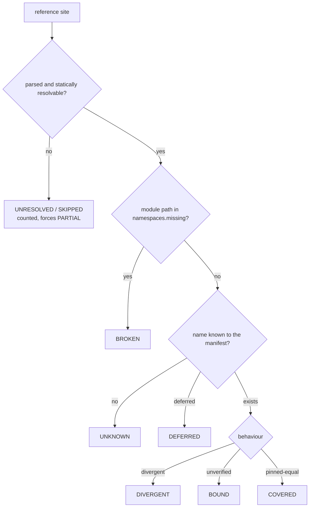

# XGI Compat Layer (T1 slice) — Design

**Parent:** `docs/superpowers/specs/2026-07-30-xgi-drop-in-parity-design.md` (approved).
This spec covers one slice of that design's T1 tier: `compat/divergences.toml`, the
`hypergraph_rs.compat` package including `check()`, and the six carry-over items T0
left open. It does **not** cover the 48 submodule shims (C5) or `AttrProxy` (C6);
those remain T1 work with no plan yet.

**Status:** design. Supersedes the parent spec's §4 C4 verdict vocabulary and its
implicit assumption that the divergence register can be transcribed. Both are
corrected below against measurement.

---

## 1. Problem

The task as originally framed was "populate `compat/divergences.toml` from D1–D17, and
build `xgi.compat` with `check()`." Two of those three premises did not survive contact
with the runtime.

### 1.1 Measured findings

Every figure in this section came from a command run against
`/home/user/projects/game/hypergraph-rs/.venv`, which holds real `xgi 0.10.2` and the
built `hypergraph_rs` extension. Findings marked **[re-verified]** were additionally
re-run by the spec author.

**F1 — The D-register is not the register that exists.** Of 19 investigated D/REV ids,
12 are live and Python-visible. Seven must not ship: D1 (resolved — both create the empty
edge), D10 (dissolved, *and* its conformance test is `#[cfg(any())]`-disabled with an
assertion that now contradicts `dihypergraph.rs:544-550`), D15 (never a register entry —
zero `rg` hits in `main.rs`), D16 (agreement by omission), D6 and D8 (Rust-only, masked by
the binding), and the `subhypergraph` half of D1-ripple.

**F2 — Twenty live divergences carry no D-number.** The Rust conformance harness
structurally cannot observe the PyO3 layer, which is where most divergences live. D14 and
D17 are proven cases where the Rust test pins the fixture JSON green while the Python
surface diverges unwatched. The total live, Python-visible register is **34 entries**;
D1–D17 supplies 14 of them.

**F3 — The most dangerous divergence was unnumbered.** **[re-verified]**
`H.edges['e1']['color'] = 'red'` is silently discarded — no exception, no warning, absent
on the next read — where xgi persists it. This is ordinary user code producing wrong
answers, and it is registered here as D33.

**F4 — Adversarial review overturned five of nineteen findings, all in the same
direction.** Each overturn found a live divergence the investigator had cleared. The D5
investigator concluded no observable ordering difference exists; `to_bipartite_edgelist`
leaks it, and a four-seed re-run shows ours byte-stable while xgi varies per seed. D1-ripple,
D7, D9 and D15 were overturned likewise. A single-pass register would have under-reported.

**F5 — Two register entries were wrong as drafted, caught only by re-measurement.**
**[re-verified]** D34's arity was inverted: `H.cleanup()` and `H.cleanup(in_place=True)`
return `None` in ours and `Hypergraph` in xgi; `in_place=False` agrees. The divergence is on
the *default* path. D30's wording was too soft: for `k = {i: 3 for i in range(12)}`, seed 42,
xgi yields 12 edges with degree sequence `[3]×12` while ours yields 11 edges with
`[1, 2, 3×10]` — the edge count differs and xgi hits `k` exactly.

**F6 — `hasattr` cannot decide compatibility.** **[re-verified]** `xgi.IDDict` and our
`dict` expose an identical 11 public members; `hasattr(H.edges['e'], '__setitem__')` is
`True` on both. A pure existence diff scores this pair perfect, and the write is silently
discarded. This single fact determines the manifest schema in §3.

**F7 — `hypergraph_rs.Hypergraph` is not subclassable.** **[re-verified]**
`Py_TPFLAGS_BASETYPE` is `False` on ours and `True` on xgi's;
`class MyH(hypergraph_rs.Hypergraph)` raises `TypeError: not an acceptable base type`. This
is import-fatal for any consumer that subclasses, and it was absent from the 34-entry
register. It becomes a register entry.

**F8 — The compat package does not exist.** `python/hypergraph_rs/compat/` holds exactly
one file, `manifest.json`. There is no `__init__.py`, so it is a PEP 420 namespace package
that imports successfully and exposes nothing. None of `manifest()`, `status()`,
`divergences()`, `check()` exist anywhere in the repo.

**F9 — Methods are entirely unkeyed.** `manifest["symbols"]` holds 164 top-level names
(93 `bound`, 71 `deferred`). Across 14 type pairs there are 322 xgi members against our 167
— **178 missing**, all invisible to the manifest. None of the 11 view/stat types is a
top-level symbol in either library, so `symbols` structurally cannot name them.
`S.nodes` exposes **1** public member against xgi's 29.

**F10 — All six T0 carry-overs are still real**, each with a fix identified and a mutation
its test must catch. Item 6 reproduced three `NotImplementedError` sites reachable from
symbols the manifest calls `bound`; two are untested by the ported suite.

### 1.2 What this means

Two of the design's premises are void. The register cannot be transcribed — it must be
**re-derived from observed behaviour**, which this work has now done. And `check()` cannot
be built on `manifest["symbols"]`, because the surface it must reason about is not in there.

### 1.3 What is not broken

The T0 gate, the exclusion registry, the AST denominator, the drift check and the
hash-seed matrix all stand. The six-field schema frozen into `compat/divergences.toml` in
T0 is correct and is used unchanged, gaining one optional array (§3.3).

---

## 2. Scope and owner rulings

Three decisions were put to the owner on 2026-07-30 with measured options. All three are
recorded here as binding.

**R1 — Ship all 34 divergences now**, not the 14 register-derived ones. Rationale accepted:
a `divergences` list that omits D33 reads as complete when it is not, making it a worse
artifact than the empty list it replaces.

**R2 — Build `check()` fully**, adding a `Type.method` manifest layer first. This is the
option the parent spec's §9 R1 names as the top scope-creep risk; the owner chose it with
that stated. The mitigation is no longer "build it last" but the schema discipline in §3.

**R3 — Reuse the `exclusions.toml` closed taxonomy** for `divergences.toml`'s `class`
field, tagging the six we-are-safer cases `upstream-bug`, plus a validation test asserting
every `class` is in the closed set so the two files cannot drift.

Out of scope for this spec: the 48 submodule shims, `AttrProxy`, `DivergenceWarning` at
divergent sites, the babylon 7-file swap, and the T2 cheap tier.

---

## 3. Architecture

### 3.1 The governing rule

The parent design's three-value verdict (`COVERED`/`DEFERRED`/`DIVERGENT`) cannot be
emitted honestly. `COVERED` would derive from `symbols[name] == "bound"`, which the
manifest's own `symbols_status` defines as *"not routed through the `_deferred` stub
factory, NOT fully implemented."* That is a statement about binding plumbing standing in
for a statement about behaviour — the proxy-for-property failure that cost T0 five rounds,
reproduced at the level of the shipped artifact.

F6 makes it concrete: existence and behaviour are independent, and `hasattr` sees only the
first. So the schema **splits them into two axes with different authorities**:

| axis | values | written by | rule |
|---|---|---|---|
| `existence` | `both` · `xgi-only` · `ours-only` | **generated** introspection | the only thing `hasattr` may decide |
| `behaviour` | `unverified` (default) · `pinned-equal` · `divergent` | **authored, probe-gated** | `pinned-equal` requires a `probe` naming a passing dual-oracle test; `divergent` requires `divergence_ids` resolving to real entries |

**`COVERED` is emitted only for `existence == both AND behaviour == pinned-equal`.**
Absence of a divergence entry yields `BOUND (behaviour unverified)` — never `COVERED`.
Silence is not evidence. This one rule is what makes the layer stronger than `symbols`
rather than a larger instance of the same mistake.

### 3.2 Verdict vocabulary

Six site verdicts — `BOUND`, `DIVERGENT`, `DEFERRED`, `UNKNOWN`, `BROKEN`, `UNRESOLVED` —
plus `COVERED` reachable only under §3.1, and `SKIPPED`/`TRUNCATED`/`PARTIAL` as *file* and
*aggregate* statuses.

### 3.3 Unit boundaries

- `compat/divergences.toml`, `compat/partial_symbols.toml`, `compat/type_members.toml` are
  **authored** data. Nothing generates them.
- `tools/gen_types.py` and `tools/gen_manifest.py` are **generators**; they read the
  authored TOML and introspect both libraries. Nothing depends on them at runtime.
- `hypergraph_rs/compat/` depends on `manifest.json` alone — importable from an installed
  wheel with no dev tooling and no real xgi present.
- Within the resolver, `lookup.py` is the **sole verdict decision point**; `scan.py` imports
  no verdict logic and `lookup.py` imports no `ast`. Enforced by test, so a false-clean
  verdict has exactly one place to originate.

---

## 4. Components

**C1 — `compat/divergences.toml`, 34 entries.** The six frozen fields (`id`, `api`, `ours`,
`xgi`, `class`, `reason`) unchanged, gaining an optional `targets` array of machine-readable
keys (`kind` ∈ `member | free_function | module | class-identity`, plus `condition` for
argument-dependent cases — at minimum D3, D4, D7, D11, D17, D32, D34). `gen_manifest` fails
if a target names a type or member absent from the generated set, so the register cannot
drift into prose. D18–D37 are proposed and verified free: `rg -o '\bD[0-9]{1,2}\b'` over
`main.rs`, `reconciliation-inventory.json`, `compat/` and `tools/` returns exactly D1–D17.

**C2 — `compat/partial_symbols.toml`.** Fields `symbol`, `site`, `trigger`, `reason`. Feeds
a third symbol status `bound-partial`. Closes the carry-over where `bound` hides
`NotImplementedError`.

**C3 — `tools/symbol_status.py`.** The corrected predicate extracted from `gen_manifest.py`
so `audit_symbols.py` stops using its fail-open `endswith("_deferred")` copy. One predicate,
one place.

**C4 — `tools/gen_types.py`.** Generates the `existence` axis for 14 type pairs. Two
measurement decisions the plan must encode, both forced by data: the generator keys
`dir(type(x)) | instance_attrs(x)` and records which source each member came from (xgi's
`NodeStat` has five per-instance attributes — `args`, `func`, `kwargs`, `net`, `view` —
reachable as `H.nodes.degree.func`, which `dir(type)` alone drops); and **type names are not
a bijection** — `xgi.DiNodeStat` and `xgi.DiEdgeStat` both map to our single `DiStat`, and
`xgi.NodeView` maps to both our `NodeView` and our `SCNodeView` depending on receiver. A
table keyed by canonical name is wrong on 5 of 14 rows, so the layer needs an explicit
name-mapping table.

**C5 — `compat/type_members.toml`.** The authored half: `returns_xgi`, `returns_ours`,
`binds`, `behaviour`, `probe`, `divergence_ids`. Admitted only with a named passing probe.

**C6 — Manifest `schema_version` → 2**, gaining `types` and `partial_symbols`.

**C7 — The resolver**, ten small modules: `verdicts`, `manifest_io`, `lookup`, `imports`,
`scope`, `seeds`, `chain`, `scan`, `report`, and the package `__init__`. Its analysis is
**bounded local assignment tracking**, not type inference: `H = xgi.Hypergraph()` names the
type at the binding site, so `H.add_node(1)` is statically resolvable without inference.
Two passes per scope (collect bindings, then emit sites); a name is live only if pass 1 saw
exactly one committed type and zero poison events anywhere in the scope. A site's verdict is
the **worst over all hops**, not the last hop's.

**C8 — `hypergraph_rs/compat/__init__.py`**, the public surface: `manifest()`, `status()`,
`divergences()`, `check()`, plus a CLI.

---

## 5. Error handling

**E1 — Manifest missing, malformed, or v1.** `ManifestSchemaError` at load. A silently empty
manifest reports every call site as fine, and a false clean is the one failure mode that
actively misleads someone into a bad swap.

**E2 — Unparseable input.** `SyntaxError`, `UnicodeDecodeError`, `OSError` each caught at one
site and mapped to one reason code. The file becomes a counted `SKIPPED`, forcing aggregate
`PARTIAL`. Never dropped silently.

**E3 — Bound exceeded.** `ScopeDepthError`, `ScopeCapacityError`, chain-too-deep, and
site-cap overflow each produce a named refusal, never a truncated-prefix verdict. Caps are
count-then-drop, and the report prints `sites analysed / sites found` beside
`files parsed / files found`.

**E4 — Ambiguous binding.** Duplicate imports of one name, a name bound to both roots
(`xgi` and `hypergraph_rs` in one file), conditional bindings with conflicting types, and
subclassed types are all **poisoned**, yielding `UNRESOLVED` with a reason code. A resolver
that guesses produces the false clean the design calls worse than a crash.

No bare `except` anywhere. Each exception is mapped to exactly one reason code.

---

## 6. Testing

### 6.1 The dual-oracle definition

`check()` executes nothing it scans, so "green against both real xgi and hypergraph_rs"
must be a statement about the **evidence backing each verdict**, not about `check()`
importing xgi. Two tiers:

- **Tier 1 — verdict correctness.** `assert check(file) == golden`. No library executed.
- **Tier 2 — claim grounding.** For every member claiming `behaviour: pinned-equal`, one
  test function, in one process, does `pytest.importorskip("xgi")` **and**
  `import hypergraph_rs`, runs the exact call shape against both, and asserts equal
  observable behaviour — values, container type, scalar dtype, iteration order, **and
  exception identity**. That last is not optional: `xgi.exception.XGIError is
  hypergraph_rs.exception.XGIError` is `False` **[re-verified]**, so "raises XGIError" is
  nowhere a parity assertion by itself.

A probe id is written back into `types[T].members[m].probe`, and `gen_manifest` refuses
`behaviour: pinned-equal` without one.

The repo has exactly one instance of this pattern to extend:
`tests/ported/test_property_differential.py`. It is explicitly **not** the ported suite's
pattern — `tests/conftest.py:6` hardcodes `import hypergraph_rs as xgi`, so all ported files
execute against ours only, and their fidelity to real xgi is an unrenewed port-time
assumption.

### 6.2 Corpus

Four parts: a vendored read-only snapshot of babylon's 7 production files holding C9's 11
call sites (vendored so CI never depends on babylon's checkout); two independently-authored
same-shape files that must resolve to the same verdicts, guarding against overfitting one
file's formatting; the ported tests C9 cites as evidence; and an **adversarial corpus**, one
file per red-team attack R1–R11, each asserting the *refusal* rather than a guess.

### 6.3 Red-team disposition

Eleven attacks were run against the resolver design before any code exists. Nine are FIXED
by design changes (two-pass scoping, worst-hop verdicts, root-namespaced canonical names,
receiver-kind tracking, pre-loop depth checks, count-then-drop caps, `binds: false` on
return-type disagreement, exhaustive `ast` binding-form table, duplicate-import poisoning).
Two are **ACCEPTED refusals**: xgi's five per-instance stat attributes are recorded as
`existence: xgi-only` so sites emit `DIVERGENT` rather than `UNKNOWN`; and babylon's
instance-access expressions whose constructor lives in another function emit
`UNRESOLVED/unannotated-param`, counted, forcing `PARTIAL`. Neither is a guess.

---

## 7. Work split

23 tasks, three plans. Each plan produces working, independently testable software.

**Plan A — honest register (8 tasks).** The six T0 carry-overs, the 34-entry
`divergences.toml` with taxonomy validation, and `partial_symbols.toml` with
`bound-partial`. Ships a complete, machine-checked compatibility statement and closes all
T0 debt. Depends on nothing.

**Plan B — the types layer (4 tasks).** `gen_types.py`, `type_members.toml`, manifest
`schema_version` 2, and the `targets` wiring. Depends on Plan A.

**Plan C — `check()` (11 tasks).** The ten resolver modules, corpus and goldens, Tier-2
probes, and the public surface. Depends on Plan B.

---

## 8. Risks

**R1 — `check()` scope creep.** The owner has accepted this risk explicitly (§2 R2). The
mitigation is structural rather than schedular: `lookup.py` as sole verdict authority, the
probe gate on `COVERED`, and the adversarial corpus asserting refusals.

**R2 — The authored half of the types layer is unbounded work.** Up to 167 members could
carry probes. The resting state is `BOUND (behaviour unverified)`, which is honest and
costs nothing; probes are added where a consumer needs `COVERED`. The plan commits to
probes for the babylon corpus surface only.

**R3 — A stale `type_members.toml` poisons every downstream verdict.** Mitigated by
generation-time validation: every authored `(type, member)` must exist in the generated set,
and every `probe` id must resolve to a collected test.

**R4 — Vendored corpus drift.** Babylon's real files may change after vendoring. The
snapshot is a fixture, not a mirror; it is dated and its provenance recorded.

---

## 9. Evidence gaps

Carried forward explicitly, per the project's verifiability rule. None of these may be
stated as fact without first being measured.

1. **Babylon's source was never opened** — it lies outside this repo root. Every babylon
   figure (7 files, 11 call sites, their line numbers) comes from
   `plans/C9-exclusion-crosscheck.md` and is that document's measurement, not ours. Plan C
   task 1 must re-measure before vendoring.
2. **The `drawing.*` partial-symbol finding is simulated**, not observed — matplotlib is
   installed, so the natural trigger was unreachable. It enters `partial_symbols.toml` as
   pending, not as fact.
3. **`MAX_CHAIN_DEPTH = 4`** rests on "the deepest real expression is 3 hops", which was
   not measured across a corpus. It is a judgement; the test pins the *refusal*, not the
   value. `MAX_SCOPE_DEPTH` 8, `MAX_BINDINGS_PER_SCOPE` 512, `MAX_SITES_PER_FILE` 4096 and
   `MAX_FILE_BYTES` 2 MiB are likewise unmeasured engineering choices.
4. **Wheel packaging of `compat/` is unverified.** Both on-disk wheels predate the
   directory. The mechanism is verified (maturin's `python-source = "python"` already ships
   the non-`.py` `py.typed` marker); the artifact is not. Plan C needs a wheel-content
   assertion that exists nowhere today.
5. **Rust line numbers for the partial-symbol sites** were taken from the sweep, not
   re-run by the spec author.

---

## 10. Decisions recorded

| # | Decision | Basis |
|---|---|---|
| 1 | Ship all 34 divergences, not 14 | Owner ruling, 2026-07-30 |
| 2 | Build `check()` fully with a types layer | Owner ruling, 2026-07-30 |
| 3 | Reuse the closed `exclusions.toml` taxonomy | Owner ruling, 2026-07-30 |
| 4 | Split `status` into `existence` + `behaviour` | F6 — `hasattr` scores `IDDict` perfect while writes vanish |
| 5 | `COVERED` requires a passing probe, not the absence of a divergence | §3.1 — silence is not evidence |
| 6 | Type table keyed by an explicit xgi→ours mapping | C4 — names are not a bijection on 5 of 14 rows |
| 7 | Worst-hop-wins verdicts, two-pass scoping | Red-team R1, R9 |
| 8 | Bounded refusal over inference everywhere | E4 — a guess produces the false clean |
