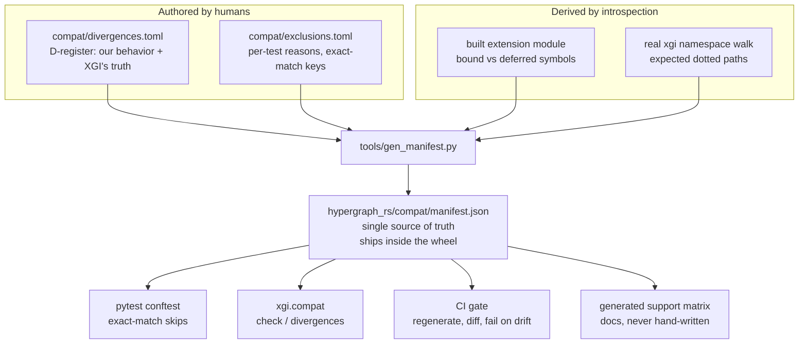
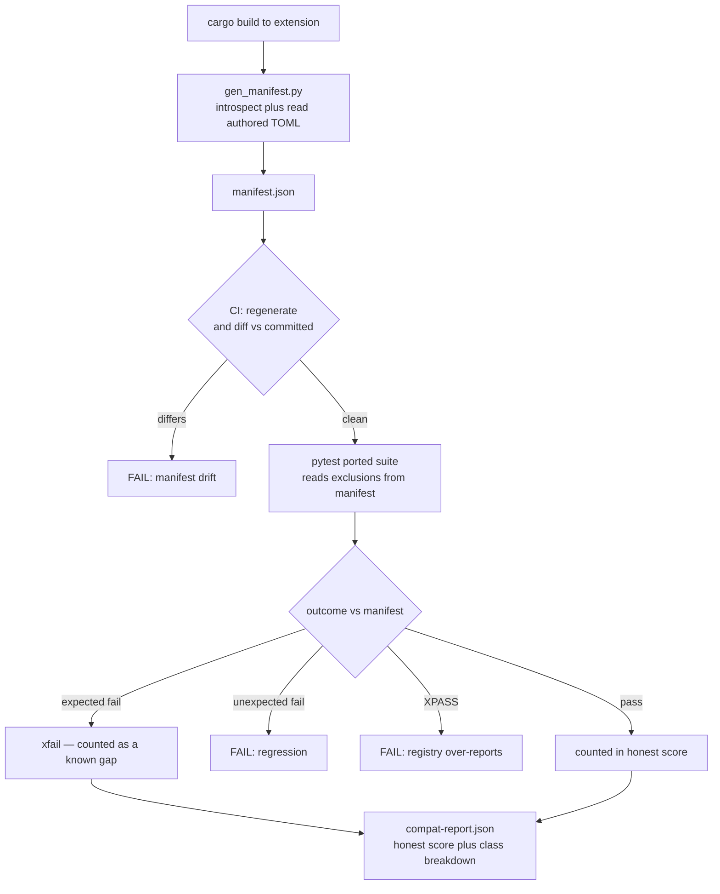

# XGI Drop-In Parity — Design

- **Date:** 2026-07-30
- **Status:** Design approved; implementation plan not yet written
- **Scope decision:** Honest drop-in with loud, legible gaps
- **Supersedes:** nothing. **Extends:** `plans/C9-exclusion-crosscheck.md`

> This is a **design document**, not a description of shipped behavior. Every
> component described under "Design" is proposed and does not exist yet. Every
> claim under "Verified findings" was measured in-repo on 2026-07-30 and the
> reproduction command is given.

---

## 1. Problem

`hypergraph-rs` exposes a PyO3 binding intended to be used as
`import hypergraph_rs as xgi`. The question this design answers is what remains
before that swap is trustworthy for a user who is not us.

The headline conformance figure is **311 passed / 83 skipped / 0 failed**. That
number is neither reproducible nor an honest measure of parity. It is wrong in
both directions simultaneously, and the machinery meant to explain it disagrees
with itself.

### 1.1 Verified findings

Each of the following was measured directly, not inferred.

**F1 — The exclusion glue over-skips by prefix.**
`tests/conftest.py:358` matches with `item.name.startswith(name)`. A registry
entry therefore claims every test sharing its prefix. There are **13 collateral
matches** across 9 registry entries. Nine of those collaterals happen to carry
their own entries; **four do not** and are skipped under a borrowed, incorrect
reason:

| Test | Swept up by entry |
|---|---|
| `readwrite/test_hif.py::test_write_hif_compressed` | `test_write_hif` |
| `linalg/test_matrix.py::test_empty_order` | `test_empty` |
| `core/test_simplicialcomplex.py::test_add_simplices_from_iterable_of_members` | `test_add_simplices_from` |
| `core/test_simplicialcomplex.py::test_add_simplices_from_wrong_format` | `test_add_simplices_from` |

All four pass when the marker is stripped. The more serious exposure is the
opposite direction: a prefix registry silently absorbs *future* regressions.

**F2 — One test in the passing column is a coin flip.**
`drawing/test_scene_graph.py::test_render_produces_valid_scene_graph` has no
registry entry and asserts `scene["hyperedges"][0]["member_ids"] == ["c","a","b"]`.
That ordering is CPython hash-set iteration order.
`crates/hypergraph-rs-python/src/hypergraph.rs:1291-1294` **deliberately**
reproduces it (`PySet::new`, then re-iterate) because real XGI's `add_edge`
performs `members = set(members)` — documented at `hypergraph.rs:1265-1272`. No
`PYTHONHASHSEED` pin exists in `pyproject.toml`, `tests/conftest.py`,
`mise.toml`, or any CI workflow. Measured: **1 pass in 12 runs.**

The binding is faithful here. The *test* pins one sample of XGI's own
nondeterminism as though it were a contract. The previously reported green gate
was a lucky roll.

**F3 — One hundred tests appear in neither column.**
The 13 `FILE_EXCLUSIONS` entries drop whole files at collection, so their tests
are invisible to both the pass and skip counts:

| File | Tests |
|---|---|
| `stats/test_core_stats_functions.py` | 52 |
| `drawing/test_draw.py` | 16 |
| `convert/test_higher_order_network.py` | 11 |
| `convert/test_line_graph.py` | 4 |
| `readwrite/test_bigg_data.py` | 3 |
| `drawing/test_draw_utils.py` | 3 |
| `convert/test_pandas.py`, `convert/test_hif_dict.py`, `convert/test_incidence.py`, `readwrite/test_xgi_data.py` | 2 each |
| `convert/test_encapsulation_dag.py`, `convert/test_k_skeleton.py`, `test_import_time.py` | 1 each |
| **Total** | **100** |

**F4 — The honest score.** Running the ported suite with conformance-exclusion
markers stripped yields **315 passed / 78 failed / 1 skipped**. The 83 skips
decompose as 78 genuine failures + 4 fictional (F1) + 1 upstream inline skip
(`test_spectral.py:59`, macOS seeding). With the 100 invisible tests restored to
the denominator, the honest figure is **311 / 494 ≈ 63%**, not 311 / 394 ≈ 79%.

**F5 — 48 of 65 xgi submodules do not exist.**
`hypergraph_rs` provides the 17 package-level names and none of the leaf
modules: `xgi.algorithms.centrality`, `xgi.core.hypergraph`,
`xgi.convert.hyperedges`, `xgi.stats.nodestats`, and 44 more.
`tools/audit_symbols.py` compares `__all__` only and passes clean, so the build
gate is structurally blind to this category. `from xgi.core.hypergraph import
Hypergraph` fails today and nothing measures it.

**F6 — Some assertions were weakened in-file, off the registry's books.**
`linalg/test_matrix.py::test_fix_647` changes upstream's `assert np.all(evals >= 0)`
to `>= -1e-12`; `test_hypergraph.py` rewrites `xgi.utilities.dual_dict` to
`xgi.dual_dict` (there is no `xgi.utilities` submodule here);
`utils/test_utilities.py:122` calls `xgi.utils.utilities.min_where` with an
inline note that the top-level alias "seems not to work";
`drawing/test_draw.py` substitutes seaborn's palette with `crest_r`, itself a
`make_deferred` stub. None of these are recorded in the exclusion registry.

### 1.2 Root cause

Four uncoordinated sources of truth, with nothing reconciling them:

1. `tests/DEFERRED_SYMBOLS.md` — symbol-level, generated (71 deferred / 93 bound of 164)
2. `tests/conftest_exclusions.py` — test-level, hand-maintained, prefix-matched
3. `tests/conformance/main.rs` D1–D17 — behavior-level, Rust-only
4. In-file adaptations (F6) — recorded nowhere

The disagreements between them are exactly F1, F2, F3, and F6.

### 1.3 What is *not* broken

The 71 deferred symbols already fail loudly and correctly:
`python/hypergraph_rs/_deferred.py` raises `NotImplementedError` naming the
symbol and citing the ledger. That class needs no work. Nor is any exclusion
fraudulent — every entry cites a real reason. The defect is in aggregation and
self-consistency, not honesty of intent.

---

## 2. Scope

**In scope.** Everything babylon's swap requires; closing the binding-layer
defects that produce wrong answers; and a machine-checkable compatibility report
that gives any XGI user a definite yes/no on their own code before they run it.
Genuine core gaps remain gaps — but become loud, classified, and enumerable.

**Out of scope.** Full XGI parity. Specifically excluded: tensor centralities,
pandas integration, network dataset loaders (`load_xgi_data`, `load_bigg_data`),
`SimplicialComplex.remove_node`, the simplicial face-id ordering rework,
matplotlib drawing, and xz compression. These are projects, not cleanup, and
each stays a classified gap.

**Explicitly forbidden.** No publishing of any kind — no PyPI, cargo, npm, or
GitHub release. Build, `--dry-run`, and smoke only, per `plans/EXECUTION-STATE.md`.

### 2.1 Failure classes

The 71 deferred symbols are already loud. Work concentrates on three classes
that are not, plus the meta-problem:

| Class | Today | Response |
|---|---|---|
| Silently wrong | returns a plausible non-XGI answer | **refuse** (§5.3) |
| Structurally missing | `ImportError`, unmeasured | shims + namespace property test |
| **Divergent-but-succeeding** | **succeeds, subtly different** | `DivergenceWarning` + declaration |
| *Meta* | the gate can't distinguish these | manifest + strict xfail |

Divergent-but-succeeding is the dangerous class. The project already owns the
right artifact for it — the D1–D17 register in `tests/conformance/main.rs`,
which pins both our behavior and XGI's recorded truth. This design promotes it
from a test-only artifact to a shipped, queryable contract.

---

## 3. Architecture

One authored source, one generated artifact, four consumers, nothing hand-copied.



Two properties follow.

**Drift becomes impossible.** CI regenerates the manifest and fails on any diff.
An exclusion whose underlying gap has been fixed no longer matches reality and
breaks the build, so the registry cannot quietly over-report — the mechanism
that produced F1.

**Documentation claims become verifiable by construction.** The support matrix
is generated from the manifest, so no compatibility claim can be written that is
not traceable to introspected reality.

### 3.1 Unit boundaries

- `tools/gen_manifest.py` depends on the built extension and the authored TOML. Nothing depends on it at runtime.
- `hypergraph_rs/compat` depends on `manifest.json` alone — importable from an installed wheel with no dev tooling present.
- `tests/conftest_exclusions.py` reduces to a thin exact-match reader.
- The Rust attr-proxy work is independent of all of the above.

---

## 4. Components

**C1 — `compat/divergences.toml` (authored).** Promotes D1–D17 out of
`tests/conformance/main.rs` into data. Fields: `id`, `api`, `ours`, `xgi`,
`reason`, `class`. The Rust conformance tests continue to assert them and remain
the executable proof; the TOML is the shippable statement of the same facts. New
divergences receive a D-number here first.

**C2 — `compat/exclusions.toml` (authored).** Replaces the two dicts in
`conftest_exclusions.py`. Keys are **exact** test names, never prefixes. Every
entry carries a `class` drawn from a closed taxonomy:

`deferred-symbol` · `core-gap` · `binding-gap` · `divergence` · `float-parity` ·
`upstream-private` · `env` · `upstream-bug`

The taxonomy is load-bearing: it is what lets a gap be *described* rather than
merely counted, and what makes the reported score decomposable.

**C3 — `tools/gen_manifest.py`.** Introspects the built extension for
bound-vs-deferred status, walks real xgi's namespace for expected dotted paths,
reads C1 and C2, emits `manifest.json`.

**C4 — `hypergraph_rs/compat/`.** Ships inside the wheel.

```python
compat.manifest()   -> dict
compat.status(name) -> "bound" | "deferred" | "divergent"
compat.divergences() -> list[Divergence]
compat.check(path)  -> Report          # per-callsite findings
```

`check()` performs attribute-access matching against the manifest — deliberately
dumb. No type inference, no call-graph analysis. It reports each xgi call site as
COVERED / DEFERRED / DIVERGENT with the cited reason.

**C5 — 48 generated submodule shims.** `hypergraph_rs/algorithms/centrality.py`
and siblings, re-exporting from the top level, generated from real xgi's own
module contents so the mapping is not guesswork.

**C6 — `AttrProxy` (new PyO3 type).** Read-through, raise-on-mutation for
`_net_attr`, `_node_attr`, `_edge_attr`, `_node`, `_edge`. Reads
(`__getitem__`, `__iter__`, `__len__`, `__contains__`, `__eq__`, `__repr__`)
behave as today; mutations (`__setitem__`, `__delitem__`, `update`, `pop`,
`clear`) raise. Reads are the common case in the ported suite, so the many tests
that only read `_edge`/`_node` stay green.

**C7 — `tools/audit_symbols.py`, extended.** Gains a submodule-path assertion
alongside the existing `__all__` check, closing the F5 blind spot.

**C8 — `tests/conftest_exclusions.py`, reduced.** Exact-match lookup against the
manifest; `conftest.py:358` changes `startswith` to `==`.

**C9 — Cheap-tier implementations.** Proposed from ledger reading, each
independently droppable: `largest_connected_hypergraph`, `empty_dihypergraph`,
`empty_simplicial_complex`, `find_triangles`, `binomial_sequence`, `geometric`,
`hist`, `to_line_graph`, `k_skeleton`, the `to_hypergraph` / `to_dihypergraph`
dispatchers, and gzip compression via `flate2` (dropping xz, the only piece
requiring a system-liblzma link).

> This list is a proposal derived from reading the ledger, **not** a verified
> effort estimate. Each item must be sized during planning, and any item that
> proves larger than cheap drops out of the tier rather than expanding it.

### 4.1 The uncollectable-file problem

Converting `FILE_EXCLUSIONS` to per-test entries does not fully work: some files
cannot import at all. `drawing/test_draw_utils.py` imports private `_CCW_sort`
from `xgi.drawing.draw`, which the C5 shims will not provide.

For such files the manifest records the test count **counted by AST**, not by
pytest. Otherwise the honest denominator silently loses exactly the tests that
cannot be collected — which is the F3 defect being fixed.

---

## 5. Data flow



### 5.1 `skip` is the wrong primitive

- **`skip`** — the test genuinely *cannot run*: network, pandas, matplotlib, import error. Attempting it teaches nothing.
- **`xfail(strict=True)`** — the test runs and fails. If it ever *passes*, the build fails.

This swap makes F1 impossible by construction. Under `skip`, a test whose gap is
quietly fixed stays green forever and the registry decays into over-reporting —
precisely how the four fictional skips arose. Under strict xfail they surface as
XPASS the moment they begin working, forcing the reason to be updated. The gap
register becomes self-correcting rather than a document that rots.

### 5.2 Score reporting

`compat-report.json` reports passes plus remaining gaps broken down by C2 class,
so the figure carries its own explanation rather than being one opaque number.

The manifest ships **without** a score: a static capability claim belongs in the
wheel, a run outcome belongs in CI. Shipping a stale number would reintroduce
the problem being fixed.

### 5.3 User flow

```
python -m hypergraph_rs.compat check ./src     # per-callsite verdict, before anything
# swap: import xgi  ->  import hypergraph_rs as xgi
# runtime: deferred -> NotImplementedError; refused private -> XGIError;
#          divergences were already named in step one
```

Babylon's flow is shorter: the C9-plan action A1 containment oracle must run
green against **both** real `xgi` and `hypergraph_rs` — that dual run is the
entire point — after which the 7 identified files swap.

---

## 6. Error handling

Each way of hitting a gap has one specified, non-generic failure. No catch-alls.

**E1 — Deferred symbol called.** `NotImplementedError`, as today. The message
gains a pointer to `xgi.compat` alongside the ledger reference, so the error
directs the reader to the full picture rather than naming a single casualty.

**E2 — Missing name in a namespace.** The C5 shims carry a PEP 562 module-level
`__getattr__` that consults the manifest: a known-deferred name raises
`NotImplementedError` with its real reason; a genuinely unknown name raises
`AttributeError`. `from xgi.drawing.draw import _CCW_sort` then reports that this
is an XGI-private helper the port does not provide, rather than failing bare.
The shim layer becomes the loud surface for the whole namespace.

**E3 — Refused private-attr mutation.** `XGIError`, naming the action, the
reason, and the working alternative:

> `H._net_attr is a read-only snapshot in hypergraph-rs (binding-gap); use H['key'] = value. See xgi.compat.divergences().`

`XGIError` rather than `TypeError` keeps the library's own error vocabulary, so
`except xgi.XGIError` catches it.

**Stated cost:** `utils/test_utilities.py::test_iddict` expects `XGIError` for
one case and `IDNotFound` for another. Under refusal it remains a permanent
`binding-gap` xfail. That is the honest price of refusing rather than repairing,
and it is accepted deliberately.

**E4 — Divergent-but-succeeding.** Cannot raise by definition. These sites emit
a `DivergenceWarning` (a real exception subclass exported from the package)
rather than gaining a bespoke strict-mode flag. This reuses Python's own
machinery: visible by default, filterable per-site, and hard failure comes free
via `warnings.simplefilter("error", xgi.DivergenceWarning)` or `-W error`. No
global state, no new API surface, no hot-path flag checks.

**E5 — Manifest missing or malformed.** `compat` raises at import. A silently
empty manifest would report every call site as fine, and a false clean is worse
than a crash — it is the one failure mode that actively misleads someone into a
bad swap.

Anything unclassified is a manifest bug, caught by the §5 drift check.

---

## 7. Testing

### 7.1 Red first

Every defect in §1.1 becomes a failing test before any fix. All four are red today:

| Red test | Fails today because |
|---|---|
| No exclusion key is a prefix of another | 9 violations (F1) |
| Every skipped test has an exact registry entry | 4 borrowed reasons (F1) |
| Every dotted path in real xgi resolves in `hypergraph_rs` | 48 missing (F5) |
| Ported suite green under varied `PYTHONHASHSEED` | `test_scene_graph` fails ~11/12 (F2) |

The hash-seed leg is the general fix rather than a patch on one test: CI runs the
ported suite under three or four seeds. The suite completes in roughly 12
seconds, so the cost is negligible, and it is the only mechanism that catches a
test pinning CPython hash order as though it were a contract.

### 7.2 Durable artifacts

Applying the rewrite test — what would let a reimplementation be proven correct:

1. **`manifest.json` as a golden baseline.** Committed, regenerated in CI, diffed. The highest-value artifact here: a machine-readable statement of what the port does and does not do.
2. **Strict xfail as executable contract.** Every gap is a running test with a pinned outcome, not a document entry that decays.
3. **Namespace closure as a property**, not 48 hand-written cases: walk xgi's tree and assert resolution. New xgi releases that add submodules are caught automatically.
4. **Dual-oracle tests.** Babylon's A1 pattern generalized — tests that must run green against **both** real `xgi` and `hypergraph_rs`. This is the doctrine-compliant shape: real xgi is the independent oracle; our own beliefs are not. `compat.check()` is validated this way.

### 7.3 Float-parity reclassification

`katz_centrality` and the Kuramoto trajectories are currently skipped because
the ported tests assert exact `==` while the Rust implementation lands a few ULP
away. Skipping is the wrong response: these are libm transcendentals, which are
not expected to reproduce bit-for-bit across implementations.

The fix is an explicit tolerance policy with a **written derivation**, after
which the tests run and pass under that tolerance. This converts permanent skips
into real coverage with a justification attached. It is the one place in this
design where the score rises because something stopped being hidden rather than
because something was built.

---

## 8. Work tiers

Tiers are ordered by dependency, not priority. T0 must land before T1 is
measurable; T2 is optional and item-wise droppable.

**T0 — Honest measurement.** Exact-match registry; `skip` → strict `xfail`;
`PYTHONHASHSEED` CI leg; fix `test_scene_graph` to assert set-equality rather
than a hash-order sample; AST-counted denominator for uncollectable files;
manifest + generator + drift check.

**T1 — Loud gaps.** 48 submodule shims with PEP 562 `__getattr__`; extended
`audit_symbols.py`; `AttrProxy` refusal; `DivergenceWarning` at divergent sites;
`xgi.compat` with `check()`; generated support matrix; babylon A1 dual-oracle
test and the 7-file swap.

**T2 — Cheap-tier gap closing.** The C9 list, plus the §7.3 float-parity
reclassification.

`compat.check()` is built last within T1. It is the component most at risk of
being over-built: for babylon's 11 expressions a scanner is worth less than
reading the file, and it earns its keep only against arbitrary third-party
codebases.

---

## 9. Risks

**R1 — `check()` scope creep.** Mitigated by building it last and specifying it
as attribute matching only.

**R2 — Strict xfail surfaces unknown flakiness.** Converting ~78 skips to xfail
may reveal tests that are intermittent for reasons unrelated to parity. F2 shows
at least one such case already exists. The hash-seed leg should land before the
xfail conversion so intermittency is diagnosed rather than papered over.

**R3 — Shims may make currently-uncollectable files collectable**, changing the
denominator mid-effort. This is a desired outcome but must be re-baselined
deliberately rather than absorbed silently.

**R4 — The C9 cheap tier is unsized.** Any item exceeding "cheap" leaves the
tier; the tier does not expand to accommodate it.

---

## 10. Reproduction commands

```bash
# F1 — collateral prefix matches and undocumented skips
.venv/bin/python -m pytest tests/ported/readwrite/test_hif.py \
    tests/ported/core/test_simplicialcomplex.py -q -rs

# F2 — hash-seed dependence of the scene-graph assertion
for i in 1 2 3 4 5 6; do PYTHONHASHSEED=$i .venv/bin/python -c "
import hypergraph_rs as xgi
H = xgi.Hypergraph(); H.add_edge(['a','b','c'], idx='e1')
print(H.render('hyperedge_aware')['hyperedges'][0]['member_ids'])"; done

# F4 — honest score with exclusion markers stripped
#      (uses a throwaway trylast plugin that removes [conformance-exclusion] marks)
.venv/bin/python -m pytest tests/ported -p unskip_plugin -q -rf

# F5 — submodule namespace gap
.venv/bin/python -c "
import importlib, pkgutil
def subs(n):
    m = importlib.import_module(n)
    return {s.replace(n+'.','',1) for _,s,_ in pkgutil.walk_packages(m.__path__, n+'.')}
print(len(subs('xgi') - subs('hypergraph_rs')), 'missing')"
```

---

## 11. Decisions recorded

| Decision | Choice | Rationale |
|---|---|---|
| Scope | Honest drop-in + loud gaps | Owner ruling, 2026-07-30 |
| Silently-wrong attrs | Refuse private, repair nothing | Underscore attrs are XGI-private; costs 2 tests, avoids a large proxy build |
| Approach | B (A + cheap tier) | A alone measures without reducing; the cheap tier is where score moves per unit effort |
| Skip vs xfail | Strict xfail for anything that runs | Makes registry over-reporting self-correcting |
| Divergence signalling | `DivergenceWarning` | Reuses Python machinery; `-W error` gives strict mode free |
| Score location | CI artifact, not the wheel | A stale shipped number would recreate the problem |
