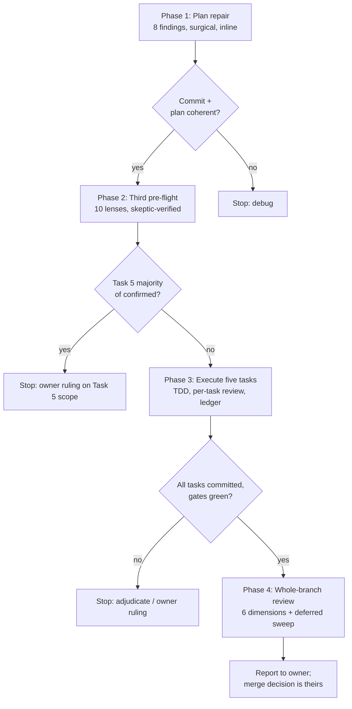

# A2 Closeout Session Design — repair, pre-flight, execute, review

**Date:** 2026-08-03
**Status:** APPROVED (owner, 2026-08-03)
**Branch:** `feat/xgi-compat-plan-a` (unmerged, unpushed; nothing published)
**Predecessor spec:** `docs/superpowers/specs/2026-07-31-xgi-compat-a2-cross-register-design.md` (`a4cd86f`)
**Predecessor plan:** `docs/superpowers/plans/2026-07-31-xgi-compat-a2-cross-register.md` (`f58188a`, marked UNFINISHED)

## Why this document exists

Plan A completed 8/8 at `1b0d67e` (ported suite 316 passed / 1 skipped /
77 xfailed, denominator 492, pass_rate 0.6423; ledger sealed). Its follow-on,
A2, has an approved spec and a written plan — but that plan carries an
UNFINISHED marker: eight pass-2 pre-flight findings remain unapplied (nine
of its seventeen confirmed findings landed before the pause), and the plan's
own closing section mandates a third adversarial pass before execution.
Measured on this repo, rewriting a plan introduces new defects at roughly
two-thirds the rate it removes them, so the closeout needs a designed process,
not an improvised one.

This document designs that **session**: the orchestration around the existing
A2 plan. It does not replace the A2 plan, which remains the sole
implementation source for Phase 3's five tasks.

## Goal and success criteria

The session succeeds when all four hold:

1. The A2 plan carries every outstanding pass-2 fix and has survived a
   third adversarial pre-flight pass.
2. All five A2 tasks execute with per-task review gates and land as one
   conventional commit each.
3. The whole-branch review of `feat/xgi-compat-plan-a` against `main` is
   complete, with every confirmed finding fixed.
4. Final gates are green: `py:gate` under `PYTHONHASHSEED=0` and
   `rust:check`.

**Out of scope:** merging to `main`, pushing, publishing, and Phase R. The
merge decision stays with the owner after reading the review report.

## Phase structure

## Phase 1 — plan repair (inline, surgical)

Seven work items — the bullets of the plan's UNFINISHED section, covering
its eight outstanding finding ids — each a surgical edit anchored to the
finding text. No section rewrites. Two findings carry design decisions made
here, in advance:

- **U12/U5** (Task 3 Step 5's `site` field cites a traceback the Step 2
  harness never captures): resolve by **dropping `site` to the symbol's
  `__module__`**, not by adding `traceback.print_exc()` to the harness. For
  the packaging-asymmetry `drawing.*` ImportError family the module is the
  meaningful site; an ImportError traceback adds noise, not signal.
- **U7** (`except BaseException` in the two measurement snippets, banned by
  the Global Constraints): resolve by **narrowing to `except Exception`**. A
  measurement harness probing imports must not swallow `KeyboardInterrupt`
  or `SystemExit`, so the narrow form stays compliant and correct and needs
  no exemption.
- **U14** (no command in the plan exercises either `sys.path.insert` line
  from Task 5 Step 8): run a **live experiment before any edit** — the
  imports those lines allegedly serve, without them, under the same
  invocation `py:gate` uses (`$PY -m pytest`). Load-bearing → keep, with a
  comment stating why; not load-bearing → the conftest change comes out of
  Task 5.
- **U3, U6, U17** are mechanical replacements per the finding text: replace
  the phantom `M1/M2/M7` identifiers with F-numbers or spelled-out findings;
  widen Task 2 Step 4's `reason` definition so packaging-asymmetry entries
  can meet it; quote the full before/after sentence for the
  `partial_symbols_status` replacement.
- **U16/U19/U20** get re-verified as closed, with the evidence recorded.

The UNFINISHED section is then updated, not deleted — history stays; it gains
a resolution record dated 2026-08-03. One commit closes the phase.

## Phase 2 — third adversarial pre-flight (Workflow)

Ten finder agents: the five established lenses over the whole plan
(runnability of every code block; every cited fact true of the tree;
self-contradiction against the plan's own constraints; property-vs-proxy in
the tests; task composition in order) **plus the same five lenses scoped to
Task 5 alone**. That doubles the allocation on the one task two passes have
not converged on (Task 5 produced 12 of pass 2's 17 confirmed findings).

The pass has the two-halved job the doctrine requires: verify the applied
fixes (the nine that landed before the pause plus Phase 1's eight) are
correct, and find what the repair introduced. Every finding goes to a skeptic instructed to refute by
default. Verification cap: 8 per lens; the workflow logs every dropped
finding — no silent caps. Finders and skeptics run at the Opus review tier (adversarial
critique); mechanical spot-checks run on Sonnet.

The main session applies confirmed findings surgically inline and commits
them.

**Hard gate:** if Task 5 accounts for the majority of pass-3 confirmed
findings, the session stops and the Task 5 scope question goes to the owner.
Re-scoping an owner-ruled task is an owner decision.

## Phase 3 — execute A2's five tasks

Sequential, one task at a time, per the established executor pattern:

1. A per-task brief generated from the repaired plan.
2. A Sonnet implementer running strict TDD (red → green → refactor).
3. Gate run after green.
4. An Opus reviewer with the verdict → fix protocol (one Sonnet fixer, TDD,
   re-review).
5. One conventional commit per task.

New ledger: `.superpowers/sdd/2026-08-03-xgi-compat-a2-cross-register/progress.md`.
Plan A's ledger stays sealed.

Every brief carries the standing constraints verbatim:

- The oracle is this repo's own `.venv` (cp313); babylon's venv stays
  read-only, and its xgi import fails.
- Probe via `.venv/bin/python -c "import xgi; ..."` — never a bare
  `import xgi` in bash (it invokes ImageMagick's `import` screenshot tool
  and dumps a multi-MB capture into the repo).
- Task 3's `drawing.*` measurement uses a **throwaway venv**, not a
  `meta_path` blocker (owner ruling, 2026-07-31).
- Cargo single-flight; no publishing; subagents are never Fable; commit
  trailer `Co-Authored-By: Claude Fable 5 <noreply@anthropic.com>`.

An implementer reporting BLOCKED stops the phase for adjudication; anything
needing an owner ruling goes to the owner — the session never improvises one.

## Phase 4 — whole-branch review (Workflow)

Scope: the full diff `git diff $(git merge-base main HEAD)..HEAD` — the
entire compat effort, T0 through A2. Six review dimensions, each its own
agent:

1. Correctness.
2. Docs-and-claims accuracy — every register and manifest claim traceable to
   a probe.
3. Test quality — property versus proxy.
4. Constraint compliance — catch-alls, loop bounds, explicit typing.
5. Register and schema internal consistency.
6. A **deferred-ledger sweep** targeting the recorded debts: the six Task 7
   minors (M1/M2/M5–M8 in Plan A's task-7 review), the unregistered
   `pytest.mark.slow`, and the four unmutated Task 6 guards. The 15-file
   `sys.path` duplication is A2 Task 5's job, so the sweep verifies its
   removal rather than re-reporting it.

Findings get majority-vote adversarial verification (three refute-by-default
skeptics per finding). Confirmed findings go through the same
fixer-and-review loop as Phase 3. The phase closes with a final full gate
(`py:gate` under `PYTHONHASHSEED=0` plus `rust:check`) and a written review
report in the ledger.

## Failure handling and stop conditions

- Gate numbers deviating from what the plan predicts → stop and debug
  systematically; never adjust expectations to match output.
- Task 5 convergence failure in Phase 2, or any BLOCKED needing a ruling →
  goes to the owner.
- A red gate at any phase boundary blocks the next phase. No skipped
  verification.

## Rejected alternatives

- **Single mega-workflow chaining all four phases:** rejected because the
  Task 5 convergence gate and BLOCKED adjudication both require a human-
  visible seam a workflow cannot provide mid-run.
- **Parallel delegation of the seven repair findings:** rejected because the
  findings touch overlapping sections of one document; parallel editors on
  one file invite merge damage, and the doctrine prefers one hand making
  surgical edits.
