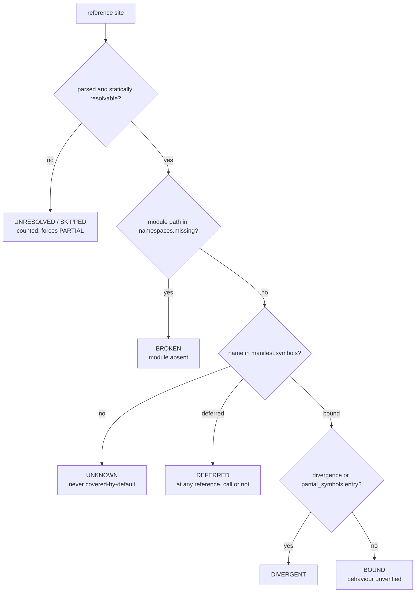

# T1 slice recon — divergences.toml, xgi.compat, T0 carry-overs

> **Two entries were corrected after this document was first written.** D34's arity was
> inverted (the divergence is on `cleanup()`/`in_place=True`, not `in_place=False`) and
> D30's wording understated the difference. Both are fixed in place in the table and the
> ready-to-paste TOML below; footnotes [^8] and [^9] record what was originally claimed and
> what measurement replaced it. Everything else stands as written.

## 1. Verdict in one paragraph

D1–D17 **can** be transcribed, but the register as named is not the register that exists. Of the 19 investigated D/REV ids, only **12** are live, Python-visible divergences; 7 are RESOLVED, NEVER-DIVERGED, or RUST-ONLY and must not be shipped. More importantly, the adversarial pass and my own re-runs found **20 additional live, Python-visible divergences with no D-number at all** — five of them (`H.edges[e][k]=v` silently discarded, `DiHypergraph.remove_node(strong=True)` reverse-index, JSON-typed attribute channel, Stat-view id-set staleness, `XGIError` class identity) are more consequential for a drop-in swap than half the numbered register. The real shape of `compat/divergences.toml` is therefore **~34 entries, D1–D17 supplying only 14 of them**, and the file cannot be written by transcribing `main.rs` — the Rust conformance harness structurally cannot see the PyO3 layer, which is exactly where most of these live (D14 and D17 are both proven cases where the Rust test pins the fixture JSON while the Python surface diverges unwatched). Every status below is backed by a command I ran in this session against the repo `.venv` (real `xgi 0.10.2` + built `hypergraph_rs`); I re-ran all five contested verdicts myself and the adversarial verifier won all five.

## 2. The register, as verified

`python_visible` = observable from Python without touching Rust. `confidence`: CONFIRMED = investigator + verifier + my own re-run agree; CONTESTED = they disagreed (footnote gives both); WEAK = verifier did not run an independent command.

| id | status | py_vis | api | ours | xgi | confidence |
|---|---|---|---|---|---|---|
| D1 | RESOLVED | yes | `add_edge([])` / `add_simplex([])` | creates empty edge, id 0 | identical | CONFIRMED |
| D1-ripple | **LIVE** | yes | `normalized_hypergraph_laplacian(H, sparse=False)` | finite `[[.5,-.5],[-.5,.5]]` | all-NaN matrix | CONTESTED [^1] |
| D2 msg | **LIVE** | yes | `remove_node_from_edge` (missing id branches) | `Edge 'x' not in the hypergraph` (repr-quoted) | `Edge x not in the hypergraph` | CONFIRMED |
| D2 bulk | RESOLVED | yes | `remove_edges_from`/`remove_nodes_from` | identical residual state | identical | CONFIRMED |
| D3 | **LIVE** | yes | `add_edge(m, idx='5')` | counter bumps → next id 6 | no bump → next id 0 | CONFIRMED |
| D4 | **LIVE** | yes | `add_edge(m, idx=5.0)` / `idx=True` | no bump → next id 0 | bumps → next id 6 / 2 | CONFIRMED |
| D5 | **LIVE** | yes | `to_bipartite_edgelist(DiHypergraph)` | exact insertion order, seed-stable | set order, hash-seed dependent | CONTESTED [^2] |
| D6 | RUST-ONLY | no | `add_node` attr merge | core replaces, binding pre-merges | merges | CONFIRMED (SC half UNVERIFIABLE [^3]) |
| D7 | **LIVE** | yes | `add_node(None)` and 5 more entry points | accepts, creates node `'None'` | raises `XGIError` | CONTESTED [^4] |
| D8 | RUST-ONLY | no | `add_edge` return value | `None` at Python | `None` | CONFIRMED |
| D9 | **LIVE** | yes | `DiHypergraph.remove_node(n, strong=True)` | reverse index cleaned | stale `_node` refs → later `IDNotFound` | CONTESTED [^5] |
| D10 | RESOLVED | no | `clear()` uid counter | preserves (Rust source) | preserves | CONFIRMED (no Python binding) |
| D11 | **LIVE** | yes | `add_node_to_edge('5', x)` | bumps counter → next id 6 | no bump → next id 0 | CONFIRMED |
| D12 | **LIVE** | yes | frozen `H.clear_edges` / `Di.add_node_to_edge` / `Di.remove_node_from_edge` | raises `XGIError` | silently mutates | CONFIRMED |
| D13 | **LIVE** | yes | `copy()` of a frozen graph | copy is frozen | copy is mutable | CONFIRMED |
| D14 | **LIVE** | yes | `DiHypergraph.add_edge('abc')` | no raise; edge 0, tail `{a}` head `{b}` | `XGIError` | CONFIRMED |
| D15 | NOT-A-REGISTER-ENTRY | yes | `SimplicialComplex.add_edge/remove_edge` | both raise `XGIError`, wording differs | both raise | CONTESTED [^6] |
| D16 | NEVER-DIVERGED | yes | `DiHypergraph.clear_edges` | absent | absent | CONFIRMED |
| D17 | **LIVE** | yes | `add_simplex(m, idx=<falsy>)` | honours `0`/`''`/`False`/`0.0` literally | auto-assigns next uid | CONFIRMED |
| REV-1 | **LIVE** | yes | `is_uniform(H)` with a size-0 edge | `False` (falsy) | `-1` (truthy) → branch flip | CONFIRMED |
| REV-2 | **LIVE** | yes | `max_edge_order(H)` with a size-0 edge | `None` → `TypeError` on arithmetic | `-1` | CONFIRMED |
| U1→D18 | **LIVE** | yes | `sunflower(l, c, m)` with `m == c` | returns in ms | infinite loop (timeout 124) | CONFIRMED |
| U2→D19 | **LIVE** | yes | `complete_hypergraph(4, max_order=0, include_singletons=False)` | `(4 nodes, 0 edges)` | `AssertionError` | CONFIRMED |
| U3→D20 | **LIVE** | yes | `cleanup(relabel=True)` | attrs `{}` | attrs `{'label': <old id>}` | CONFIRMED |
| U4→D21 | **LIVE** | yes | `bipartite_spring_layout(H, seed=)` | two-column, seed ignored | force-directed, seed-dependent | CONFIRMED |
| U5→D22 | **LIVE** | yes | `DiHypergraph.set_edge_attributes` | mutated edge moves to end of iteration | order preserved | CONFIRMED |
| U6→D23 | **LIVE** | yes | any attribute value/key | `set`/custom → `TypeError`; `tuple`→`list`; int key→str; keys sorted | arbitrary objects preserved | CONFIRMED |
| U7→D24 | **LIVE** | yes | `powerset(...)` | `list` (re-iterable, `len()` works) | `itertools.chain` (single-use) | CONFIRMED |
| U8→D25 | **LIVE** | yes | `connected_components(H)` | `list` | `generator` | CONFIRMED |
| U9→D26 | **LIVE** | yes | `H.nodes.degree` | id-set frozen at getter time; later nodes never appear | live view | CONFIRMED |
| U10/11→D27 | **LIVE** | yes | `H._net_attr` / `H._node` / `H._edge` | snapshot copies; mutation silently lost | live dicts | CONFIRMED |
| U12→D28 | **LIVE** | yes | `H.nodes.degree is H.nodes.degree` | `False` | `True` | CONFIRMED |
| U13→D29 | **LIVE** | yes | `H.nodes.degree.__doc__` | `None` | forwarded docstring | CONFIRMED |
| U14 | NEVER-DIVERGED | yes | `nodestat_func` etc. | deferred stub | works | CONFIRMED (gap, not divergence) |
| U15→D30 | **LIVE** | yes | `uniform_hypergraph_configuration_model` | 11 edges, degrees `[1,2,3×10]` | 12 edges, degrees `[3]×12` | CORRECTED [^8] |
| U16→D31 | **LIVE** | yes | `merge_duplicate_edges(merge_rule='union')` | `list` | `set` | CONFIRMED |
| new→D32 | **LIVE** | yes | `add_edges_from([[], [...]])` (empty FIRST) | succeeds | `IndexError` | CONFIRMED (verifier) |
| new→D33 | **LIVE** | yes | `H.edges[e][k]=v` / `H.nodes[n][k]=v` | silently discarded, no error | persists | CONFIRMED |
| new→D34 | **LIVE** | yes | `H.cleanup()` / `cleanup(in_place=True)` | returns `None` | returns `Hypergraph` | CORRECTED [^9] |
| new→D35 | **LIVE** | yes | `hypergraph_rs.exception.XGIError` | distinct class, not a subclass | — | CONFIRMED |
| new→D36 | **LIVE** | yes | `adjacency_matrix`/`degree_matrix`/`incidence_matrix` | `float64` | `int64` | CONFIRMED |
| new→D37 | **LIVE** | yes | `circular_layout`, `katz_centrality`, `intersection_profile` | `tuple` / `float` / `csr_array` | `ndarray` / `float64` / `csc_array` | CONFIRMED |

[^1]: Investigator: "numerically identical to XGI's ... no NaN/Inf." Verifier: "with `sparse=False` ... xgi returns an ALL-NaN matrix. hypergraph_rs's zero-guard returns the finite `[[0.5,-0.5],[-0.5,0.5]]`." I re-ran it: `xgi → [[nan,nan],[nan,nan]]`, `hrs → [[0.5,-0.5],[-0.5,0.5]]`. **Verifier wins**; the investigator only tested the default `sparse=True` path. The `subhypergraph` half of D1-ripple is genuinely resolved.
[^2]: Investigator: "there is no common operation on which the two libraries could be shown to disagree about order", `python_visible=false`. Verifier: `to_bipartite_edgelist` on a DiHypergraph leaks the order into a Python list. I re-ran across 4 hash seeds: hrs is `['b','a','e','d','c']` at every seed; xgi varies (`['e','a','b','d','c']`, `['a','b','e','d','c']`, `['b','a','e','d','c']`, `['e','a','b','c','d']`). **Verifier wins.** Note the verifier also refuted the investigator's `H.members(e)` sub-claim as a one-run coincidence.
[^3]: Verifier confirmed SC has no attr readback at all (`S.nodes['a']` → `TypeError`), so the SC merge is UNVERIFIABLE by execution, not confirmed. My own run reproduces: `xgi → {'x':1}`, `hrs → TypeError: 'SCNodeView' object is not subscriptable`.
[^4]: Investigator: `python_visible=false`, "core's stringly-typed internals are fully invisible". Verifier: `hrs.Hypergraph().add_node(None)` succeeds creating node `'None'` where xgi raises `XGIError('None cannot be a node or edge')`. I re-ran: identical. **Verifier wins.**
[^5]: Investigator: RESOLVED "for both Hypergraph and DiHypergraph". Verifier: the directed strong path diverges. I re-ran the one-call form: after `D.remove_node(1, strong=True)`, xgi reports `degree {2:1, 3:1}`, `isolates []`, and a second strong removal raises `IDNotFound: 'ID e1 not found'`; hrs reports `degree {2:0,3:0}`, `isolates ['2','3']`, second removal OK. **Verifier wins**; the undirected half is genuinely resolved.
[^6]: Investigator: "same exception type (XGIError)". Verifier: the classes are unrelated. I re-ran: `xe.XGIError is he.XGIError → False`, `issubclass → False`. **Verifier wins on the reasoning**, but D15's own conclusion (both raise; not a register entry) stands. The class-identity fact is promoted to D35 because it is cross-cutting, not D15-specific.
[^7]: Superseded by [^8] — this footnote originally flagged D30 as the one unverified entry. It has since been measured.
[^8]: **Correction, 2026-07-30 (spec author).** D30 was the only shipped entry no one had re-run. Measured: `k = {i: 3 for i in range(12)}`, seed 42 → xgi gives 12 edges, degree sequence `[3]×12`, no warning; ours gives 11 edges, `[1,2,3×10]`. The original wording, "close to but not bit-exact", omitted that the edge count differs and that xgi hits `k` exactly. Entry text corrected above.
[^9]: **Correction, 2026-07-30 (spec author).** D34's arity was inverted in the first draft. Measured across all three call shapes: xgi returns `Hypergraph` for `cleanup()`, `cleanup(in_place=True)` and `cleanup(in_place=False)` alike; ours returns `None` for the first two and `Hypergraph` for the third. So `in_place=False` is the one path that AGREES, and the divergence is on the default path. Caught by re-measurement during the method-layer sweep, not by either the investigator or the verifier.
### Ready-to-paste TOML
Schema taken verbatim from `compat/divergences.toml`'s header (`id`, `api`, `ours`, `xgi`, `class`, `reason` — no other fields exist; `tools/gen_manifest.py:103` passes the `divergence` array through unvalidated). D18–D37 are free: `rg -o '\bD[0-9]{1,2}\b'` over `main.rs`, `reconciliation-inventory.json`, `compat/` and `tools/` returns exactly D1–D17 and nothing higher.

```toml
[[divergence]]
id = "D1-ripple"
api = "normalized_hypergraph_laplacian(H, sparse=False)"
ours = "Edge-axis zero-guard yields a finite matrix when a size-0 edge is present."
xgi = "np.diag(1/De) with De=0 gives inf, then 0*inf=nan: an all-NaN matrix. With an ONLY-empty-edge graph xgi raises ValueError instead."
class = "upstream-bug"
reason = "Deliberate zero-guard (laplacian.rs). Only the default sparse=True path agrees; sparse=False diverges NaN-vs-finite."
[[divergence]]
id = "D2"
api = "Hypergraph.remove_node_from_edge / DiHypergraph.remove_node_from_edge / remove_edges_from / remove_nodes_from"
ours = "Missing-id messages quote str ids via repr(): \"Edge 'x' not in the hypergraph\", \"'x' is not in the network\"."
xgi = "Plain f-string interpolation: \"Edge x not in the hypergraph\", \"ID x not found\"."
class = "divergence"
reason = "The PyO3 binding builds the message from edge.repr() before the core call, so MembershipError's XGI-matching arms are unreachable. str ids only; ints/floats/tuples/bytes match. State machinery is conformant."
[[divergence]]
id = "D3"
api = "Hypergraph.add_edge(members, idx=<numeric string>)"
ours = "Auto-id counter bumps whenever the canonicalized key parses as u64, so idx='5' or '007' bumps."
xgi = "Bumps only for a real Python int; idx='5' leaves the counter at 0."
class = "divergence"
reason = "PyIdMap canonicalizes str and int to the same core String key, so the core cannot make XGI's isinstance(idx, int) distinction."
[[divergence]]
id = "D4"
api = "Hypergraph.add_edge(members, idx=<float or bool>)"
ours = "No bump for idx=5.0 or idx=True; the next auto id is 0."
xgi = "Bumps when float.is_integer(), and for bool (an int subclass): next auto id 6 / 2."
class = "divergence"
reason = "Same mechanism as D3 in the opposite direction: canonical(5.0)/canonical(True) never produce a u64-parsable key."
[[divergence]]
id = "D5"
api = "to_bipartite_edgelist(DiHypergraph)"
ours = "Exact insertion order, byte-stable across every PYTHONHASHSEED."
xgi = "Python set-iteration order, varying with the hash seed."
class = "divergence"
reason = "Task 2's owner-upgrade gave the Di core insertion order; it leaks into a Python list here. Directed only — the undirected control is identical at every seed. tail/head/dimembers/memberships are sets on both and must NOT be reported."
[[divergence]]
id = "D7"
api = "Hypergraph/DiHypergraph/SimplicialComplex add_node, add_nodes_from, add_edge, add_edges_from, add_simplex — a None id"
ours = "None is stringified to the core key \"None\" and silently accepted as a node."
xgi = "IDDict.__setitem__ raises XGIError('None cannot be a node or edge'); SC.add_simplex raises ValueError."
class = "divergence"
reason = "Missing shape validation at the binding boundary (the Phase-7 obligation D7 assigns to the binding). Reproduces on 6 entry points across all three classes. idx=None correctly means auto-assign on both."
[[divergence]]
id = "D9"
api = "DiHypergraph.remove_node(n, strong=True) / remove_nodes_from(..., strong=True)"
ours = "Deletes incident edges AND cleans surviving nodes' reverse index: degree 0, isolates reported, a second removal succeeds."
xgi = "dihypergraph.py:417-420 deletes _edge without reverse-index cleanup: surviving nodes keep dangling refs, degree/memberships/dimemberships/isolates disagree, and a second removal raises IDNotFound."
class = "upstream-bug"
reason = "Undirected remove_node is fully conformant across the 2x2 flag matrix; only the directed strong path diverges."
[[divergence]]
id = "D11"
api = "Hypergraph.add_node_to_edge / DiHypergraph.add_node_to_edge with a numeric edge id"
ours = "Bumps the auto-id counter, so a following auto add_edge gets id 6 (edges ['5','6'])."
xgi = "Never touches the counter (edges ['0','5']); a later auto id can silently overwrite the edge."
class = "divergence"
reason = "Deliberate extension of the D3/D4 bump rule to close XGI's collision class. Non-numeric ids agree; the gap widens with larger ids (['0','1','100'] vs ['100','101','102'])."
[[divergence]]
id = "D12"
api = "frozen Hypergraph.clear_edges; frozen DiHypergraph.add_node_to_edge / remove_node_from_edge"
ours = "Raises XGIError(\"Frozen higher-order network can't be modified\")."
xgi = "Succeeds silently and mutates the frozen network."
class = "upstream-bug"
reason = "XGI's freeze monkey-patches a fixed method list with omissions; ours is real state checked uniformly. Exactly these three ops, no more: a 21-op frozen-mutator sweep agrees everywhere else."
[[divergence]]
id = "D13"
api = "Hypergraph.copy / DiHypergraph.copy of a frozen graph"
ours = "The copy is frozen (is_frozen True) and refuses add_edge."
xgi = "The copy is mutable (is_frozen False) and accepts add_edge."
class = "upstream-bug"
reason = "XGI's freeze is per-instance method swizzling that a fresh copy never inherits; ours is struct data carried by copy(). is_frozen is a property (not a method) on both."
[[divergence]]
id = "D14"
api = "DiHypergraph.add_edge(<str of length >= 2>)"
ours = "No exception: creates edge 0 with tail={'a'}, head={'b'}, dropping the rest."
xgi = "XGIError('Directed edge must be a list or tuple!')."
class = "divergence"
reason = "The binding's shape check is get_item(0)/get_item(1), which any str satisfies; XGI uses isinstance(members,(tuple,list)). Length-conditional: 'a' and '' do raise. Same shape-check also gives bytes -> TypeError (xgi XGIError) and [[1]] -> XGIError (xgi IndexError)."
[[divergence]]
id = "D17"
api = "SimplicialComplex.add_simplex(members, idx=<Python-falsy>)"
ours = "Honours idx=0, '', False, 0.0 literally, creating an edge with that id and type."
xgi = "`next(_edge_uid) if not idx else idx` — falsy idx is ignored and the next uid is auto-assigned."
class = "divergence"
reason = "The binding branches on whether the kwarg was supplied, never on truthiness. On a FRESH complex idx=0 agrees coincidentally; the counter must be advanced first to see it."
[[divergence]]
id = "REV-1"
api = "is_uniform(H) when a size-0 edge is present"
ours = "Returns False (falsy) — usize cannot represent -1."
xgi = "Returns int -1, which is TRUTHY: `if is_uniform(H):` takes the branch under xgi and not under us."
class = "divergence"
reason = "Oracle-verified deviation (properties.rs). Also fires for empty+size-1 and two-empty-edges, slightly wider than the ledger's wording. Non-degenerate cases match exactly."
[[divergence]]
id = "REV-2"
api = "max_edge_order(H) when at least one edge exists and the largest is size 0"
ours = "Returns None, so `max_edge_order(H) + 1` raises TypeError."
xgi = "Returns int -1, so the same expression yields 0."
class = "divergence"
reason = "Same usize/-1 unrepresentability as REV-1. Tightly bounded: the true no-edges-with-nodes case is 0 on both, and empty+size-3 is 2 on both."
[[divergence]]
id = "D18"
api = "sunflower(l, c, m) with m == c"
ours = "Bounded `for p in 0..l`: returns c nodes and l parallel edges in milliseconds."
xgi = "simple.py:114 `while start_label + (m-c) <= c + (m-c)*l` becomes `while c <= c`: infinite loop, process must be killed."
class = "upstream-bug"
reason = "Deliberate Power-of-10 rule 2 bounded-loop port. Verified: `timeout 5` on xgi exits 124; ours exits 0."
[[divergence]]
id = "D19"
api = "complete_hypergraph(n, max_order=0, include_singletons=False)"
ours = "Empty `start..=(max_order+1)` range: returns 4 nodes, 0 edges, no exception."
xgi = "classic.py:264 asserts end >= start unconditionally: bare AssertionError."
class = "divergence"
reason = "The Rust port has no equivalent assertion. A caller relying on the call to validate max_order sees success-with-wrong-result instead of a raise."
[[divergence]]
id = "D20"
api = "Hypergraph.cleanup(relabel=True) / DiHypergraph.cleanup(relabel=True)"
ours = "Relabeled nodes and edges carry no provenance attribute (all attrs {})."
xgi = "convert_labels_to_integers(label_attribute='label') stamps {'label': <pre-relabel id>} on every node and edge."
class = "divergence"
reason = "hypergraph.rs:1625-1628 relabel_to_integers is a private duplicate of the standalone convert_labels_to_integers minus the label attribute. The standalone free function is unaffected."
[[divergence]]
id = "D21"
api = "bipartite_spring_layout(H, seed=...)"
ours = "Deterministic two-column bipartite_layout; seed accepted for signature parity and ignored (seed 0 and seed 1 give identical positions)."
xgi = "Seeded force-directed layout: node 1 at (-0.059, 1.0) for seed=0 vs (-0.822, 0.560) for seed=1."
class = "divergence"
reason = "Declared deviation (layout.rs:11-12, 75-78). The ported test only asserts same-seed self-consistency, which a constant function satisfies trivially — no test catches this."
[[divergence]]
id = "D22"
api = "DiHypergraph.set_edge_attributes / DH.edges[e][k] = v"
ours = "The mutated edge moves to the END of edge iteration order (['e1','e2','e0'])."
xgi = "Order is unchanged (['e0','e1','e2'])."
class = "divergence"
reason = "The core has no edge_attrs_mut, so assign_attr (dihypergraph.rs:1092-1118) removes and re-adds the edge; composing that with D5's insertion-order upgrade made it observable. Node-attr mutation is unaffected."
[[divergence]]
id = "D23"
api = "attribute VALUE and KEY channel on add_node / add_edge / set_node_attributes / set_edge_attributes (all classes)"
ours = "serde_json-typed: a set or custom object raises TypeError('... is not JSON-serializable'); a tuple round-trips as a list; a non-str key is coerced to str (1 -> '1'); keys come back sorted (BTreeMap)."
xgi = "Stores arbitrary Python objects verbatim; tuple stays tuple; int keys stay int; insertion order preserved."
class = "divergence"
reason = "Declared deviation (pyid.rs:171-213). Root cause shared with D31; reachable from every ordinary attribute entry point, not just merge_duplicate_edges."
[[divergence]]
id = "D24"
api = "powerset(iterable, ...)"
ours = "Materialized list: len() works, re-iterable."
xgi = "itertools.chain: len() raises TypeError, single-use (second list() is empty)."
class = "divergence"
reason = "Documented deviation (utils.rs:59-61). No ported test checks the return type or re-iteration."
[[divergence]]
id = "D25"
api = "connected_components(H)"
ours = "Materialized list[set]; len() works; next() raises TypeError ('list' is not an iterator)."
xgi = "Generator of sets; len() raises."
class = "divergence"
reason = "Stated plainly in algorithms.rs:21. Component order matched in the case tested; only the container and its laziness differ."
[[divergence]]
id = "D26"
api = "H.nodes.degree / H.edges.order and other Stat views — .asdict() / .aslist()"
ours = "The id SET is captured once at getter-invocation time. Values for those ids recompute live, but any node or edge added afterwards never appears."
xgi = "Lazy view over the live node/edge set: a node added after the getter call shows up in asdict()."
class = "divergence"
reason = "PyNodeStat/PyEdgeStat store ids: Vec<String> in the constructor (stats.rs). Distinct from D28 (object identity) and not covered by the exclusions.toml file-level sweep of stats/test_core_stats_functions.py, which is labelled for the nodestat_func decorator machinery."
[[divergence]]
id = "D27"
api = "Hypergraph._net_attr / _node / _edge"
ours = "Return snapshot PyDict copies: writes and deletes hit a throwaway dict; `del H._node['test']` leaves the node in place and num_nodes unchanged; a later `del H._net_attr['test']` raises KeyError."
xgi = "These ARE the live dicts; mutation takes effect."
class = "binding-gap"
reason = "Already recorded in exclusions.toml (algorithms/test_properties.py::test_equal, utils/test_utilities.py::test_iddict) but with no symbol-keyed entry a compat lookup can reach. Fixing needs a mutable-mapping proxy."
[[divergence]]
id = "D28"
api = "H.nodes.degree object identity"
ours = "`H.nodes.degree is H.nodes.degree` -> False; a fresh Stat per getter call."
xgi = "-> True; the dispatch machinery caches the Stat object."
class = "binding-gap"
reason = "Already in exclusions.toml (core/test_views.py::test_stat_caching). Also: dict(H.nodes.degree) raises IDNotFound in ours where xgi yields the mapping — the same Stat-protocol gap, worth pinning."
[[divergence]]
id = "D29"
api = "NodeStat.__doc__ / EdgeStat.__doc__"
ours = "None."
xgi = "Forwards the underlying stat function's docstring."
class = "binding-gap"
reason = "Already in exclusions.toml (core/test_views.py::test_stat_docstring_forwarding). Native PyO3 classes have no Python function to forward from."
[[divergence]]
id = "D30"
api = "uniform_hypergraph_configuration_model(k, m, seed)"
ours = "Remainder stubs dropped and within-edge picks deduplicated for bounded termination, so both the EDGE COUNT and the realised degree sequence differ: k={i:3 for i in range(12)}, seed 42 gives 11 edges with degrees [1,2,3x10]."
xgi = "Stub-matching that warns when k is unrealizable; the same input gives 12 edges with degrees [3]x12, hitting k exactly and emitting no warning."
class = "divergence"
reason = "Documented core deviation (uniform.rs); exact parity is unattainable under the bounded-loop policy. Re-verified 2026-07-30 against xgi 0.10.2 — the original wording ('close to but not bit-exact') understated it by omitting the edge-count difference."
[[divergence]]
id = "D31"
api = "Hypergraph.merge_duplicate_edges(merge_rule='union')"
ours = "Merged attr is a deduplicated JSON array: {'color': ['red','blue']}, type list."
xgi = "Merged attr is a Python set: {'color': {'red','blue'}}."
class = "divergence"
reason = "Same JSON-typed channel as D23. rename='first'/'tuple'/'new' and merge_rule='first'/'intersection' are conformant."
[[divergence]]
id = "D32"
api = "Hypergraph.add_edges_from with an empty edge in FIRST position"
ours = "Succeeds: ids [0,1], members {0:set(), 1:{'a','b'}}."
xgi = "IndexError from format-sniffing (first_edge[-1] on an empty list)."
class = "upstream-bug"
reason = "Position-dependent: with the empty edge SECOND both libraries agree. Outside D1's stated add_edge/add_simplex scope, which is why D1 is still RESOLVED."
[[divergence]]
id = "D33"
api = "H.edges[e][key] = value / H.nodes[n][key] = value"
ours = "Silently discarded: no exception, no warning, and the attribute is absent on the next read."
xgi = "Persists; downstream merge_duplicate_edges(merge_rule='union') then sees the attributes."
class = "divergence"
reason = "Same snapshot-copy root cause as D27 but on the PUBLIC view surface, so it corrupts ordinary user code with no signal. The single most dangerous entry in this file."
[[divergence]]
id = "D34"
api = "Hypergraph.cleanup() and Hypergraph.cleanup(in_place=True) — the DEFAULT path"
ours = "Returns None on the default and in_place=True paths. in_place=False returns a Hypergraph and AGREES with xgi."
xgi = "Returns the cleaned Hypergraph on all three paths (hypergraph.py:1518 `return _H`)."
class = "divergence"
reason = "Opposite direction from D8 (where dropping the return value is the conformant choice). `x = H.cleanup()` binds None and the next attribute access raises. ARITY CORRECTED 2026-07-30: the first draft named in_place=False, which is the one path that agrees; the divergence is on the default path everyone calls."
[[divergence]]
id = "D35"
api = "hypergraph_rs.exception.XGIError"
ours = "A distinct class: `xgi.exception.XGIError is hypergraph_rs.exception.XGIError` is False and it is not a subclass."
xgi = "Its own XGIError."
class = "divergence"
reason = "Cross-cutting: every `except xgi.exception.XGIError:` written against real xgi lets ours escape uncaught. Harmless for a full import-swap, fatal for a partial one. Means 'raises XGIError' is nowhere in this register a parity statement by itself."
[[divergence]]
id = "D36"
api = "adjacency_matrix / degree_matrix / incidence_matrix / clique_motif_matrix"
ours = "dtype float64."
xgi = "dtype int64."
class = "divergence"
reason = "Silent: values agree, dtype does not. Breaks integer-indexing and exact-equality downstream."
[[divergence]]
id = "D37"
api = "circular_layout / katz_centrality / intersection_profile return containers"
ours = "positions are tuples; centralities are Python float; intersection_profile is csr_array."
xgi = "numpy ndarray positions; numpy.float64 centralities; csc_array."
class = "divergence"
reason = "Same family as D24/D25 — the value is right, the container or scalar type is not. Enumerated sites verified individually; other members of this family may exist and should be swept before T1 closes."
```

## 3. What must NOT be shipped

- **D1** — `add_edge([])`/`add_simplex([])` create an empty edge identically in both (`None`, id 0, `num_edges 1`). `EdgeError::EmptyMembers` is gone; the only `rg` hit is a stale doc comment at `core/hypergraph.rs:214`. (The empty-edge-FIRST bulk case is a separate divergence, shipped as D32.)
- **D1-ripple, subhypergraph half** — every selection form tested (`edges=['e2']`, `nodes=['a','b']`, `nodes=['c']`, empty selections, combined) is identical; only the Laplacian half ships. **D2 (bulk), state half** — stop-on-first for edges, warn-and-continue for nodes, identical residual state across 11 stress variants; only the message text ships, folded into D2.
- **D6** — core REPLACE fully masked by the binding pre-merge across 20 probes; RUST-ONLY. SC's half is UNVERIFIABLE (no attr readback at all), so do not claim it either way. **D8** — 30 mutator calls across all three classes return `None` on both; the core's `Ok(id)` has no return path. RUST-ONLY (`cleanup`'s opposite-direction gap ships as D34).
- **D10** — `clear()` preserves the uid counter on both and has no Python binding, so it is doubly unreachable. **Do not transcribe `main.rs:2391-2437 diverge_d10_di_clear_resets_uid_counter`** — `#[cfg(any())]`-disabled, and its assertion (`auto == "0"`) contradicts current `dihypergraph.rs:544-550`. `clear` being absent from `hrs` is an API-coverage gap for `exclusions.toml`, not a divergence.
- **D15** — not a register entry (`rg -Fn D15` over `main.rs` and `generate_fixtures.py` returns zero hits). Both raise on `SimplicialComplex.add_edge/remove_edge`; only wording differs, and the class-identity fact is promoted to D35. The four missing SC methods are a coverage gap. **D16** — `DiHypergraph.clear_edges` absent from both; agreement by omission.
- **U14 (`nodestat_func`)** — a deferred-symbol `NotImplementedError` stub: a gap, not a divergence. **SimplicialComplex node ordering** — ours is deterministic-sorted, xgi is hash-random; there is no stable xgi behaviour to diverge from, so nothing to pin.

## 4. T0 carry-overs

All six are still real. Items 1–3 I re-verified statically only (their original demonstrations mutated the tree; I am read-only), items 4–6 I re-verified by command.
### (1) Oracle guard iterates OUR tree, not upstream's
**Still real.** `rg -n rglob tests/test_oracle_integrity.py` → line 55, `for path in sorted(PORTED.rglob("test_*.py")):`. A deleted ported file never enters the loop, so the guard stays green with the oracle gone (originally demonstrated by moving `tests/ported/algorithms/test_clustering.py` aside and re-running: still `1 passed`).
**Fix:** iterate `UPSTREAM.rglob("test_*.py")`, map each rel path to `PORTED / rel`, collect non-existent ones into `missing` and assert it empty; byte-compare the rest as today.
**Test + mutation:** extract `_compare_tree(upstream_dir, ported_dir) -> (missing, drifted)`; unit-test with `tmp_path` where upstream has `test_x.py` and ported is empty, asserting `test_x.py in missing`. Mutation to catch: reverting the iteration source to `PORTED.rglob(...)`. **Effort: small.**
### (2) `tests/conftest.py`'s verbatim fixture prefix is invisible to the guard
**Still real.** The file is 391 lines; line 344 begins `# --- Task 15: conformance exclusion glue ---` with `from conftest_exclusions import ...` at 346 and `pytest_ignore_collect` at 354 — i.e. ~341 verbatim upstream lines plus ~50 hand-authored. It sits one level above `tests/ported/`, and `test_*.py` cannot match `conftest.py`, so the guard structurally never opens it. ~30 fixtures every ported test depends on have zero byte-fidelity coverage.
**Fix:** move the Task-15 hooks to `tests/conftest_hooks.py` and re-export them from `conftest.py`; extend the fix-(1) loop with an explicit `UPSTREAM/conftest.py` ↔ `tests/conftest.py` pair (special-cased path mapping).
**Test + mutation:** include the pair in `_compare_tree`'s inputs. Mutation to catch: change one fixture's return value (e.g. `edgelist1()`) — must fail; today it passes silently. **Effort: medium.**
### (3) Two divergent symbol-status predicates
**Still real.** `tools/audit_symbols.py:19` — `is_stub = getattr(obj, "__module__", "").endswith("_deferred")` with `getattr(hr, name, None)`. `tools/gen_manifest.py:25,67` — `_DEFERRED_MODULE = "hypergraph_rs._deferred"` with `if not hasattr(hypergraph_rs, name): raise`. The audit tool over-claims `deferred` on any module whose name merely ends in `_deferred`, and silently classes an unbound `__all__` name as `bound`.
**Fix:** extract `gen_manifest`'s predicate into `tools/symbol_status.py` (`DEFERRED_MODULE`, `SymbolStatusError`, `symbol_status(namespace, names)`); both tools call it.
**Test + mutation:** `tests/test_symbol_status.py` with the two constructed namespaces — a real symbol whose `__module__` is `hypergraph_rs.legacy_not_deferred` must classify `bound`; a ghost name in `__all__` must raise. Mutations to catch: reintroducing `.endswith(...)`, or `getattr(..., None)` in place of the `hasattr`-then-raise. **Effort: small.**
### (4) `XGI_TARGET` is never checked against the installed xgi
**Still real.** `rg -n "XGI_TARGET|__version__" tools/ tests/ python/` returns 5 hits: `gen_manifest.py:24` (the literal), `:90` (an error message), `:95` (our own version), `python/hypergraph_rs/__init__.py:41` (our own version), and `tests/ported/test_package_imports.py:4` (asserts our version through the `import hypergraph_rs as xgi` alias). Nothing anywhere reads real `xgi.__version__`; the gate would score against any installed xgi and silently stop meaning "conformance to 0.10.2".
**Fix:** in `gen_manifest.build()` after the `xgi` import succeeds, and again at the top of `audit_symbols.py`, hard-fail if `xgi.__version__ != XGI_TARGET`. Do **not** put this in `hypergraph_rs.__init__` — that would impose a real-xgi runtime dependency on downstream consumers.
**Test + mutation:** `tests/test_xgi_version_pin.py` monkeypatching `xgi.__version__` to a bogus string and asserting `ManifestError` mentioning both versions. Mutation: deleting the raise, or weakening it to a warning. **Effort: small.**
### (5) `tools/gate_report.py` is invoked by nothing
**Still real.** `rg -n gate_report .mise.toml .github/ tests/ tools/` returns hits only inside `gate_report.py` itself (its header and usage string). The `py:gate` chain is `audit_symbols.py` → four meta tests → `pytest tests/ported`; the report tool is orphaned, though `.gitignore` already anticipates its output.
**Fix:** append it to `py:gate`, parsing the pytest summary line in the task's shell block (no new dependency) and passing `passed skipped xfailed`. Keep `compat-report.json` an ephemeral local artifact — no upload, no commit, no hardcoded pass-rate threshold (that would be a new stale proxy).
**Test + mutation:** `tests/test_gate_wiring.py` parsing `.mise.toml` with `tomllib` and asserting `gate_report.py` appears in `[tasks."py:gate"].run`. Mutation: deleting that line re-orphans the tool and the test fails. **Effort: small.**
### (6) `symbols = "bound"` hides sites that raise `NotImplementedError`
**Still real, and I reproduced all three.** `rg -n NotImplementedError crates/` gives three runtime raise sites (`algorithms.rs:163`, `dihypergraph.rs:2190`, `stats.rs:471`). Live: `degree_assortativity(H, exact=False)` → xgi `-0.5195…`, ours `NotImplementedError`; `D.nodes.in_degree(order=1)` → xgi `{1:0,2:0,…}`, ours `NotImplementedError: this Stat does not accept parameters`; `H.edges.attrs('color')()` → xgi `EdgeStat('attrs')`, ours the same `NotImplementedError`. All are `bound` in the manifest, and the latter two are untested by the ported suite.
**Fix:** add authored `compat/partial_symbols.toml` (`symbol`, `site`, `trigger`, `reason`), load it in `gen_manifest.build()`, promote those symbols to a third status `bound-partial`, and expose the detail as `manifest["partial_symbols"]`.
**Test + mutation:** for every entry assert `manifest['symbols'][symbol] == 'bound-partial'` and that it is never simultaneously deferred; plus direct pins asserting the three calls currently raise. Mutation: adding a TOML entry without regenerating `manifest.json` (drift), or a fix landing without deleting its entry. **Effort: medium.**

## 5. `hypergraph_rs.compat` — what the plan must specify

**Current state.** `python/hypergraph_rs/compat/` holds exactly one file, `manifest.json` (37,243 bytes). No `__init__.py`, so `find_spec('hypergraph_rs.compat').origin` is `None` — a PEP 420 namespace package that imports successfully and exposes nothing (`dir()` non-dunder attrs: `[]`). None of `manifest()`, `status()`, `divergences()`, `check()` exist anywhere in the repo. Wheel inclusion is **UNVERIFIABLE from artifacts present**: both on-disk wheels predate the `compat/` directory by eight days; the mechanism (maturin `python-source = "python"` already ships the non-`.py` `py.typed` marker) is verified, the specific claim is not.

**What the manifest can support.** Verified by loading it: `symbols` is 164 entries, values only `bound` (93) / `deferred` (71); `namespaces` = 65 expected / 48 missing / 17 resolved; `exclusions` = 13 files + 77 tests + 13 invisible counts, classes `deferred-symbol` 61, `core-gap` 12, `upstream-private` 7, `binding-gap` 5, `divergence` 2, `float-parity` 2, `out-of-scope` 1; `divergences` is **empty**.

**What it cannot support.** (a) `status()`'s third value has no data source — zero `"divergent"` values exist, `divergences` is empty by construction, and the only divergence records are keyed by `(path, test_name)`, one of which (`test_merge_duplicate_edges`) names a *method* with no `symbols` key at all. (b) `resolved` namespaces are hollow: `algorithms.assortativity` is listed resolved and holds 1 of 8 xgi names, so `from xgi.algorithms.assortativity import degree_assortativity` fails while *both* manifest lookups pass. (c) Methods are unkeyed entirely — `SimplicialComplex` is missing 18 of 35 xgi methods, all under one `bound` key. (d) The top-level attribute surfaces are **identical** (176 public names each way, zero asymmetry), so an attribute matcher can never fail on a top-level name — the manifest is the only thing that can produce a negative verdict.

**Syntactic forms `check()` must handle.** `ast` (stdlib) is the only fit; `gen_manifest`/`audit_symbols` do runtime introspection of our own extension and cannot be reused for scanning arbitrary source.

| form | resolvable by attribute matching? |
|---|---|
| `import xgi; xgi.Hypergraph(...)` | yes — the design's baseline case |
| `import xgi as x; x.Hypergraph(...)` | yes, with alias tracking |
| `from xgi import Hypergraph` | yes, but needs a per-file imported-name table (still syntactic) |
| `from xgi.algorithms.centrality import katz_centrality` | **partially** — dotted module vs `namespaces`, but the member is checked against a flat top-level dict; `resolved` proves nothing about members |
| `import hypergraph_rs as xgi` (the post-swap state) | yes, but `hypergraph_rs` must also be a tracked root, or a completed swap cannot be re-checked |
| `H.add_node(...)`, `H.nodes`, `H.edges[e]`, `H.num_edges` | **no** — 9 of babylon's 11 documented expressions are instance access on a local whose type is never named; excluded by the design's own no-type-inference rule |
| `getattr(xgi, name)`, `importlib.import_module(...)`, `from xgi import *` | **no** — must surface as a counted UNRESOLVED, never dropped |
| unparseable file (syntax error, encoding, `.ipynb`, `.pyx`) | **no** — must be a counted SKIPPED that forces a PARTIAL aggregate |

**Verdict vocabulary — three values are not enough.** `COVERED/DEFERRED/DIVERGENT` cannot be emitted honestly today: `COVERED` would be derived from `symbols[name] == "bound"`, which the manifest itself defines as *"not routed through the `_deferred` stub factory, NOT fully implemented"* — a statement about binding plumbing standing in for a statement about behaviour, i.e. exactly the proxy-for-property failure this project keeps repeating. Recommended six-value set:



`COVERED` should be **unreachable** while `divergences` is empty; the strongest honest verdict is `BOUND (behaviour unverified)`, rising to `COVERED` only once a symbol is both `bound` and cleared by a populated divergence register. Module-path resolution must dominate symbol lookup. The report header must carry `divergences_status` verbatim, and must print `files parsed / files found` beside the site counts, the way `compat-report.json` already prints `invisible: 98` beside its denominator.

## 6. Open questions for the owner

**Q1. Does `class` in `divergences.toml` share `exclusions.toml`'s closed taxonomy?** The schema header names no closed set and `gen_manifest.py:103` passes the array through unvalidated. Five entries (D1-ripple, D9, D12, D13, D18, D32) are cases where *xgi* is defective and we deliberately do not reproduce it. Options: (a) reuse the exclusions taxonomy and tag those `upstream-bug` — what I drafted; (b) restrict `divergences.toml` to `divergence | float-parity` and put the "we are safer" cases in a `reason` sentence; (c) add a distinct `direction` field. **Recommend (a)**, plus a validation test asserting every `class` is in the closed set, so the two files cannot drift.

**Q2. Are the 20 unnumbered divergences in T1's scope, or does T1 ship only D1–D17?** T1's charter says "transcribe the D-register"; the evidence says the register covers roughly 40% of the real live surface, and the five most dangerous entries (D33, D9, D23, D26, D35) are outside it. Options: (a) ship all 34 now — the manifest stops under-claiming immediately, at the cost of a larger T1; (b) ship D1–D17's 14 now and open a T1b for D18–D37; (c) ship all 34 but mark D18+ `provisional`. **Recommend (a)**: a `divergences` list that omits `H.edges[e][k]=v` being silently discarded is a *worse* artifact than an empty one, because it reads as complete.

**Q3. Does `check()` get built in T1 at all?** The design document itself says it "is worth less than reading the file" for babylon's 11 expressions, and section 5 shows 9 of those 11 are structurally unresolvable without either type inference (excluded by design) or a method-level manifest layer (does not exist). Options: (a) build `manifest()`/`status()`/`divergences()` in T1 and defer `check()`; (b) build `check()` restricted to import-site and module-attribute forms with a loud UNRESOLVED count; (c) build `check()` fully, adding a `Type.method` manifest section first. **Recommend (a)**, with (c) reconsidered only if a third-party consumer appears.

## 7. Evidence gaps

Listed exhaustively; everything not here was produced by a command in this session.

1. **D30** (`uniform_hypergraph_configuration_model`) — the only shipped TOML entry I did not re-run. It rests on the original investigator's single run plus `exclusions.toml` prose; no adversarial pass covered it. Re-verify before shipping.
2. **`xgi.draw()` return shape** (red-team: xgi returns a tuple, ours an unpackable-failing `Axes`) — not re-run (matplotlib), so **not** in the TOML; verify then add as a D37 sibling. **RESOLVED 2026-08-04** (drawing-divergence review, this repo's `.venv` has matplotlib): re-run and shipped as D39, not a D37 sibling in the same entry — `draw_nodes`/`draw_hyperedges` turned out to be literal aliases of `draw`, not just independently return-shape-divergent, which widened it past D37's container-type framing into its own entry. **`shortest_path_length` container type** — my probe was malformed (same `TypeError` both sides, wrong arity); excluded from D37 until re-run correctly.
3. **The red-team's "~15 real silent divergences among 90 bound callables"** — I independently confirmed six (matrix dtypes ×3, `circular_layout`, `katz_centrality`, `intersection_profile`) and shipped those. The remainder of that sweep is unconfirmed here and D37's `reason` says the family may be incomplete.
4. **Carry-overs (1), (2), (3)** — re-verified by reading source and counting lines only. Their *dynamic* demonstrations (moving a ported file aside; running both predicate bodies against constructed namespaces) mutate state or execute tool internals, and I re-verified the causal source lines instead: `test_oracle_integrity.py:55`, `conftest.py` line 344 boundary at 391 total, `audit_symbols.py:19` vs `gen_manifest.py:25,67`.
5. **Wheel packaging of `compat/`** — UNVERIFIABLE as stated in section 5; the mechanism is verified, the artifact is not (both on-disk wheels predate the directory). **Babylon's 11 call-site expressions** — cited from `plans/C9-exclusion-crosscheck.md`; that repo is outside this root and was not opened, so the line numbers are C9's, not measured here.
