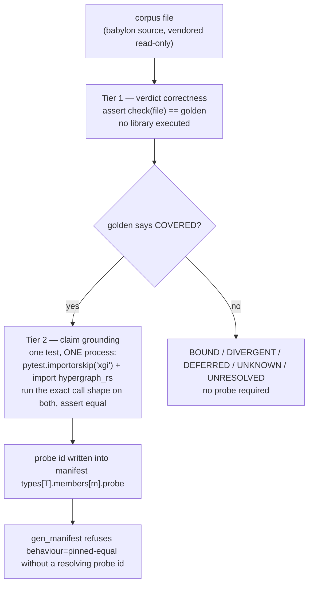

# T1 addendum — the method layer and full check()

Owner ruling (final, not re-argued): build `check()` fully, `Type.method` manifest layer first.
Every number below came from a command I ran this session against
`/home/user/projects/game/hypergraph-rs/.venv/bin/python` (real `xgi 0.10.2` + built
`hypergraph_rs`). Where an input's number disagreed with my re-run, I say so.

## 1. What the owner's ruling costs, measured

I re-ran the inventory rather than transcribing it, and the two inputs disagree. **Both were
right about different things**, which is itself a schema decision the plan must make:

- The class/view inventory reports `NodeStat` xgi=25, `DiNodeStat` xgi=25. It measured
  `dir(instance)`.
- The resolver design §0 reports `NodeStat` 20, `EdgeStat` 20. It measured `dir(type)`.
- Measured cause: `set(dir(x)) - set(dir(type(x)))` on `xgi`'s `NodeStat` is exactly
  `{args, func, kwargs, net, view}` — five per-instance attributes set in `__init__`. Ours has
  zero instance attributes (`dir(inst) == dir(type) == 3`). So the +5 is not noise; it is five
  real attributes reachable as `H.nodes.degree.func` that our type does not have.
- **Ruling the plan needs: the generator keys `dir(type(x)) | instance_attrs(x)`** and records
  which source each member came from. Anything else silently drops or silently inflates.

Neither input covered the whole surface. My sweep adds `EdgeStat`, `DiEdgeStat`, the two
SimplicialComplex views, and `IDDict`. Measured, `dir(type)` convention, one row per distinct
`(xgi type, ours type)` pair reachable from a populated instance:

| xgi type | ours type | xgi | ours | missing | extra |
|---|---|---|---|---|---|
| Hypergraph | Hypergraph | 28 | 40 | 3 | 15 |
| DiHypergraph | DiHypergraph | 21 | 25 | 1 | 5 |
| SimplicialComplex | SimplicialComplex | 35 | 18 | 18 | 1 |
| NodeView | NodeView | 29 | 19 | 10 | 0 |
| EdgeView | EdgeView | 21 | 16 | 7 | 2 |
| NodeStat | NodeStat | 20 | 3 | 17 | 0 |
| EdgeStat | EdgeStat | 20 | 5 | 15 | 0 |
| DiNodeView | DiNodeView | 20 | 9 | 11 | 0 |
| DiEdgeView | DiEdgeView | 27 | 13 | 14 | 0 |
| DiNodeStat | **DiStat** | 20 | 2 | 18 | 0 |
| DiEdgeStat | **DiStat** | 20 | 2 | 18 | 0 |
| NodeView (`S.nodes`) | **SCNodeView** | 29 | 1 | 28 | 0 |
| EdgeView (`S.edges`) | **SCEdgeView** | 21 | 3 | 18 | 0 |
| IDDict (`H.edges[0]`) | **dict** | 11 | 11 | **0** | 0 |

**Totals: 14 type pairs · 12 distinct xgi types · 13 distinct ours types · 322 xgi members ·
167 ours members · 178 missing · 23 extra.** Under the instance convention the stat rows each
gain 5, so the same sweep reads 342 / 167 / 198.

Four things the original design did not contemplate, each measured:

1. **Type names are not a bijection.** `xgi.DiNodeStat` and `xgi.DiEdgeStat` both map to our
   single `DiStat`; `xgi.NodeView` maps to *both* our `NodeView` and our `SCNodeView` depending
   on the receiving class. A `types` table keyed by a single canonical name is wrong on 5 of 14
   rows. The layer needs a **name-mapping table (xgi type → ours type), not name identity**.
2. **SimplicialComplex is effectively unbound at the view layer.** `S.nodes` exposes **1** public
   member against xgi's 29. This is far worse than the 18/35 class-level gap the recon quotes and
   was invisible to every prior count.
3. **`IDDict` is the counter-example that kills `hasattr` as the sole generator.** Measured:
   both sides expose 11 public members, missing = 0, and `hasattr(H.edges['e'], '__setitem__')`
   is `True` on both — yet `d['color']='red'` then `dict(H.edges['e'])` gives `{'color':'red'}`
   under xgi and `{}` under ours (D33). A pure existence diff scores this pair **perfect**.
4. **None of the 11 view/stat types is a top-level symbol in either library** (`hasattr(xgi,
   'NodeView')` → `False`, both). `manifest["symbols"]` (164 keys, `bound` 93 / `deferred` 71,
   `divergences` length **0**, `schema_version` 1 — all re-verified) structurally cannot name
   them. The `types` key is not an enhancement; it is the only place these 238 members can live.

## 2. Method-layer manifest schema

`schema_version` → **2**. Two new top-level keys, `types` and `partial_symbols`, plus a
now-populated `divergences` carrying machine-readable targets.

The red-team's central finding is that a single `status` field cannot answer both "does this
name exist" and "does it behave the same", and that collapsing them makes *absence of a
divergence entry* promote to *verified equivalent*. So `status` is **split into two axes**:

```json
"types": {
  "Hypergraph": {
    "xgi_source": "xgi.core.hypergraph.Hypergraph",
    "ours_type":  "hypergraph_rs.Hypergraph",
    "constructible": true,
    "subclassable": false,
    "members": {
      "nodes": {
        "kind": "property", "existence": "both", "behaviour": "pinned-equal",
        "probe": "tests/compat/probes/test_hypergraph_nodes.py::test_nodes_returns_nodeview",
        "returns_xgi": "NodeView", "returns_ours": "NodeView", "returns_verified": true
      },
      "cleanup": {
        "kind": "method", "existence": "both", "behaviour": "divergent",
        "divergence_ids": ["D20", "D34"],
        "returns_xgi": "Hypergraph", "returns_ours": null, "returns_verified": true,
        "binds": false
      },
      "add_weighted_edges_from": { "kind": "method", "existence": "xgi-only",
                                   "behaviour": "divergent", "divergence_ids": ["GAP-HG-01"] }
    }
  },
  "IDDict": {
    "xgi_source": "xgi.core.iddict.IDDict", "ours_type": "builtins.dict",
    "constructible": false, "subclassable": true,
    "members": { "__setitem__": { "kind": "dunder", "existence": "both",
                                  "behaviour": "divergent", "divergence_ids": ["D33"] } }
  },
  "DiNodeStat": { "xgi_source": "xgi.stats.DiNodeStat", "ours_type": "hypergraph_rs.DiStat",
                  "aliases_ours_with": ["DiEdgeStat"], "members": { "...": {} } }
}
```

**The two axes, and what may write each.**

| axis | values | source | rule |
|---|---|---|---|
| `existence` | `both` · `xgi-only` · `ours-only` | **generated** by introspecting both libraries | the only thing `hasattr` may decide |
| `behaviour` | `unverified` (default) · `pinned-equal` · `divergent` | **authored + probe-gated** | `pinned-equal` requires a non-empty `probe` naming a passing dual-oracle test id; `divergent` requires ≥1 `divergence_ids` resolving to a real entry |

`COVERED` is emitted **only** for `existence == both AND behaviour == pinned-equal`. Absence of
a divergence entry yields `BOUND (behaviour unverified)` — never `COVERED`. That single rule is
what makes the layer stronger than `symbols` rather than a bigger version of the same proxy.

**A method that exists on both sides but diverges** is `cleanup` above: `existence: both`
(the `hasattr` diff is clean), `behaviour: divergent`, `divergence_ids: ["D20","D34"]`,
`returns_xgi: "Hypergraph"` vs `returns_ours: null` — measured, `type(H.cleanup())` is
`Hypergraph` under xgi and `NoneType` under ours, and `cleanup(in_place=False)` returns
`Hypergraph` under **both**. Two consequences the plan must encode: (a) `binds: false` — a
member whose two libraries disagree on return type must never seed a binding, or `H2 =
H.cleanup()` silently types `H2` as `Hypergraph` and every downstream site reports clean;
(b) the recon's D34 text is **arity-inverted** and must be corrected before transcription — the
divergence is on the default / `in_place=True` path, not `in_place=False`.

**Divergence targets** (`compat/divergences.toml` gains a `targets` array alongside the existing
free-prose `api`, which stays for humans):

```toml
[[divergence]]
id = "D34"
api = "Hypergraph.cleanup(...) — default and in_place=True"
targets = [
  { kind = "member", xgi_type = "Hypergraph",   member = "cleanup", condition = "in_place in (unset, True)" },
  { kind = "member", xgi_type = "DiHypergraph", member = "cleanup", condition = "in_place in (unset, True)" },
]
class = "divergence"
```

`kind` ∈ `member | free_function | module | class-identity`. `gen_manifest` **fails** if a
target names a type or member absent from the generated set, so the register cannot drift into
prose. `condition` is matched by `check()` against literal keyword arguments at the call site;
where the argument is non-literal, `check()` emits `DIVERGENT (condition unevaluated)` — the
conservative direction. At least D3, D4, D7, D11, D17, D32 and D34 need `condition`.

**Provenance.** `types.*.members.*.{kind, existence}`, `xgi_source`, `ours_type`,
`subclassable` (`T.__flags__ & Py_TPFLAGS_BASETYPE`; measured `xgi.Hypergraph` **True**,
`hypergraph_rs.Hypergraph` **False**) and `aliases_ours_with` are **generated** by a new
`tools/gen_types.py` invoked from `gen_manifest.build()`. `returns_*`, `behaviour`, `probe`,
`binds`, `divergence_ids` are **authored** in `compat/type_members.toml` and admitted only with
a named passing probe. A test asserts every authored `(type, member)` exists in the generated
set and every `probe` id resolves to a collected test.

## 3. The resolver, after red-teaming

Kept unchanged: single decision point (`lookup.py`), `ClassDef` scope barrier, refusal table,
six-verdict vocabulary — **BOUND · DIVERGENT · DEFERRED · UNKNOWN · BROKEN · UNRESOLVED**, with
`COVERED` reachable only under §2's probe rule and `SKIPPED`/`TRUNCATED` as *file* statuses.

Changed at the core: **the single forward pass is replaced by two non-recursive passes per
scope** (pass 1 collects every binding event for every name; pass 2 emits sites), and **a site's
verdict is the worst verdict over all hops, not the last hop's**. Both are bounded by statement
count, so §4 is unaffected.

| attack | design's verdict | truth | resolution |
|---|---|---|---|
| R1 loop back-edge / closure rebinds `H` after the site | confident final-hop verdict | receiver type unknown on iteration 2+ | **FIXED** — two-pass; a name is live only if pass 1 saw exactly one committed type and **zero** poison events anywhere in the scope. Also kills the forward-reference hole and R4. |
| R2 `H2 = H.cleanup()` (measured: xgi `Hypergraph`, ours `NoneType`) | `BOUND`, binds `H2` | `H2 is None`; next access raises | **FIXED** — `returns_xgi`/`returns_ours` both probed; disagreement ⇒ `DIVERGENT` + `binds:false`. Probes run against both libraries in one process. |
| R3 member exists on both, behaves differently (`IDDict.__setitem__`, all 3 shared `NodeStat` members) | `bound` from `hasattr` diff | silent data loss / stale ids / dtype flip | **FIXED** — `existence` vs `behaviour` split (§2); `hasattr` may only write `existence`. |
| R4 `FunctionDef`/`ClassDef`/`Import`/`AnnAssign`/`MatchAs`/`TypeAlias` rebind a tracked name | no rule fires, binding survives | not an xgi object | **FIXED** — invalidation table becomes exhaustive-by-construction, with a test enumerating every `ast` node that can bind a `Name` and asserting each has an entry. |
| R5 duplicate import of the same name | unspecified first/last-wins | either choice wrong half the time | **FIXED** — any name imported more than once in a file is poisoned, reason `import-shadowed`. |
| R6 `xgi.Hypergraph` and `hypergraph_rs.Hypergraph` share a canonical name | binding kept, `BOUND` | measured: `xgi.subhypergraph(ours)` → `AttributeError`; `hrs.subhypergraph(xgi_obj)` → `TypeError` | **FIXED** — canonical names namespaced by root (`xgi:Hypergraph`); a name bound to both is `type-conflict`; a file importing both roots gets file-level `MIXED-ROOTS` forcing `PARTIAL`. |
| R7 class-level access `xgi.Hypergraph.nodes` (measured: `property` vs `getset_descriptor`; `function` vs `method_descriptor`) | resolves through `NodeView` | `AttributeError` at runtime | **FIXED** — chain walker tracks receiver kind; a member hop off a class object is legal only for `kind: method` accessed unbound, else `UNRESOLVED`/`class-level-access`. |
| R8 `class MyGraph(xgi.Hypergraph)` (measured `subclassable`: xgi True, ours **False**) | unreported; base's member table inherited | import-fatal `TypeError` at class-definition time | **FIXED** — generated `subclassable` flag; a `ClassDef` whose base resolves to a tracked type is its own reference site (`DIVERGENT`, new register id), and instances of subclassed types are poisoned. New divergence, absent from the 34-entry register. |
| R9 `H.cleanup().nodes` | `BOUND` (final hop) | intermediate hop carries D20/D34 | **FIXED** — verdict = worst over all hops; report names the hop that produced it. |
| R10 6-hop chain | slice silently truncates to the 4-hop prefix's verdict | over-deep chain | **FIXED** — `if len(hops) > MAX_CHAIN_DEPTH: return UNRESOLVED(chain_too_deep)` **before** the loop; the slice stays only as the static-provability device. |
| R11 `MAX_SITES_PER_FILE` overflow | `TRUNCATED`, per-verdict counts silently short | counts presented as exact | **FIXED** — count-then-drop; report prints `sites analysed / sites found` beside `files parsed / files found`. |
| Instance attrs (`H.nodes.degree.func`, 5 members) | absent from the type table | reachable at runtime under xgi | **ACCEPTED with a rule** — generator records them with `source: "instance"`; they are `existence: xgi-only`, so sites emit `DIVERGENT`, never `UNKNOWN`. |
| Babylon's 9 instance-access expressions where the constructor is in another function | — | unknowable without cross-function inference | **ACCEPTED** — emits `UNRESOLVED`/`unannotated-param`, counted, forcing aggregate `PARTIAL`. Not a guess. |

## 4. Bounds and compliance

Power-of-10 rule 2 is non-negotiable; each bound is enforced, none assumed. No `while` anywhere
in the resolver; every `for` iterates a materialised, pre-sized sequence.

| bound | value | enforcement | why this value |
|---|---|---|---|
| `MAX_CHAIN_DEPTH` | 4 | length-checked **before** `for hop in hops[:4]` (R10) | deepest real expression `H.nodes.degree.asdict()` = 3 hops; one hop slack |
| `MAX_SCOPE_DEPTH` | 8 | `ScopeStack.push()` raises `ScopeDepthError` at 9 → subtree `UNRESOLVED`/`scope-too-deep` | |
| `MAX_BINDINGS_PER_SCOPE` | 512 | `bind()` raises `ScopeCapacityError`; scope saturated, all names poisoned | |
| `MAX_SITES_PER_FILE` | 4096 | count-then-drop; `TRUNCATED`, counts reported as `analysed / found` | |
| `MAX_FILE_BYTES` | 2 MiB | `stat` before read → `SKIPPED`/`file-too-large` | |
| passes per scope | **exactly 2** | two named functions, no loop over passes; no fixpoint, no convergence test | R1 fix |
| seed chase | 1 table read per assignment | pass-2 table reads only; no recursion to bound | |
| AST recursion | CPython's own parse-time depth limit | documented, not re-implemented | |

Exception set, each caught at one site and mapped to one reason code, no bare `except`:
`SyntaxError`, `UnicodeDecodeError`, `OSError`, `ScopeDepthError`, `ScopeCapacityError`,
`ManifestSchemaError`. Rule 3 (≤100 lines/function): the 10-module split of the resolver design
§6 is retained unchanged and is what makes this hold; `lookup.py` stays the sole verdict
decision point, `scan.py` imports no verdict logic, `lookup.py` imports no `ast` — enforced by
test, so a false-clean verdict has exactly one place to originate.

## 5. Test corpus and the dual-oracle definition

`check()` executes nothing it scans, so "green against both" must be a statement about the
**evidence backing each verdict**, not about `check()` importing xgi. Two tiers:



**Corpus.** (1) Primary: a vendored read-only snapshot of babylon's 7 production files
(`community.py`, `graph_wrappers.py`, `bifurcation_monitor.py`, `analysis.py`, `axis.py`,
`bridges.py`, `consciousness.py`) holding C9's 11 call sites — vendored so CI does not depend on
babylon's checkout. (2) Same-shape confirmation: `tests/unit/bifurcation/factories.py::
build_test_hypergraph` and `tests/unit/engine/hydration/test_hydrate_industry.py`, independently
authored, must resolve to the *same* verdicts — a regression check against `check()` overfitting
one file's formatting. (3) The ~10 `tests/ported/` tests C9 actually cites as evidence, closing
the loop between "COVERED" and "here is the test COVERED means". (4) **Adversarial corpus** the
plan must author: one file per red-team row R1–R11, each a minimal reproduction with a golden
asserting the *refusal*, not a guess.

**The mechanical definition.** A member may carry `behaviour: pinned-equal` iff a single test
function, in one process, does `pytest.importorskip("xgi")` **and** `import hypergraph_rs`, runs
the exact call shape found at a corpus site against both, and asserts equal observable behaviour
— values, container type, scalar dtype, iteration order, and exception identity where relevant
(D35: `xgi.exception.XGIError is hypergraph_rs.exception.XGIError` is **False**, so "raises
XGIError" is never by itself a parity assertion). The repo already has exactly one instance of
this pattern to extend: `tests/ported/test_property_differential.py`. It is **not** the ported
suite's pattern — `tests/conftest.py:6` hardcodes `import hypergraph_rs as xgi`, so all 60
ported files execute against ours only and their fidelity to real xgi is an unrenewed port-time
assumption. Babylon's real surface is 2 top-level symbols and ~8 call shapes, so Tier 2 for the
primary corpus is ~10 small tests; the full `types` table needs one probe per member the plan
wants to call `COVERED`, which is a deliberate, incremental cost — an unprobed member stays
`BOUND (behaviour unverified)` forever and that is the honest resting state.

## 6. Task decomposition

Ordered; each ends independently testable. Deps are task numbers. "Mutation" = the change the
named test must fail on.

| # | task / deliverable | deps | test | mutation it must catch |
|---|---|---|---|---|
| 1 | **Carry-over 3** — extract `tools/symbol_status.py`; `audit_symbols` + `gen_manifest` both call it | — | `tests/test_symbol_status.py`: module named `…legacy_not_deferred` ⇒ `bound`; ghost `__all__` name ⇒ raise | reintroducing `.endswith("_deferred")` or `getattr(...,None)` for `hasattr`-then-raise |
| 2 | **Carry-over 4** — hard-fail in `gen_manifest.build()` + `audit_symbols` if `xgi.__version__ != XGI_TARGET` | 1 | `tests/test_xgi_version_pin.py` monkeypatches a bogus version, asserts `ManifestError` naming both | deleting the raise or weakening it to a warning |
| 3 | **Carry-over 1** — `_compare_tree(upstream, ported)` iterating **upstream**'s rglob | — | `tmp_path` case: upstream has `test_x.py`, ported empty ⇒ `test_x.py in missing` | reverting the iteration source to `PORTED.rglob(...)` |
| 4 | **Carry-over 2** — move Task-15 hooks to `conftest_hooks.py`; add the `UPSTREAM/conftest.py` ↔ `tests/conftest.py` pair to `_compare_tree` | 3 | the pair in `_compare_tree`'s inputs | changing one fixture's return value (e.g. `edgelist1()`) — passes silently today |
| 5 | **Carry-over 5** — append `gate_report.py` to `py:gate`; report stays ephemeral, no pass-rate threshold | — | `tests/test_gate_wiring.py` parses `.mise.toml` with `tomllib` | deleting the line (re-orphans the tool) |
| 6 | `divergences.toml` populated to **34 entries** + closed `class` taxonomy + validation | 1 | every `class` in the closed set; every id unique; D34 text corrected to the default/`in_place=True` path | adding an entry with an off-taxonomy `class`; restoring D34's arity-inverted wording |
| 7 | `targets = [...]` machine-readable divergence keys (`member`/`free_function`/`module`/`class-identity` + `condition`) | 6, 9 | `gen_manifest` fails when a target names a nonexistent type or member | renaming a member without updating its target |
| 8 | **Carry-over 6 / partial symbols** — `compat/partial_symbols.toml` (A–D verified; E `drawing.*` pending the owner's schema ruling), status `bound-partial`, exposed as `manifest["partial_symbols"]` | 1 | each entry ⇒ `symbols[s] == "bound-partial"`, never also deferred; plus direct pins that the 4 calls raise today | adding a TOML entry without regenerating `manifest.json`; a fix landing without deleting its entry |
| 9 | `tools/gen_types.py` — generated half: 14 type pairs, `existence`, `kind`, `xgi_source`, `ours_type`, `subclassable`, `aliases_ours_with`, `source: type\|instance` | 1, 2 | asserts the measured counts (322/167/178/23, `dir(type)` convention) and that `DiNodeStat`+`DiEdgeStat` both map to `DiStat` | switching to `dir(instance)` without updating the counts; dropping the alias map |
| 10 | `compat/type_members.toml` — authored `returns_xgi`/`returns_ours`/`binds` + `behaviour` + `probe` | 9 | every authored `(type,member)` exists in the generated set; every `probe` id resolves to a collected test | authoring `behaviour="pinned-equal"` with no probe id |
| 11 | Manifest `schema_version` → 2; `types` + `partial_symbols` keys; schema validation | 7, 8, 9, 10 | round-trip validation; a v1 manifest is rejected with a named error | loosening validation to accept a member with `behaviour` but no `existence` |
| 12 | `verdicts.py` — six-verdict `StrEnum`, reason codes, frozen `Site`/`FileResult`/`Report` | — | enum membership is exactly the six; `COVERED` is not among the freely constructible verdicts | adding a seventh verdict without a rule |
| 13 | `manifest_io.py` — load + schema-validate only | 11, 12 | corrupt manifest ⇒ `ManifestSchemaError`, not `KeyError` | replacing the validator with a bare `json.load` |
| 14 | `lookup.py` — sole verdict decision point; `COVERED` iff `existence==both AND behaviour==pinned-equal` | 13 | a member with `behaviour="unverified"` and no divergence ⇒ `BOUND`, **never** `COVERED` | making absence of `divergence_ids` promote to `COVERED` (the R3 failure) |
| 15 | `imports.py` — root/alias table; duplicate-import poisoning (R5); `MIXED-ROOTS` flag (R6); `star_import` | 12 | R5 and R6 corpus files ⇒ `import-shadowed` / `MIXED-ROOTS` + `PARTIAL` | first-wins or last-wins precedence; collapsing the two roots to one canonical name |
| 16 | `scope.py` — **two-pass** binding table, exhaustive invalidation table, `MAX_SCOPE_DEPTH`/`MAX_BINDINGS_PER_SCOPE` | 12 | R1 loop/closure corpus ⇒ `UNRESOLVED`; a test enumerates every `ast` node that can bind a `Name` and asserts each has a table entry (R4) | reverting to one forward pass; removing an `ast` binding form from the table |
| 17 | `seeds.py` — RHS→type, `binds:false` honoured (R2) | 14, 16 | `H2 = H.cleanup()` ⇒ `H2` unbound + site `DIVERGENT` | letting a member with disagreeing `returns_*` seed a binding |
| 18 | `chain.py` — spine flatten, receiver-kind tracking (R7), depth **check** before slice (R10), worst-hop verdict (R9) | 14, 17 | 7-hop spine ⇒ `chain-too-deep`; `H.cleanup().nodes` ⇒ `DIVERGENT`; `xgi.Hypergraph.nodes.degree` ⇒ `class-level-access` | restoring last-hop verdict; removing the pre-loop length check |
| 19 | `scan.py` — `NodeVisitor`, `Site` emission, `ClassDef`-base sites (R8), count-then-drop caps (R11) | 15, 16, 18 | `class MyGraph(xgi.Hypergraph)` ⇒ `DIVERGENT`/`not-subclassable`; over-cap file reports `analysed / found` | dropping sites without counting; treating a `ClassDef` base as a non-site |
| 20 | `report.py` — aggregate, `divergences_status` verbatim, `files parsed / files found`, `sites analysed / sites found` | 12, 19 | header carries both denominators and the verbatim status string | printing a count without its denominator |
| 21 | Corpus vendoring + Tier-1 goldens (babylon ×7, same-shape ×2, ported-cited ×10, adversarial R1–R11) | 19, 20 | `assert check(file) == golden` per file; the two same-shape files match the production verdicts | editing a golden to match a regression instead of fixing the resolver |
| 22 | Tier-2 dual-oracle probes; wire probe ids back into `type_members.toml` | 10, 21 | one `importorskip("xgi")` + `hypergraph_rs` test per `COVERED` member, asserting value, container type, dtype, order, exception identity | asserting only values (misses D36 dtype, D24/D25/D31/D37 containers, D5/D22 order, D35 exception identity) |
| 23 | `compat/__init__.py` public surface: `manifest()`, `status()`, `divergences()`, `check()` + CLI | 20, 22 | `check()` on the primary corpus returns `PARTIAL` with a non-zero `UNRESOLVED` count and no `COVERED` lacking a probe | making `check()` return a bare pass/fail that hides the `UNRESOLVED` count |

**Task count: 23.**

## 7. Evidence gaps

Ruthlessly, everything above not backed by a command I ran this session:

1. **Not re-run by me, taken from the corpus input:** every babylon fact — the 7 `import xgi`
   files, the 19/33 `xgi.` occurrence counts, C9's 11-row table and its line numbers, the 6
   extra test files, the 67/60 `tests/ported/` file counts, the 167 symbol / 146 method-form AST
   figures, `tests/conftest.py:6`, `tools/port_tests.sh`'s dead `ORACLE=` path, and the
   `.github/workflows/ci.yml:92` dormant `xgi-conformance` job. Babylon is outside this repo
   root and I did not open it.
2. **Not re-run by me, taken from the partial-symbols input:** findings A–D
   (`degree_assortativity`, `in_degree`/`out_degree` call shapes, `edges.attrs(k)()`), their
   Rust line numbers, and the "3 raise sites workspace-wide" claim. Finding **E**
   (`drawing.draw*`) is explicitly **simulated** — matplotlib is installed, so the natural
   trigger was unreachable; its status in `partial_symbols.toml` is an open owner question
   (task 8 carries it as pending, not as fact).
3. **Not re-run by me, taken from the recon:** the whole 34-entry divergence register except
   D33, D34, D35 and the class-identity fact, which I re-measured. D30
   (`uniform_hypergraph_configuration_model`) is flagged in the recon as never independently
   re-run by anyone — it must be re-verified in task 6, not transcribed.
4. **Not re-run by me, taken from the red-team:** the R2 `subhypergraph` cross-library
   `AttributeError`/`TypeError`, the `NodeStat` `asdict`/`aslist`/`asnumpy` staleness and dtype
   figures, and the `divergences.toml` / `gen_manifest.py:103` schema claims. I did verify
   independently: `cleanup` return types both libraries, `IDDict` vs `dict` member parity and
   the discarded write, `subclassable`, class-vs-instance descriptor kinds, stat identity,
   `XGIError` non-identity, and the manifest's key set and counts.
5. **Design assertions with no measurement behind them, flagged as such:** the value 4 for
   `MAX_CHAIN_DEPTH` rests on "deepest real expression is 3 hops", which I did not measure
   across a corpus — it is a judgement, and task 18's test pins the *refusal*, not the value.
   `MAX_SCOPE_DEPTH` 8, `MAX_BINDINGS_PER_SCOPE` 512, `MAX_SITES_PER_FILE` 4096 and
   `MAX_FILE_BYTES` 2 MiB are all unmeasured engineering choices carried forward from the
   resolver design; none is derived from corpus statistics.
6. **The ~10-probe Tier-2 estimate** for the primary corpus is arithmetic on the corpus input's
   claimed babylon surface, not a count I made. The full-`types` probe cost (up to 167 members)
   is an upper bound, not a plan commitment.
7. **Wheel packaging of `compat/`** remains UNVERIFIABLE from artifacts present (both on-disk
   wheels predate the directory); the mechanism is verified, the artifact is not. If `check()`
   ships as a public entry point, task 23 needs a wheel-content assertion that does not exist
   yet in any input.
