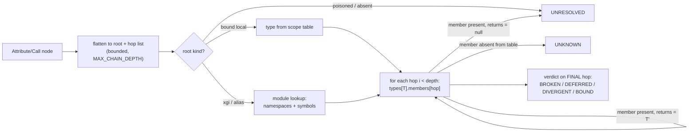
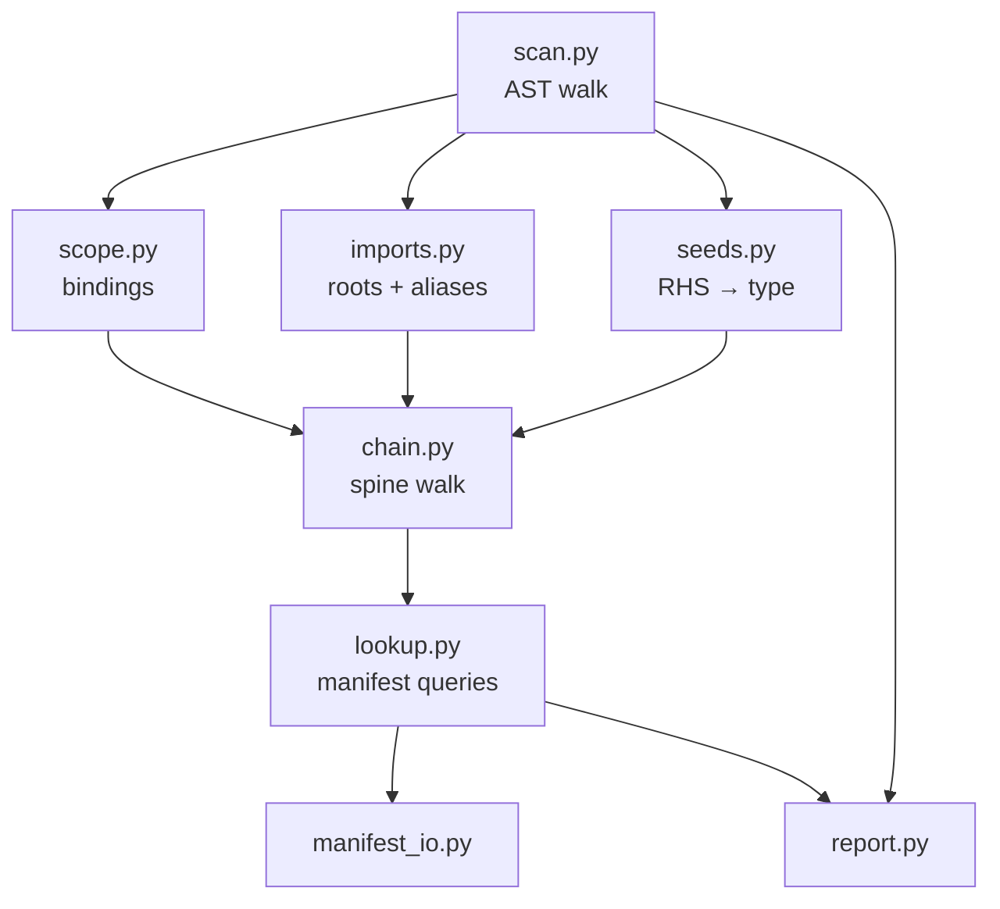

# `compat.check()` — bounded local-type resolver design

Scope: the analysis that lets `check()` reach `H.add_node(1)` and `H.nodes.degree`.
Owner ruling (final): build `check()` fully, with a `Type.member` manifest layer first.

## 0. Measured ground truth (commands run this session, repo `.venv`)

| fact | measurement |
|---|---|
| manifest top-level keys | `divergences`(0) `divergences_status` `exclusions` `namespaces` `schema_version`=1 `symbols`(164) `symbols_status` `xgi_target` `hypergraph_rs_version` |
| classes in `dir(xgi)` | **3** — `Hypergraph`, `DiHypergraph`, `SimplicialComplex` |
| `NodeView`/`EdgeView`/`NodeStat`/`EdgeStat` top-level | **absent from both** libs (`hasattr(xgi,'NodeView')` → `False`; live in `xgi.core.views` / `xgi.stats`) |
| public-member deltas (xgi → hrs, missing) | `Hypergraph` 28→40, 3 missing · `DiHypergraph` 21→25, 1 · `SimplicialComplex` 35→18, **18** · `NodeView` 29→19, 10 · `EdgeView` 21→16, 7 · `NodeStat` 20→3, **17** · `EdgeStat` 20→5, **15** |
| chain terminals | `H.nodes`→`NodeView`, `H.nodes.degree`→`NodeStat`, `H.edges`→`EdgeView`, `H.edges.order`→`EdgeStat`, `H.edges[0]`→`IDDict`, `H.copy()`→`Hypergraph`, `xgi.subhypergraph(H,…)`→`Hypergraph` |

**Consequence that shapes everything below:** `manifest["symbols"]` is a *flat top-level*
namespace and cannot name the view types at all. The method layer therefore needs its own
type namespace keyed by canonical type name, not by top-level symbol. The 17/15 missing
`NodeStat`/`EdgeStat` members are the single largest blind spot the current manifest has, and
they sit at exactly the `H.nodes.degree.<x>` position babylon's code reaches.

## 1. THE STATE

Per scope, one table: `dict[str, Binding]`.

```python
@dataclass(frozen=True)
class Binding:
    type_name: str | None   # canonical type name, or None when poisoned
    poisoned: bool
    origin: tuple[int, int] # (lineno, col) of the establishing statement
    reason: str             # why poisoned; "" when live
```

Scopes nest as a list built by the AST walk: `Module → FunctionDef/AsyncFunctionDef → …`.
`ClassDef` bodies **push a barrier scope** — names in them are recorded but never visible to
inner functions (Python's own rule), and lookups do not pass through them. Lambdas and
comprehensions push a scope whose every target is pre-poisoned. Lookup walks innermost →
outermost, skipping barriers, stopping at the first scope holding the name; a poisoned hit
**terminates** the walk rather than falling through to an outer live binding, since falling
through would let a shadowed local silently adopt a module-level type.

Invalidation rules, all applied in a single forward source-order pass:

| event | effect |
|---|---|
| re-assignment to the **same** resolved type | binding kept, `origin` updated |
| re-assignment to a **different** resolved type | `poisoned`, reason `type-conflict` |
| assignment from an unresolvable RHS | `poisoned`, reason `unresolvable-rhs` |
| `AugAssign` (`H += x`) | `poisoned`, reason `augmented-assign` — the result type is `__iadd__`'s, unknown |
| `del H` | binding **removed** (not poisoned); a later reference is then a plain unbound name → `UNRESOLVED` |
| function parameter with the same name | new scope, binding absent unless the annotation names a known type (§2) |
| `for H in …` target | `poisoned`, reason `for-target` |
| `with … as H` target | `poisoned`, reason `with-target` |
| comprehension / lambda target | `poisoned`, reason `comprehension-target` |
| `except E as H` | `poisoned`, reason `except-target` |
| `global H` / `nonlocal H` in any scope | name `poisoned` in **that** scope **and** in the scope it names, reason `global-decl` |
| tuple/star unpacking (`a, b = …`) | every target `poisoned`, reason `unpack-target` |
| `walrus` `(H := xgi.Hypergraph())` | treated as an ordinary assignment |

Conditionality is *not* by itself invalidating. `if c: H = xgi.Hypergraph()` still yields
`H: Hypergraph`, because the question asked is "what type, if bound" — not "is it bound".
`if c: H = xgi.Hypergraph()` / `else: H = xgi.DiHypergraph()` **is** invalidating, by the
`type-conflict` rule, which is where the safety lives.

## 2. THE SEEDS

An assignment RHS establishes a binding only in these forms:

1. **Rooted constructor call** — `Call` whose func resolves through the import table to a
   name in `manifest["symbols"]` that is also in the type table's `constructors` set:
   `xgi.Hypergraph()`, `x.Hypergraph()` (alias), `hypergraph_rs.Hypergraph()`,
   `Hypergraph()` after `from xgi import Hypergraph`.
2. **Aliased roots** — the import table tracks `xgi`, `hypergraph_rs`, and every alias bound to
   either, plus `from xgi import <name>` / `from xgi.<sub> import <name>` direct names.
   `from xgi import *` binds nothing and poisons nothing; it sets a file-level
   `star_import=True` flag that downgrades every bare-name resolution in that file to
   `UNRESOLVED`.
3. **Free functions with a known return type** — `xgi.subhypergraph(H, …)` → `Hypergraph`,
   `xgi.convert_labels_to_integers(H)` → `Hypergraph` (both measured). Sourced from the same
   authored return-type table as methods, keyed under the pseudo-type `<module>`.
4. **Method calls with a known return type** — `H.copy()`, `H.subhypergraph(...)`,
   `H.dual()`. This is the self-referential case.

**Self-reference bound.** The chase is *not* recursive. Because the walk is a single forward
pass in source order, `H2 = H.copy()` resolves by reading the binding for `H` that is
**already committed** in the table. Each seed therefore costs exactly one table read at
depth 1. A chain `H2=H.copy(); H3=H2.copy(); …` has transitive depth equal to the number of
assignment statements, which is finite and requires no recursion, no fixpoint, and no loop
whose bound must be proven. Forward references (`H2 = H.copy()` before `H` is bound) resolve
to nothing → `unresolvable-rhs` → poison. There is no second pass; that is the cutoff.

**Return types must be verified, not asserted.** An entry in the table may only carry a
`returns` field if a probe test constructs the receiver and asserts
`type(expr).__name__ == returns`. Unverified entries carry `returns = null` and force
`UNRESOLVED` downstream. This is the anti-proxy guard: without it the return table is prose,
and prose is what burned this project five times.

## 3. THE CHAIN

`H.nodes.degree` resolves as: name `H` → `Hypergraph` → member `nodes` → `NodeView` →
member `degree` → `NodeStat`.



### Method-layer schema (new manifest key `types`, `schema_version` → 2)

```json
"types": {
  "Hypergraph": {
    "source": "xgi.core.hypergraph.Hypergraph",
    "constructible": true,
    "members": {
      "add_node":  {"kind": "method",   "status": "bound",    "returns": null,        "returns_verified": false},
      "nodes":     {"kind": "property", "status": "bound",    "returns": "NodeView",  "returns_verified": true},
      "copy":      {"kind": "method",   "status": "bound",    "returns": "Hypergraph","returns_verified": true},
      "cleanup":   {"kind": "method",   "status": "divergent","returns": null,        "returns_verified": false,
                    "divergence_ids": ["D20", "D34"]}
    }
  },
  "NodeView": {"source": "xgi.core.views.NodeView", "constructible": false, "members": {"degree": {...}}}
}
```

Required fields, and why each is load-bearing:

- **`source`** — the fully-qualified *xgi* path. Needed because 4 of the 7 relevant types are
  not top-level names in either library, so `symbols` cannot key them.
- **`kind`** ∈ `method | property | dunder` — distinguishes `H.nodes` (no call) from
  `H.copy()` (call); a `method` referenced without a call is still a valid reference site.
- **`status`** ∈ `bound | bound-partial | deferred | divergent | missing` — `missing` is
  generated by the same `hasattr(xgi_type, m) and not hasattr(hrs_type, m)` diff that produced
  the 18/17/15 counts in §0. `bound-partial` is carry-over (6) of the recon.
- **`returns`** + **`returns_verified`** — chain continuation, per §2.
- **`divergence_ids`** — links a member to `divergences[]`, which is what makes `DIVERGENT`
  reachable for methods; today `divergences` is empty and `check()` must say so in its header.

**Generated vs authored.** `members` existence and `status` are *generated* by
`tools/gen_manifest.py` introspecting both libraries (measurable, regenerable). `returns` is
*authored* in a new `compat/type_members.toml` and admitted only with a passing probe test.
Two sources, one output key, with a test asserting every authored member also exists in the
generated set — so the authored file cannot drift into naming a member that is gone.

**Depth bound: `MAX_CHAIN_DEPTH = 4` hops after the root.** Justification, not a guess: the
deepest real xgi expression is `H.nodes.degree.asdict()` = 3 hops; 4 gives one hop of slack.
Enforced by flattening the `Attribute`/`Call`/`Subscript` spine into a `list[str]` **first**,
then `for hop in hops[:MAX_CHAIN_DEPTH]` — a slice, so the bound is a literal in the loop
header and statically provable. A chain longer than the bound emits `UNRESOLVED` with reason
`chain-too-deep`; it is never silently truncated to a verdict.

`Subscript` (`H.edges[e]`) terminates the chain: `H.edges` resolves to `EdgeView` and the
subscript result is reported as `UNRESOLVED` reason `subscript-result` unless the type table
carries an explicit `__getitem__` member with a verified `returns` (measured: `IDDict`). This
is where D33 (`H.edges[e][k]=v` silently discarded) becomes reportable at all.

## 4. THE CUTOFF — what the resolver must REFUSE

Every item emits a counted verdict with a machine-readable `reason`; none may be dropped.

| refusal | reason code |
|---|---|
| parameter with no annotation | `unannotated-param` |
| parameter annotated with a name not in `types` | `unknown-annotation` |
| element out of a list/dict/set/tuple/generator | `container-element` |
| return value of a call whose callee is unresolved | `unknown-call-return` |
| return value of a known callee with `returns_verified = false` | `unverified-return` |
| conditionally bound with conflicting types | `type-conflict` |
| `getattr(...)`, `setattr`, `importlib.import_module`, `__import__`, `eval`, `exec` | `dynamic-access` |
| any name in a file containing `from xgi import *` | `star-import` |
| decorated/reassigned module alias (`xgi = something_else`) | `alias-clobbered` |
| chain deeper than the bound | `chain-too-deep` |
| self/cls receiver | `receiver-self` |
| unparseable file (`SyntaxError`, encoding, `.ipynb`, `.pyx`) | file-level **SKIPPED**, forces aggregate `PARTIAL` |

Verdict vocabulary is the recon §5 six-value set, unchanged:
**BOUND** (behaviour unverified) · **DIVERGENT** · **DEFERRED** · **UNKNOWN** (never
covered-by-default) · **BROKEN** (module in `namespaces.missing`) · **UNRESOLVED**.
`COVERED` stays unreachable while `divergences` is empty — and once populated, is reachable
only for a member that is `bound`, has no `divergence_ids`, and whose type is in `types`.
Module-path resolution dominates symbol lookup, exactly as in the recon flowchart.
`SKIPPED` is a *file* status, not a site verdict, and is printed as `files parsed / files found`.

## 5. THE BOUNDS (Power-of-10 rule 2 — each enforced, none assumed)

| bound | value | enforcement |
|---|---|---|
| `MAX_CHAIN_DEPTH` | 4 | spine flattened to a list, iterated as `hops[:MAX_CHAIN_DEPTH]` |
| `MAX_SCOPE_DEPTH` | 8 | `ScopeStack.push()` raises `ScopeDepthError` at 9; walker converts to `UNRESOLVED`/`scope-too-deep` for the whole subtree |
| `MAX_BINDINGS_PER_SCOPE` | 512 | `bind()` raises `ScopeCapacityError`; scope marked saturated, all its names poisoned |
| `MAX_SITES_PER_FILE` | 4096 | site list is capped; overflow sets file status `TRUNCATED`, forcing `PARTIAL` |
| `MAX_FILE_BYTES` | 2 MiB | stat before read; over-size → `SKIPPED`/`file-too-large` |
| seed chase depth | 1 (per assignment) | single forward pass, table reads only — no recursion exists to bound |
| AST recursion | `ast.NodeVisitor` over a tree CPython already depth-limited at parse | documented, not re-implemented |

No `while` loops anywhere in the resolver. Every `for` iterates a materialised, pre-sized
sequence. No bare `except:`; the exception set is `SyntaxError`, `UnicodeDecodeError`, `OSError`,
`ScopeDepthError`, `ScopeCapacityError`, `ManifestSchemaError` — each caught at one site and
mapped to one reason code.

## 6. THE SHAPE

All under `python/hypergraph_rs/compat/`. Small, one responsibility each.

| file | responsibility | public signature |
|---|---|---|
| `__init__.py` | package surface | `manifest() -> Mapping`, `status(name: str) -> Verdict`, `divergences() -> list[Divergence]`, `check(path: str \| Path) -> Report` |
| `verdicts.py` | the six-value enum + reason codes + frozen dataclasses | `class Verdict(StrEnum)`, `class Reason(StrEnum)`, `@dataclass Site`, `@dataclass FileResult`, `@dataclass Report` |
| `manifest_io.py` | load + schema-validate `manifest.json`; no analysis | `load_manifest(path: Path \| None = None) -> Manifest`, `class ManifestSchemaError(Exception)` |
| `lookup.py` | manifest queries only — the sole place a verdict is decided | `symbol_verdict(m: Manifest, name: str) -> tuple[Verdict, str]`, `module_verdict(m, dotted: str) -> tuple[Verdict, str]`, `member_lookup(m, type_name: str, member: str) -> MemberEntry \| None` |
| `imports.py` | per-file import table for `xgi` / `hypergraph_rs` roots | `build_import_table(tree: ast.Module) -> ImportTable` |
| `scope.py` | the binding table and its nesting/invalidation rules (§1) | `class ScopeStack`, `.push(kind)`, `.pop()`, `.bind(name, type_name, origin)`, `.poison(name, reason, origin)`, `.unbind(name)`, `.resolve(name) -> Binding \| None` |
| `chain.py` | flatten an expression spine, walk it through `lookup` (§3) | `flatten(node: ast.expr) -> ChainSpine \| None`, `resolve_chain(spine, scopes, imports, m) -> Resolution` |
| `seeds.py` | decide whether an RHS establishes a binding (§2) | `seed_type(rhs: ast.expr, scopes, imports, m) -> str \| None` |
| `scan.py` | the `ast.NodeVisitor`; emits `Site`s, owns no rules | `scan_source(src: str, filename: str) -> FileResult`, `scan_path(path: Path) -> list[FileResult]` |
| `report.py` | aggregate + render; carries `divergences_status` verbatim | `build_report(results: list[FileResult], m: Manifest) -> Report`, `render_text(r: Report) -> str`, `render_json(r: Report) -> str` |



Enforced by test: `scan.py` imports no verdict logic, `lookup.py` imports no `ast` — one
decision point, one file, so a false-clean verdict has exactly one place to originate.

## 7. What this design does NOT do

No cross-function inference, no type stubs, no `self.H`, no containers — nothing a reader could
not resolve from the enclosing function alone. On babylon's 9 instance-access expressions it
succeeds **iff** the constructor is in the same function; otherwise it reports
`UNRESOLVED`/`unannotated-param` and the aggregate is `PARTIAL`. That is the design working.
