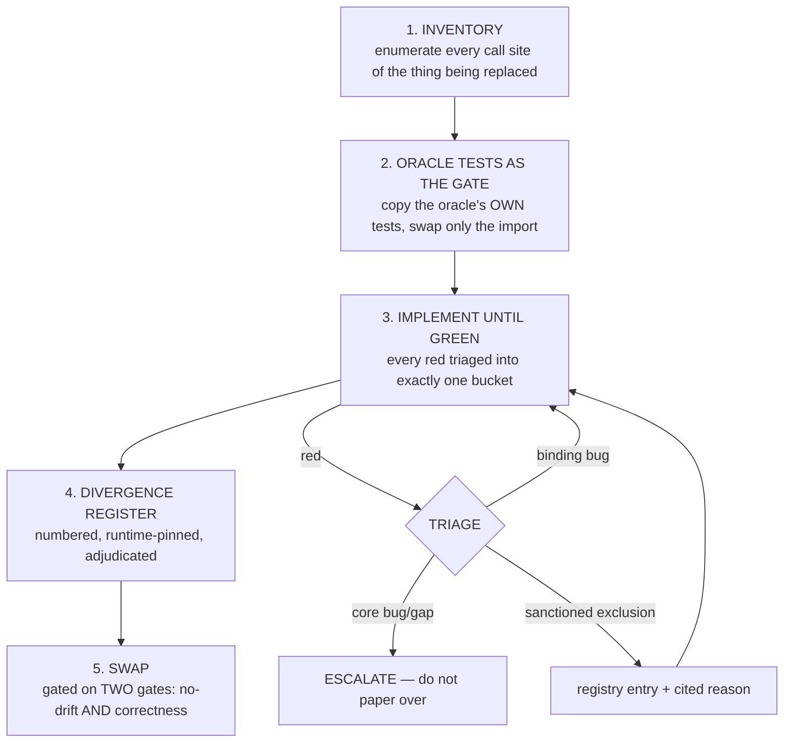
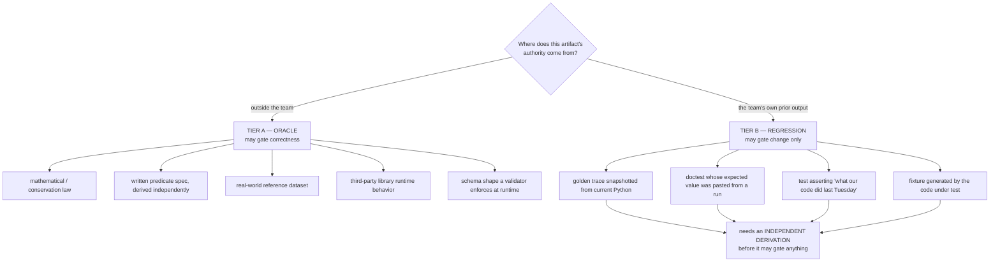
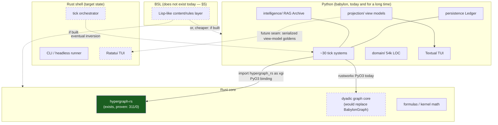
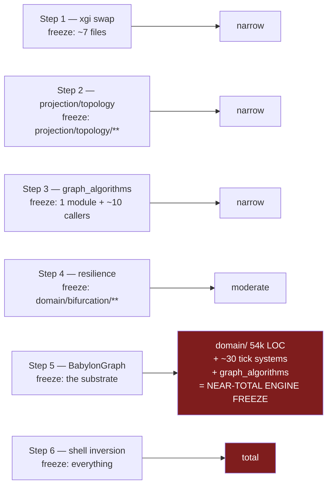

# Babylon → Rust Migration Doctrine

> **STATUS: PLANNING ONLY. NO CODE IS CHANGED BY THIS DOCUMENT.**
> The refactor described here belongs on the **babylon** branch/repo
> (`/home/user/projects/game/babylon`), *not* in `hypergraph-rs`. This file lives in
> `hypergraph-rs/plans/` because that is where the proven precedent (Phase 7) and its
> artifacts live; it is a doctrine document, not an execution plan. Nothing here is
> scheduled, approved, or authorized to run.
>
> **Everything in §3.3 (C1–C11) and every step in §6 is a PROPOSAL. None is approved.
> Each requires separate authorization on the babylon side before any file is touched.**
> Where this document uses imperative voice ("write", "swap", "drop"), read it as
> "*would*, if authorized" — the imperative is shorthand for the shape of the work item,
> never a licence to start it.
>
> **Diataxis quadrant:** Explanation (why / architecture). Not a tutorial, not a how-to.
> **Audience:** the owner and whoever plans the babylon-side port.
> **Date:** 2026-07-22. **Revision 2** (adversarial review applied; see §9 changelog).
> **Evidence:** four read-only scout passes over babylon + this repo's own
> `plans/EXECUTION-STATE.md` and `tests/EXCLUSIONS.md`, plus a verification pass over
> babylon and hypergraph-rs on disk conducted for revision 2.

**Marking discipline used throughout:**
`[VERIFIED]` — checked against a file on disk with a citation, in this pass or a prior one.
`[UNVERIFIED]` — asserted, plausible, and **not** checked. Do not act on it.
`[WITHDRAWN]` — a claim revision 1 made that revision 2 retracts, with the reason.

---

## 0. The directive this document serves

> **"Use the Python as the API shape … base it on the Python tests."** — owner

Restated as doctrine, and reconciled with the project's own written policy
(user CLAUDE.md, *Tests as Behavioral Contracts*, added 2026-07-09):

1. **The Python implementation is the API shape.** A Rust reimplementation does not get
   to redesign the surface. It reproduces the surface, then earns the right to change it
   later, one deliberate deprecation at a time.
2. **The proof is an oracle whose authority comes from outside the porter.** Phase 7's
   oracle was xgi — a third party. Babylon's own test suite is *not* that, and §2.2 now
   confronts what that changes. The directive survives; the naive reading of it does not.
3. **Every divergence is declared, numbered, and pinned against RUNTIME behavior**, never
   against a docstring, comment, or spec paragraph. Documentation lies; the running
   oracle does not.

The rewrite test, verbatim from the project's own doctrine: *"if we rewrote this system in
another language, what would let us prove the rewrite correct? THOSE artifacts are the real
spec."* This document is an audit of whether babylon currently owns those artifacts, and a
sequence for building the ones it does not.

---

## 1. Verdict

**Headline: babylon's test estate is unusually strong for its age and size — but as of
2026-07-22 it is INSUFFICIENT to gate any port step, because every step in §6 is gated on a
contract (C1–C11) that does not yet exist. The estate is strong enough that building those
contracts is weeks of work rather than years. That, not "we can start", is the real
headline.**

Formal verdict, stated in two parts so a skimmer cannot take away the wrong one:

- **Today: insufficient.** No port step's gating contract exists. §3.3 says this directly —
  each C-item is "a red-phase test that does not yet exist."
- **After C1–C11 are built and green against the *Python*: sufficient-with-gaps**, and only
  conditional on the port order in §6.
- **For a big-bang whole-engine rewrite: insufficient, permanently**, on today's artifacts
  and on any realistically foreseeable set of them.

A second, deeper qualifier that revision 2 adds and §2.2 develops: even a complete C1–C11
does not make babylon's own tests an *oracle* in the Phase 7 sense. They make it possible to
detect **change**. Detecting **error** needs a source of truth outside the team, and only
some of babylon's artifacts have one.

### Why "strong"

Babylon already did the hard part that most projects never do — it wrote down what a
reimplementation must reproduce, at the byte level, on purpose:

- `docs/reference/determinism-contract.rst` (783 lines) is explicitly framed as *"the
  rewrite test of Constitution III.12"* and states plainly that it exists *"so that a
  reimplementation of the engine in another language could reproduce these hashes without
  reading the Python."* `[VERIFIED]` It is more careful than revision 1 credited: it
  documents **two different, deliberately inconsistent hash paths** and warns they are
  *"not interchangeable"* (`determinism-contract.rst:58-64`):

  | Hash | Serializer | Key order | Digest | Cite |
  |---|---|---|---|---|
  | `defines_hash` | Pydantic v2 `model_dump_json(indent=None)` (pydantic-core's Rust serializer), **not** stdlib json | field **declaration** order, recursively; Pydantic does *not* sort | SHA-256 **truncated to first 16 hex** | `determinism-contract.rst:78-128`; `tools/regression_test.py:131-141` |
  | III.7 tick hash (`compute_determinism_hash`) | stdlib `json.dumps(..., sort_keys=True, separators=(",",":"), default=str)` | **alphabetical**, recursively — the opposite convention | SHA-256, **full 64 hex** | `determinism-contract.rst:247-300`; `src/babylon/persistence/conservation_audit.py:70-111` |

  > `[WITHDRAWN]` Revision 1's §1 said the contract "specifies canonical serializer (Pydantic
  > v2 `model_dump_json`, **not** stdlib json), key ordering (field *declaration* order …)".
  > That conflated the two paths into one and would have led a porter to sort the wrong hash
  > the wrong way. Both statements are true of `defines_hash` and both are **false** of the
  > tick hash. The contract document itself is not at fault; revision 1's summary of it was.

  The contract also honestly warns that transcendentals are not bit-reproducible cross-libm,
  so byte-identical hashing is an *intra-implementation* claim. That caveat is exactly right
  and is the single most valuable sentence in babylon's documentation.
- `tests/baselines/dense/*.csv` — 7 files `[VERIFIED]`, per-tick, per-entity, per-edge golden
  traces compared **byte-identically** by `mise run qa:regression`
  (`.mise.toml:944-946` → `tools/regression_test.py compare`). This is the strongest
  *regression* tier babylon owns. It is not a correctness tier — see §2.5.
- `tests/baselines/*.json` — 10 files `[VERIFIED]`, of which **9** are sampled scenario
  checkpoints and one (`mutation_baseline.json`) is the mutmut baseline. Tolerance `1e-5`
  per field (`tools/regression_test.py:61`), and the determinism contract explicitly names
  this as *the regime a reimplementation should target for cross-language validation*.
  (Revision 1 said "10 checkpoints"; it is 9 plus a mutation baseline.)
- A three-tier float tolerance policy **with written derivations**
  (`determinism-contract.rst:447-503`), including a size-scaled property-test bound
  `max(1e-10, 1e-11*N)` with a named O(N) summation-error growth model.
- 54 files using Hypothesis; `tests/property/invariants/` (18 files) and
  `tests/property/dialectics/` (6 files) encode conservation laws (c+v+s, INV-001/Spec-053,
  backed by a *written predicate spec* at
  `specs/053-conservation-invariants/contracts/value_conservation.md`) and algebraic laws
  (composition, Galois, cylinder, value-form invariance). **These are the estate's genuinely
  external contracts** — see the Tier A/B split in §2.2.
- `tests/property/strategies/` (11 files) are reusable input-domain definitions — they
  port to `proptest`/`quickcheck` almost mechanically and are themselves a spec of what
  a valid input *is*.
- Architectural seams are **mechanically enforced**, not merely documented: `import-linter`
  runs 9 forbidden-import contracts (`pyproject.toml:602-682`) `[VERIFIED]`, including
  *"tui client reads projections only — no engine, persistence, or legacy web stack"*
  and *"projection (the Hoist, Program 24) must not import the engine"*. Babylon already
  has the enforcement idiom this doctrine repeatedly asks for; see R1 in §7.1.
- A family of **sentinels** that prove their own gate reds — `check:gate-coverage`
  ("`qa:regression` estate declaration is complete over all 30 engine systems"),
  `check:gate-coverage-truth` (dynamic probe: every declared `SystemEvidence` actually
  occurs in its scenario), `check:tutorial-coverage`, `check:liveness`
  (`.mise.toml:238-256` → `tools/sentinel_check.py`) `[VERIFIED]`. This is the pattern R1
  and R2 want copied to every new port gate.

### What revision 1 claimed here and revision 2 withdraws

> `[WITHDRAWN]` **"Roughly 93% of the suite is behavioral."**
>
> That figure was an inference from a negative, **file-level** metric: it counted test files
> that do *not* import mock. Not importing mock does not make a test behavioral. Tests that
> assert on private attributes, internal dict shapes, ABC scaffolding, exception message
> strings, or call ordering are equally implementation-bound and would not survive a rewrite,
> and none of them import mock. The metric is also file-granular, not test-granular: one
> mocked test in a 40-test file taints the whole file in the numerator and, symmetrically, 39
> implementation-bound tests in a mock-free file are counted as "behavioral" for free.
>
> **The defensible statement, remeasured 2026-07-22** `[VERIFIED]`: of **1198**
> `tests/**/test_*.py` files, **102 (≈8.5%)** import `unittest.mock` / `mocker` /
> `MagicMock` / `patch(`, and **22 (≈1.8%)** assert `assert_called*`. So: **at most ~8.5% of
> test FILES are provably mock-coupled. The behavioral fraction of the remaining ~91.5% has
> never been measured, and file-level counting overstates it in both directions.**
> Producing an actual number is work item **C8**. Until C8 exists, §1's verdict must not
> lean on any behavioral percentage, and neither may any argument for skipping C1–C11.

### Why "with gaps" — and where

| # | Gap | Blocks |
|---|---|---|
| G1 | **No xgi behavioral-pin test inside babylon.** The 7 `import xgi` call sites have no local spike test analogous to `tests/unit/engine/test_rustworkx_spike.py`. The XGI-0.10-specific `idx=` (not `id=`) kwarg exists only as a code comment at `src/babylon/engine/systems/community.py:92`. `memberships()` set-vs-frozenset return type and `incidence_matrix(...)` rowdict orientation **and ordering** are unpinned locally. | The hypergraph swap (§6 step 1) |
| G2 | **Seeded-RNG cross-language reproducibility is undefined.** `compute_purge_resilience(seed=...)` (`src/babylon/domain/bifurcation/resilience.py`) and `anisotropic_observation_error(rng_seed=...)` (`src/babylon/domain/bifurcation/consciousness.py:176`) both use Python's `random.Random` (MT19937). No written derivation or tolerance policy exists for what a Rust PRNG is allowed to do differently. This directly violates the project's own stated policy that cross-implementation checks need *an explicit tolerance policy with a written derivation*. | Bifurcation/resilience port (§6 step 3) |
| G3 | **The determinism hash's *inputs* are unverified as reproducible.** `compute_determinism_hash()` (`src/babylon/persistence/conservation_audit.py:70-111`) is a portable *function*. But the floats it hashes come from Python arithmetic that includes transcendentals, and its rows arrive via `_to_jsonable()` → `model_dump(mode="json")` (`conservation_audit.py:112-118`) `[VERIFIED]` — i.e. through Pydantic, not through anything a Rust port controls. The hash function ports; the values may not. Nobody has checked. | Anything that must reproduce a tick hash (§6 steps 4+) |
| G4 | **`classify_topology` thresholds are inline constants.** `src/babylon/domain/organizations/topology.py` (density > 0.6, hub degree >= n-1) has no externalized golden fixture file mapping graph shape → classification. The decision tree *is* the only spec. | Organizations/topology port |
| G5 | **The BSL does not exist.** Zero repo-wide hits for `BSL`, `Lisp-like`, `Babylon Scripting Language`, `s-expression`, `sexpr` across code, docs, specs, ADRs, and `ai/_inbox/`. See §5. | Any plan that assumes a scripting layer to port |
| **G6** | **Pydantic v2 is an unowned cross-language contract.** `[VERIFIED]` babylon's `src/` contains **517** `frozen=True`, **177** `extra="forbid"`, **104** `@model_validator`, **30** `@field_validator` sites. Pydantic is the serializer of record for `defines_hash`, the reducer feeding the tick hash, the parser of all 15 `tests/fixtures/**.json`, and the runtime shape-checker behind the §3.1 `IncidenceMatrix`/`AdjacencyMatrix` "strong contract". Nothing in revision 1 owned reproducing it. | **Every step that crosses a serialization or validation boundary — 2, 3, 6, 7, and fixture parsing in all of them.** New work item **C7**. |

### Scale, stated honestly

`src/` is 199,531 LOC across ~2275 Python files; `tests/` is 325,443 LOC. Subsystems:
`domain/` 54,361 · `engine/` 37,039 · `projection/` 14,878 · `models/` 13,908 ·
`persistence/` 12,774 · `tui/` 7,350 · `ooda/` 6,038 · `intelligence/` 5,428 ·
`formulas/` 4,008 · `game/` 3,796 · `topology/` 2,068 · `kernel/` 2,527.

This is not a port. It is a decade of ports, or a decade's worth of *not* porting most of
it. The doctrine's main job is to say which 5% moves and which 95% stays.

---

## 2. The method — Phase 7, and where it does not generalize

hypergraph-rs Phase 7 is the proof that this works at small scale. Result, owner-verified
from scratch (`maturin develop` + `pytest tests/ported`):
**311 passed / 83 skipped / 0 failed** against the live xgi 0.10.2 oracle, plus 470 Rust
tests, fmt/clippy/doc all zero (`plans/EXECUTION-STATE.md`, UPDATE 6).

The pattern, stated so it can be reapplied to any subsystem:

### 2.1 Inventory the call sites first

Phase 7 knew, before writing a line, that the swap was exactly 7 files and that the
*actual* used surface was ~8 methods: `Hypergraph()`, `add_node`,
`add_edge(members, idx=..., **attrs)`, `.nodes` (contains/iterate/`memberships()`),
`.edges` (contains/iterate/`members()`/`[id]` attrs), `num_edges`, and
`incidence_matrix(H, sparse=False, index=True)` (`plans/EXECUTION-STATE.md`, "Babylon as
it actually exists on dev"). Reconfirmed on disk in this pass `[VERIFIED]` at
`graph_wrappers.py:94,118,119,137,151-152,157`; `systems/community.py:74,82,93,130-131,157,163,173,197`;
`bifurcation/consciousness.py:89`; `bifurcation/bridges.py:114`.
**The inventory is what makes a scary port small.** Do it first, every time,
and write it down as a table with file:line.

### 2.2 The oracle's tests are the gate — and babylon does not have an oracle

Phase 7's gate, verbatim from the spec: *"XGI's test files pass against the Rust port with
`import hypergraph_rs as xgi` — the only change."* 51 oracle test files copied into
`tests/ported/`, import swapped, nothing else touched.

This is the whole trick, and it is why it worked. Tests you write while porting encode
*your understanding of the source*, which is precisely the thing under suspicion. The
oracle's tests encode **someone else's** understanding. Porting them is the only way to
import knowledge you do not have.

#### The asymmetry — read this before believing anything else in this document

> Revision 1 generalized this as: *"babylon's Python tests are the oracle tests."*
> **That is false in the sense the method requires, and the inversion is not a detail —
> it is the difference between the method working and the method laundering an assumption.**

Phase 7's oracle was **xgi: an independent third party**. Its tests were written by people
who did not know the porter existed, against an understanding the porter demonstrably did
not have. That is *why* copying them imports knowledge — and D1 (§2.4) is the receipt: the
porter's own belief about empty edges was wrong, and only a test written by strangers could
have said so.

Babylon's pytest suite was written by the same team that would write the Rust port. It
encodes **babylon's own understanding of babylon** — which is exactly what point 3 of §0
declares to be under suspicion. A Rust subsystem that passes babylon's own tests has proven
**self-consistency with a prior belief**, not correctness. If the belief was wrong, the port
faithfully reproduces the error, the suite goes green, and the defect is now enshrined in
two languages instead of one. This is R1 (§7.1) with a wider blast radius.

**So: what actually transfers?** Split babylon's estate in two. The dividing question is
*"where does this artifact's authority come from?"*

**The triage rule, stated so it can be applied mechanically to a file you are holding:**

> For each test or fixture, ask: **"If our implementation had always been wrong in this
> respect, would this artifact still be green?"**
>
> - **If NO** — something outside the implementation would have contradicted it — it is
>   **Tier A**. It may gate correctness. Port it.
> - **If YES** — it would have happily recorded the wrong answer — it is **Tier B**. It may
>   gate *no-drift*, and nothing else. It cannot certify a Rust port as correct, and
>   byte-freezing it into the Rust gate imports the team's blind spots into the port.

Three sharpening cases, because the rule is easy to apply too generously:

- A property test is Tier A **only if the property is externally true**. `sum(c+v+s)` is
  conserved because value conservation is a law with a written predicate spec
  (`specs/053-conservation-invariants/contracts/value_conservation.md`) — Tier A. A property
  test asserting "the output dict is key-sorted" is a *design decision the team made* —
  Tier B, and a good one, but it certifies nothing about economics.
- A doctest is Tier A only if the expected value was **derived**, not **observed**. §6 step 3
  cites `4-cycle → (1,1)` (Betti numbers of a cycle — derivable from topology, Tier A) and
  `K5 at removal_rate 0.2 seed 42 → 0.8` (an observed trajectory of one PRNG — Tier B, and
  it is Tier B *twice over* because the seed pins MT19937 as well).
- A runtime-enforced schema (`@model_validator` shape/symmetry checks) is Tier A about
  *shape* — the validator would have rejected a wrong shape all along — and Tier B about
  *values*.

**What this changes about §6.** Step 1 (the xgi swap) is the **only** step in the sequence
that has a true external oracle: xgi 0.10.2 is a running third party, and hypergraph-rs's
311 ported xgi tests are Tier A by construction. That — not "it is small" — is the real
reason step 1 is safe and steps 3–7 are not. Every other step must **construct** its Tier A
artifact before it can be gated, which is what C1–C11 are for and why §1's verdict is
"insufficient today."

**What this does not change.** The directive stands: use the Python as the API shape, and
run babylon's existing test files unmodified through the binding. Doing so is still the
cheapest, highest-yield no-drift gate available, and Tier B artifacts are genuinely
load-bearing for the thing they can do. The correction is to stop calling that *proof*.

### 2.3 Triage every red into exactly one bucket

From `tests/EXCLUSIONS.md` (verbatim buckets):

1. **BINDING BUG** — core is right, the FFI layer mistranslates (wrong ID type,
   set-vs-list, missing kwarg, wrong exception class). *"This is the default assumption;
   ~all reds should land here."* Fix the binding.
2. **CORE BUG / GAP** — the core computes a wrong value or lacks a method.
   *"STOP. Do not paper over it in the binding."* Escalate. Adding core methods is not
   pre-approved.
3. **DOCUMENTED EXCLUSION** — only with one of a fixed, enumerated set of reasons.
   *"Never exclude to dodge a fixable binding bug."*

The bucket-3 discipline is what makes 83 skips trustworthy instead of alarming. Every
skip in `tests/conftest_exclusions.py` carries a cited reason — deferred symbol, pandas
integration, network access, matplotlib pixel compare, RNG/float trajectory. `[VERIFIED]`
the registry holds **13 whole-file exclusions** and **78 named test exclusions across 21
files**. Some entries are multi-sentence forensic notes (see the
`algorithms/test_properties.py::test_equal` entry, which explains that `_net_attr` returns a
snapshot PyDict rather than a live reference, verifies which assertions *do* pass, and
classifies it as a deferred binding limitation rather than a core gap). **An exclusion
registry with enforced reason codes is the difference between "we skipped some" and a
contract.**

**A corollary revision 1 missed:** an exclusion registry is *also* a map of where the oracle
gate is blind. A green 311/0 says nothing about the 13 excluded files. Reading the registry
against the consumer's actual surface is therefore a required pre-step, not a courtesy —
see **C9** (§3.3) and §6 step 1.

### 2.4 The divergence register, pinned against runtime

D1–D17 (in `plans/reconciliation-plan.md` §2, "Rulings ledger") is the durable record.
Its defining property, from `plans/EXECUTION-STATE.md`: *"pinned against the XGI
**runtime**, never docstrings."*

D1 is the canonical illustration: babylon's/main's core rejected empty edges because that
is what the documentation implies; the XGI *runtime* happily creates them. The register
ruled `adopt-lineage-core`, empty edges became first-class, and `EdgeError::EmptyMembers`
was deleted. A docstring-pinned port would have shipped the wrong semantics and been
"correct" by its own tests.

Register entry shape (adopt this format):

| field | meaning |
|---|---|
| ID | `D<n>`, permanent, never reused |
| ruling | adopt-oracle / keep-ours / owner-override, with date |
| rationale | what the **runtime** does, and how it was observed |
| citation | `file:line` in both implementations |

The closeout ceremony matters too: Phase 7's review **parked** three advisories rather
than silently fixing or silently dropping them — including one that a plan's *stated
rationale* referenced a nonexistent error variant (plan-text drift, no code impact). Park
list ≠ ignore list.

**Unresolved: whose register, and where.** The D-series numbers 1–17 are consumed inside
hypergraph-rs. A babylon-side port needs its own register, and nothing currently says
whether it forks the D-series, continues it, or starts a new prefix — nor who owns it. See
**OD-10**.

### 2.5 The swap needs TWO gates, not one

Phase 7 defined swap acceptance up front: babylon `mise run qa:regression`
**byte-identical** plus `nix build .#babylon` green. Not "tests pass" — *the same bytes*.

Revision 1 then adopted that as the universal acceptance criterion (OD-6) while §7.1 R1
simultaneously warned that freezing current-but-wrong output "freezes the defect as the
contract." **Those are the same act, and revision 1 left the reader holding two mutually
exclusive rules.** Revision 2 resolves it:

> **Byte-identity to today's Python output is a NECESSARY and STRONG no-drift gate. It is
> DEFINITIONALLY INCAPABLE of proving correctness.** It answers "did I change anything?"
> perfectly and answers "is it right?" not at all. Adopting it as the *sole* gate
> institutionalizes exactly the failure R1 describes, at engine scale.

Therefore every port step carries **two** gates, and passing one is not passing:

| Gate | Question it answers | Instrument | Tier (per §2.2) |
|---|---|---|---|
| **Gate 1 — no-drift** | "Did this change anything I did not intend?" | `mise run qa:regression` byte-identical + `nix build .#babylon` green + the step's existing pytest files passing unmodified through the binding | Tier B |
| **Gate 2 — correctness** | "Is the frozen answer the *right* answer?" | at least one of: a **law** (property/invariant test whose truth is external), a **hand-derived expected value** with the derivation written down, or a **real-world dataset** the output is checked against | Tier A |

A step with no Gate 2 artifact is not ready to start. Gate 2 is per-step and named in the
§6 table; if a step's Gate 2 column is empty, that is the finding, not an oversight.

**The provenance problem, stated plainly as a standing finding.** `[VERIFIED]` The 7 dense
traces and 9 checkpoint JSONs in `tests/baselines/` were generated from current Python, and
`tests/baselines/PROVENANCE.md` **does not exist** — there is no record of when any baseline
was generated, from which commit, or whether anyone ever audited a sample against
first-principles reasoning about what the values *should* be. Revision 1 asked readers to
"extend that scepticism" to the dense traces; it never found that the scepticism had ever
been applied. It has not been. Every baseline in `tests/baselines/` is currently
**provenance-unknown** and must be audited before it is cited as a port contract. That audit
is work item **C6**.

**And a note on why this must be mandatory rather than advised.** The Phase R session is the
proof: the "eyeball the golden before freezing it" step was *discretionary*, and it was
skipped, and a collapsed render was frozen as the contract. A discretionary correctness check
is a check that gets skipped precisely when schedule pressure makes it matter. Gate 2 and C6
are mandatory or they are decorative.

---

## 3. The contract inventory

### 3.1 Strong — these ARE the spec, use them as-is

Tier column per §2.2: **A** = external authority, may gate correctness; **B** = self-referential,
gates change only.

| Artifact | Location | Tier | Why it survives a rewrite |
|---|---|---|---|
| Determinism Contract | `docs/reference/determinism-contract.rst` (783 lines) | A (spec) | Byte-level serialization/hash spec for **two distinct hash paths** (§1) + 3-tier float tolerance policy with derivations + a "What Stays Valid Under Rewrite" classification table. Written *for* this purpose. |
| Dense golden traces | `tests/baselines/dense/*.csv` (7 files) | **B** | Every tick, every entity wealth/tension, every edge value_flow/tension. Byte-identical comparison. Strongest no-drift instrument babylon owns; proves nothing about correctness until C6 audits it. |
| Sampled checkpoints | `tests/baselines/*.json` (9 checkpoints + 1 mutation baseline) | **B** | Tolerance-bounded (1e-5); the contract doc names this as the cross-language target regime. Same C6 caveat. |
| Vault page manifests | `tests/baselines/vault/*/manifest.json` | **B** | Per-page SHA manifest of rendered markdown, keyed by head_sha. |
| Property/invariant laws | `tests/property/invariants/` (18), `tests/property/dialectics/` (6) | **A** where the law is external | Conservation + algebraic laws; several backed by written predicate specs. Language-agnostic by construction. The estate's primary Tier A holding. |
| Hypothesis strategies | `tests/property/strategies/` (11 files) | A (domain spec) | Definitions of the valid input domain — portable to proptest. |
| Scenario suites | `tests/scenarios/` (4 files) | B | Multi-tick emergent behavior, real factories, zero mocks. `[VERIFIED]` depth is bounded: the largest tick budget anywhere in `tests/` is `max_ticks=100`, with 52 for the checkpoint runs. |
| rustworkx spike pins | `tests/unit/engine/test_rustworkx_spike.py` | **A** (pins a third-party runtime) | Pins substrate quirks the design *depends on*: add_edge replaces-not-merges, node indices reused after removal, subgraph/copy share payload dicts. The template G1 should copy. |
| Centrality determinism | `tests/unit/topology/test_graph_algorithms_determinism.py` | B (design decision, well made) | Pins that centrality dicts are key-sorted so ordering is *a property of the data, not of rustworkx internals*. |
| Pydantic self-validating models | `src/babylon/projection/topology/incidence.py` (`IncidenceMatrix`/`AdjacencyMatrix` with `@model_validator` shape/symmetry checks) | A about **shape**, B about **values** | A schema contract that checks itself at runtime. Strongest tier in the projection layer — *and* wholly dependent on reproducing Pydantic v2 semantics (G6/C7). |
| Trap-condition grammar | `src/babylon/domain/doctrine/mechanics.py:1-258` | A (closed grammar, enumerable) | Closed grammar with its own BNF in the docstring, string→bool, no `eval()`, 202 lines of tests. Trivially provable via golden string→bool pairs. |
| System ordering | `src/babylon/engine/simulation_engine.py:324,368` | A (self-checking) | ~30 systems, total order derived from a `position` ClassVar with a duplicate-position `RuntimeError` guard. An enumerable spec that self-checks. |
| `sim_datetime(tick)` | `src/babylon/kernel/sim_clock.py:30` | A (pure, derivable) | Pure int→datetime, doctested, 2010 epoch, 52 weeks/year. Ports in an afternoon. |
| Import-linter contracts | `pyproject.toml:602-682` (9 contracts) | A (mechanically enforced) | Layering laws the code cannot violate without a red gate. The template for every "ban" this doctrine proposes. |
| Sentinel family | `.mise.toml:238-256` → `tools/sentinel_check.py` | A (proves its own gate reds) | `gate-coverage`, `gate-coverage-truth`, `tutorial-coverage`, `liveness`. R2's pattern, already in production. |

### 3.2 Weak — scaffolding, dies with the code

- The ~102 mock/mocker files and ~22 `assert_called*` files. Legitimate scaffolding; not
  portable. Do not let load-bearing knowledge live only there.
- `tests/property/harness/system_call_spy.py`, `org_action_spy.py` — call spies. They are
  *infrastructure for* strong tests, not contracts themselves.
- `SystemBase._read` / `_write_clamped` / `_publish` (`src/babylon/kernel/system_base.py`)
  — Python-ABC-shaped DI scaffolding, not behavior.
- `FormulaRegistry` (`src/babylon/engine/formula_registry.py`) — a `dict[str, Callable]`
  DI mechanism. Rust would just call the functions. The *28 formula functions* have
  contract value; the registry pattern does not.
- The SQLite-vs-Postgres backend split — an implementation detail behind
  `DatabaseProtocol`. A port must not reproduce it byte-for-byte.
- Textual-specific TUI widget code — dies with the rewrite by the project's own framing.
  `src/babylon/projection/` one layer down is the durable seam.
- **And, newly named:** any test whose green-ness survives the implementation having always
  been wrong (§2.2's Tier B test). Being mock-free does not exempt a test from this list.

### 3.3 Gaps that must be BUILT before the corresponding subsystem moves

These are **proposed** work items, not observations, and none is approved (see the status
banner). Each is a red-phase test or written artifact that does not yet exist.

- **C1 — xgi spike test** (unblocks §6 step 1, and only after C9). Write
  `tests/unit/engine/test_xgi_spike.py` in babylon, modeled *exactly* on
  `test_rustworkx_spike.py`, pinning against the live xgi 0.10.2 runtime: `idx=` vs `id=`
  kwarg behavior, `memberships()` return type and ordering, `edges.members()` return type,
  `H.edges[id]` attr dict identity/liveness, `num_edges` after empty-edge creation, and
  `incidence_matrix(H, sparse=False, index=True)` **rowdict/coldict orientation, ORDERING,
  and id-type identity** (str vs int — babylon calls `add_edge(..., idx=comm_type.value)`,
  `community.py:93-95`). **Run it against real xgi first and let it pass** — it is a pin,
  not a wish. This is a Tier A artifact by construction: xgi is a third party.
  - **Extension revision 2 adds — the ordering hazard, with its receipt.** hypergraph-rs's
    binding builds the incidence index dict as `{index: original_python_id}` **"in core
    order"** (`crates/hypergraph-rs-python/src/linalg.rs:28-37`) `[VERIFIED]` — i.e. row
    order is a property of the *Rust core's* id ordering, not of xgi's insertion order.
    Babylon's `community_overlap_matrix()` (`src/babylon/engine/systems/community.py:182-207`)
    `[VERIFIED]` inverts that rowdict into `node_index: dict[str,int]` and returns
    `overlap = I @ I.T` **keyed by it**. A permuted core order silently permutes the overlap
    matrix and its index map together — internally consistent, externally different. The
    311 green tests do not cover this, because xgi's own tests have no reason to pin
    *cross-implementation* id ordering.
  - Also: an **order-dependence audit of all 7 call sites** — which of them iterate
    `H.nodes` / `H.edges` / `memberships()` in a way that reaches the determinism hash.
- **C2 — RNG portability ruling** (unblocks §6 step 3). Either (a) reimplement MT19937 in
  Rust to match `random.Random` byte-for-byte for the specific operations used
  (`shuffle`, `gauss`), or (b) write the tolerance policy with derivation: what
  distributional equivalence is asserted, at what sample size, with what statistical test
  and what false-failure rate. Option (b) is cheaper and is what the project's own policy
  demands. This is a *document*, plus property tests that encode it.
- **C3 — float reproducibility audit** (unblocks §6 step 4+). For each field entering
  `compute_determinism_hash()`, trace whether its computation touches a libm
  transcendental. Produce a table: field → reproducible (basic IEEE-754 ops only) /
  not-reproducible (transcendental in the chain). This determines whether the tick hash is
  a cross-language contract or only an intra-language one. **Until this exists, do not
  claim the determinism hash proves a Rust port correct.**
  - **Extension revision 2 adds — the rounding-site inventory.** Python's `round()` is
    banker's rounding (half-to-even); Rust's `f64::round()` is half-away-from-zero. In an
    economics engine that rounds wealth, rent, and faction balances repeatedly, this
    diverges *silently* and diverges *more* the longer the run. The sites are finite and
    enumerable: `[VERIFIED]` **71** `round(` call sites in `src/`, plus **129**
    `Decimal`/`quantize`/`ROUND_HALF` hits. Examples with visible round-trip risk:
    `domain/institution/balance.py:86-89` (`round(..., 6)` on four faction axes, every
    tick), `ooda/state_ai/faction_dynamics.py:237-239,510-512` (same pattern),
    `data/game/balkanization/compute_seed_influences.py:215-261` (`round(..., 4)` and
    `int(round(x*40))` — the `int(round())` composition is where half-to-even bites
    hardest). Producing this inventory as a table is cheap, mechanical, Sonnet-tier work and
    belongs inside C3.
  - **Extension — summation order.** The contract's `1e-11*N` bound assumes an O(N)
    summation-error growth model. Rust iterator sums, SIMD auto-vectorization, and any
    `rayon` parallel fold may **reassociate** the additions and break that model. C3 must
    state that *summation order is itself part of the contract* and name where it is pinned.
- **C4 — topology classification goldens** (unblocks organizations port). Externalize
  graph-shape → STAR/HIERARCHY/MESH/CELL pairs as a fixture file, including the boundary
  cases at density exactly 0.6 and degree exactly n-1. **Tier A only if the expected
  classifications are derived from the written decision rule rather than observed from a
  run** — otherwise this is C6 material.
- **C5 — read the unread conformance oracle.** `tests/unit/engine/test_graph_conformance.py`
  (735 lines) and `test_graph_iteration_order.py` (246 lines) were confirmed to exist but
  not read line-by-line. They are almost certainly the primary BabylonGraph contract.
  **Read them in full before writing any port acceptance criteria — including any estimate.**
  Similarly `src/babylon/engine/headless_runner/bridge.py` (1029 lines) — the likeliest
  host/engine orchestration seam — is unread.
- **C6 — golden provenance record** (gates §2.5's Gate 1 for *every* step). A required file,
  `tests/baselines/PROVENANCE.md`, with one row per baseline recording: (i) generation date,
  (ii) generating commit SHA, (iii) the name of whoever audited a sample against
  first-principles reasoning about what the values *should* be, (iv) the date of that audit,
  (v) a link to the written reasoning. `[VERIFIED]` the file does not exist today, and all 7
  dense traces + 9 checkpoint JSONs + the vault manifests are provenance-unknown.
  **A step whose baselines have no dated provenance row cannot pass Gate 1.** This is R1's
  missing mechanical enforcement (§7.1).
- **C7 — Pydantic v2 serialization/validation conformance spec** (gates every step crossing
  a serialization or validation boundary: 2, 3, 6, 7, and fixture parsing in all of them).
  Closes G6. Deliverable, in two parts:
  1. **A written byte-layout spec derived from the live Pydantic runtime**, not from docs
     (per §0 point 3 — documentation lies). It must pin, at minimum:
     - field **declaration-order** key emission (and where it does *not* apply — the tick
       hash sorts alphabetically instead; §1);
     - Pydantic's float repr vs stdlib `repr()` and vs Rust's `{}`;
     - `None`-omission vs `None`-inclusion rules (`exclude_none`, `exclude_unset`,
       `exclude_defaults`) per model as actually configured;
     - `datetime` and `Decimal` serialization forms under `mode="json"`;
     - `extra="forbid"` rejection behavior and the exact exception raised (177 sites);
     - `@model_validator` execution order relative to `@field_validator` and to coercion
       (104 + 30 sites);
     - `frozen=True` semantics — mutation rejection, hashability, and equality (517 sites);
     - **v2's coercion ladder**: `str`→`int`, lossy `float`→`int`, `bool` from strings,
       and what is rejected in strict vs lax mode. *Pydantic coercion is not Rust
       deserialization*, and serde's default behavior differs at nearly every rung.
  2. **A golden corpus of (Python model instance → exact JSON bytes) pairs** covering
     `None` fields, nested models, floats including `-0.0`/`inf`/`NaN`, datetimes, Decimals,
     enums, and the `frozen`/`extra="forbid"` rejection paths.

  Why this is first-class and not a footnote: `model_dump_json` — not stdlib `json` — is the
  canonical serializer for `defines_hash` (`determinism-contract.rst:92-95`), and
  `_to_jsonable()` funnels every tick-hash row through `model_dump(mode="json")`
  (`conservation_audit.py:112-118`) `[VERIFIED]`. **The determinism-hash input path and every
  JSON golden therefore inherit Pydantic's exact behavior**, whichever serializer writes the
  final bytes.
- **C8 — behavioral-fraction classification** (unblocks any argument that leans on suite
  quality). Sample ~50 non-mock test files stratified across `tests/unit/`,
  `tests/integration/`, and `tests/contract/`, and classify each test as behavioral vs
  implementation-bound using §2.2's triage question. Produce an actual number with a
  stated sampling method and confidence interval. Replaces the withdrawn 93%.
- **C9 — hypergraph-rs exclusion / deferred-symbol cross-check** (a required, cheap pre-step
  to C1 and §6 step 1). Build a table mapping each of the ~8 methods babylon actually uses to
  (a) every hypergraph-rs exclusion or deferred symbol touching it, (b) a used/unused verdict.
  This repo already contains evidence the check would find things `[VERIFIED]`:
  - `tests/conftest_exclusions.py:12` excludes **`convert/test_incidence.py` in its entirety**
    — *"to_incidence_matrix/from_incidence_matrix CONVERT dispatchers not ported"*. Babylon's
    only linear-algebra call is `xgi.incidence_matrix(...)`, which is a *different*, bound
    symbol — but the whole-file exclusion means the conformance gate has **zero** ported
    coverage of the incidence-conversion family, and nobody has written down that the
    distinction is safe.
  - `tests/conftest_exclusions.py:137-148` records a **core primitive gap**: `SC.remove_node`
    is deferred because *"no `memberships`/node-delete primitive exists, unlike
    `Hypergraph::remove_node`"*. Babylon calls `nodes.memberships()` on `Hypergraph`
    (`community.py:130-131`, `consciousness.py:89`, `graph_wrappers.py:151-152`), so the
    gap as written does not obviously bite — but "does not obviously bite" is the sentence
    that precedes every §7.1 R3 defect. Write the verdict down.
  - `crates/hypergraph-rs-python/src/linalg.rs:14-19` documents that the **core computes an
    unweighted (binary) incidence** and the `weight` callable is applied **binding-side**,
    once per nonzero entry, in CSR row-major order. Babylon passes no `weight`, so it takes
    the binary path — again, write the verdict down rather than inferring it twice.
  - `tests/DEFERRED_SYMBOLS.md` records **71 of 164 symbols not built** (93 bound). None of
    the ~8 babylon uses is on the deferred list, which is the *expected* answer and exactly
    why producing the table is cheap.
- **C10 — sample the numbered specs directories.** `[VERIFIED]` there are **95**
  `specs/NNN-*` directories (revision 1 said "~150" — `[WITHDRAWN]`, the count was
  overstated). At least one of them (`specs/053-conservation-invariants/contracts/`) contains
  a written predicate spec that is a genuine Tier A contract. Whether the other 94 contain
  golden data, contracts, or prose only **materially changes the contract inventory in
  §3.1**, and nobody has sampled them. Cheap, mechanical, Sonnet-tier. This belongs here as
  a work item, not only in the unverified list.
- **C11 — tick-system order-dependence audit** (unblocks §6 step 5 scoping). The Python-side
  insertion-order mirrors (`_ids`/`_index_to_id`, `_adj`/`_pred`) are named as the thing
  step 5 would remove. **No analysis exists of what actually consumes that ordering.**
  Enumerate, across the ~30 tick systems and `domain/`, every read whose *result* depends on
  graph iteration order, and mark which of those reach `compute_determinism_hash()` or a
  dense trace column. Without this, step 5's blast radius is unknown and OD-5 cannot be
  answered.

---

## 4. The architecture

### 4.1 Where things sit

### 4.2 What stays Python — the honest answer: almost all of it, for a long time

The `domain/` package alone is 54,361 LOC of economics, dialectics, doctrine, institution,
organizations, bifurcation, and geography logic. Moving it is not a port; it is a rewrite of
the game. It stays.

Three things make staying-Python cheap:

1. **The graph substrate is already Rust.** `BabylonGraph`
   (`src/babylon/topology/graph.py:555`) wraps `rustworkx.PyDiGraph`. The Amendment L /
   ADR052 migration already replaced a NetworkX adapter and *proved* the swap
   behavior-preserving by hand-maintaining insertion-ordered mirrors (`_ids`/`_index_to_id`,
   `_adj`/`_pred`) so the determinism hash stayed byte-identical. Babylon has already done
   one substrate swap under a behavioral contract. This doctrine is that, again, bigger.
2. **The tick loop is small and synchronous.** `SimulationEngine.run_tick()`
   (`src/babylon/engine/simulation_engine.py:164-211`) is a plain
   `for system in self._systems: system.step(graph, services, context)`. `step()`
   (`:495-603`) is documented by the project itself as *"Pure … Deterministic … Transparent."*
   The interface is one method: `step(graph: GraphProtocol, services: ServicesProtocol,
   context: ContextType) -> None` (`src/babylon/kernel/system_protocol.py:20-41`).
3. **The UI seam is clean, and it is *mechanically enforced*.** `[VERIFIED — this pass,
   upgrading revision 1's caveat]` Revision 1 flagged the clean-seam claim as unverified
   because it rested on one file's import block. It has now been audited across all **32**
   files in `src/babylon/tui/`: **zero** imports of `babylon.engine`, `babylon.topology`,
   `babylon.kernel`, `babylon.persistence`, or `babylon.domain` — and the ban is enforced by
   an import-linter contract, *"tui client reads projections only — no engine, persistence,
   or legacy web stack"* (`pyproject.toml:675-682`), so it cannot silently regress.
   - **But the seam is not closed, and revision 1 did not notice this.** `tui/` does import
     six things outside `projection/` `[VERIFIED]`: `babylon.models.enums.CommunityType`
     (`tui/directives.py:27`), `babylon.models.enums.events.EventType` and
     `babylon.models.event_severity.resolve_severity` (`tui/chronicle.py:63-64`,
     `tui/chronicle_salience.py:73-74`), and `babylon.render.tiers.TRUECOLOR_PALETTE` /
     `RoleToken` (`tui/theme.py:35`). A Ratatui port must therefore also reproduce those
     enum value spaces, `resolve_severity`'s classification, and the render-tier palette —
     they are part of the UI contract even though they are not projections. Add them to
     step 7's contract, not to its surprises.

### 4.3 What happens to hypergraph-rs's PyO3 bindings

**They stay, and they stay Python-calls-Rust, for the whole foreseeable program.**

Reasoning:

- The bindings are the *conformance gate itself*. The 311 ported xgi tests run through
  PyO3. Removing or inverting the binding removes the proof — and per §2.2, it is the only
  Tier A proof in the program today.
- Babylon already consumes this repo today as an opt-in uv dependency-group
  (`uv sync --group hypergraph` builds the wheel; `import hypergraph_rs` verified
  end-to-end, `plans/EXECUTION-STATE.md`). The plumbing works. Do not disturb it.
- Inversion (Rust hosts an embedded Python) is a *late* move that only pays off once the
  Rust shell owns the tick loop — §6 step 6 at the earliest, and plausibly never. See §7.6
  for what inversion actually costs, which revision 1 did not price.

So: **Python-calls-Rust now; a temporary bridge only at the moment the shell inverts; and
that moment is not scheduled.** Two constraints already recorded and still binding:
(a) if `hypergraph-rs/pyproject.toml` gains Python dependencies or moves
`requires-python`, babylon's CI metadata stub must mirror it or babylon's lock-check goes
red — loudly, by design; (b) do not rename the distribution (`hypergraph-rs`) or the module
without a paired babylon change. §7.7 costs the CI burden these imply.

### 4.4 One conflict the owner must resolve explicitly

Babylon's own written next-generation architecture document is
`docs/superpowers/specs/2026-07-22-mirror-typed-core-spec.md` — "The Mirror & the Typed
Core", which proposes porting the functional core (kernel/models/formulas/topology/
dialectics) to a **Haskell** algebra with GADTs and category-theoretic laws, explicitly
**TABLED post-v1.0** (*"nothing in this document schedules work before v1.0.0 ships except
§4"*). Its Python↔Haskell seam ships **as data** (`Material (NodeData k)` in, `TickReport`
+ deltas out) — a shadow-mode dual-engine, not a host/guest embedding.

A "Rust shell hosting a Lisp" is a different axis, and possibly a competing one. This is
not a technical objection; it is a request that the owner decide which of the two is the
program, out loud, rather than letting them quietly coexist in different documents. See
OD-1.

*Worth noting in passing:* the Typed Core's shadow-mode dual-engine design is, structurally,
a **Gate 2** instrument (§2.5) — two independent implementations disagreeing is external
evidence in a way one implementation's goldens can never be. That is an argument in its
favor that has nothing to do with Haskell.

---

## 5. The BSL

### 5.1 What exists today: not this

**A Lisp-like Babylon Scripting Language does not exist in babylon.** Repo-wide search for
`BSL`, `Lisp-like`, `Babylon Scripting Language`, `s-expression`, `sexpr` across code,
docs, specs, ADRs, and `ai/_inbox/`: **zero matches.** It is not implemented, not
specified, not proposed, and not listed as an aspiration in any planning document. It is
owner direction relayed out-of-band. This doctrine treats it as **new scope**, not as a
port of existing code.

What actually exists, and is real, shipped, tested code:

| Thing | Location | What it actually is |
|---|---|---|
| Doctrine trap-condition DSL | `src/babylon/domain/doctrine/mechanics.py:1-258` | A hand-written recursive-descent parser (`_Parser`, :78-158) over a closed grammar: `TAG OP INT` with `AND`/`OR`/`NOT`/parens over a fixed `DoctrineTag` enum. `evaluate_trap_condition(condition, tags) -> bool` (:161). **Never calls `eval()`** — hostile input can only raise `DoctrineExpressionError`. No variables, no arithmetic, no function calls, no user-defined anything. |
| Event precondition evaluator | `src/babylon/engine/event_evaluator.py` (470 lines) + `src/babylon/models/entities/event_template.py` (401 lines) | **Not a textual DSL.** Pydantic schemas (`NodeCondition`/`EdgeCondition`/`GraphCondition`) with `Literal` operator fields, evaluated by pure dispatch functions. `PreconditionSet.logic` is flat `"all"`/`"any"` only — no nested boolean tree. Graph metrics are a closed 6-name dispatch table (:301-310). |
| Effect application | `event_template.py:264-288` | `operation: Literal["increase","decrease","set","multiply"]`. A 4-op enum, not an expression tree. This is what CLAUDE.md's `modifiers.get(...).calculate(state)` example actually looks like in production. |
| Formulas | `src/babylon/formulas/`, `formula_registry.py` | Ordinary typed Python functions, name-swappable for tests/mods. The math is compiled-in, never data-defined. |
| The real "Paradox Pattern" | `src/babylon/data/defines.yaml` (1068 lines) → `src/babylon/config/defines/*.py` | Category-grouped, range-annotated, player-editable coefficients loaded into frozen Pydantic models. Documented at `docs/how-to/modding-defines.rst`. |

Two documentation drifts worth recording (not fixed here — read-only recon):

- **The Paradox Pattern is YAML, not TOML.** ADR007 (Dec 2024) says "JSON/TOML"; project
  CLAUDE.md says TOML; the shipped implementation is YAML end to end. The only `.toml`
  files in `src/` are a BEA sector mapping and an LLM model manifest — neither is game
  logic. `docs/how-to/modding-defines.rst:4-6` says so plainly: *"in YAML rather than
  INI."*
- **The legacy XML corpus described in project CLAUDE.md §6 does not exist.** No
  `babylon/data/xml/`, no `tools/migrate_legacy.py`. That section describes the 2024 state,
  superseded by `ai/epochs/` + `defines.yaml`.

The nearest thing to a *proposed* scripting surface is a single unratified inbox bullet
(`ai/_inbox/tui/20260719archiveinterfacedesign.md:116`) proposing Jinja2
`SandboxedEnvironment` for TUI templating-as-modding-surface — explicitly listed under
"Candidates to evaluate… decide in the ADR", and about *rendering*, not game logic.

### 5.2 What a Lisp-like BSL would buy

The honest case **for**:

- **Homoiconicity.** Today babylon has three separate content substrates: YAML
  coefficients, a bespoke string grammar for trap conditions, and a Pydantic-structured
  condition tree for events — plus a closed 4-op effect enum. Each has its own parser,
  its own validation story, and its own ceiling. A single s-expression substrate where
  code and data are the same thing collapses all three, and lets a rule be *stored,
  inspected, diffed, and rewritten* like data. That is a genuine architectural win, not a
  fashion statement.
- **The ceiling problem is real and already visible.** `PreconditionSet.logic` is flat
  `all`/`any` with no nested boolean composition — while the *doctrine* DSL right next to
  it does have `AND`/`OR`/`NOT`/parens. Two evaluators, two expressiveness levels, in one
  engine. That asymmetry is exactly what a unified substrate fixes.
- **Modding.** `defines.yaml` lets a modder change numbers. It does not let them change
  *rules*. A sandboxed evaluator does, without `eval()` and without shipping a Python
  plugin API.

The honest case **against / cost**:

- **It is new construction, not migration.** There is no BSL code to port. Budget it as a
  from-scratch language: reader, evaluator, error model, sandbox/resource limits, a
  determinism story (evaluation order must be pinned, or it breaks the tick hash),
  tooling, and — per this project's own standards — a conformance test suite for the
  language itself before any content depends on it.
- **It puts a new interpreter inside the determinism contract.** Anything the BSL
  evaluates that feeds `compute_determinism_hash()` must be evaluation-order-deterministic
  and float-deterministic. That is a hard constraint, and it is easier to satisfy in a
  language you have not written yet than to retrofit.
- **Power-of-10 rule 2.** All loops must have statically provable upper bounds. A
  general-purpose Lisp with unbounded recursion is in direct tension with the project's own
  non-negotiable coding rules. A *total* / fuel-metered BSL satisfies both; an
  unrestricted one does not. This is a design constraint to state before, not after.
- **It competes for the same budget as the Typed Core spec** (§4.4).
- **It has no oracle.** A new language cannot be validated by anyone else's tests, by
  definition (§2.2). Every conformance test for it would be written by its author — Tier B
  all the way down — unless it is specified as a *conservative extension* of the two
  existing evaluators, in which case their 202 + 628 lines of existing tests become a
  genuine external check on the new implementation. That is the strongest argument for the
  §5.3 sequencing, and it is a methodological argument, not a scheduling one.

### 5.3 Before, during, or after the topology port?

**After. Clearly after, and probably much later.**

- The topology port has a proven method, an existing implementation, and a small, known
  call surface. It is the lowest-risk, highest-confidence work available. Nothing about it
  requires or benefits from a BSL.
- The BSL is the *highest*-uncertainty item in the program — no code, no spec, no prior
  art in-repo, and a hard interaction with the determinism contract. Sequencing an
  unspecified language ahead of a proven port inverts the risk order.
- If the BSL is wanted sooner, the cheapest first move would **not** be to build it in Rust.
  It would be to write a spec that unifies the two existing evaluators (§5.1) into one
  s-expression grammar, implement it *in Python*, prove it against the existing 202 + 628
  lines of tests for the evaluators it replaces, and only then consider a Rust
  reimplementation using this doctrine's method. That sequencing would get the homoiconicity
  win years earlier and would produce the oracle tests the Rust version needs anyway.
  *(Proposed, not scheduled — see the status banner.)*

#### A hard ordering constraint revision 1 missed

§5.2 correctly notes that anything the BSL evaluates which feeds `compute_determinism_hash()`
must be evaluation-order- and float-deterministic. That has a scheduling consequence revision
1 did not draw:

> **If the BSL is ever going to evaluate anything that reaches the determinism hash, it is a
> PREREQUISITE INPUT to C3 (the float reproducibility audit) — not something that can land
> after the shell inversion.** C3 enumerates every field entering the hash and traces its
> computation. Introducing a new interpreter into that computation *after* C3 completes
> invalidates C3's conclusions and forces a full re-audit of the tick hash.
>
> Practically this forces a choice, and it should be made now rather than discovered later:
> either **(a)** state as a design constraint today that the BSL is strictly **outside** the
> hash boundary — it may configure, describe, and select, but nothing it evaluates may reach
> a hashed field — or **(b)** accept that the BSL must land, and be frozen, **before** §6
> step 6. Option (a) is far cheaper and is the recommended default; it is also a real
> constraint on what the BSL can be, and pretending otherwise later will be expensive.

See **OD-2**.

---

## 6. Port order

Every step names the **two gates** that govern it (§2.5) and the **contract that must exist
first**. No step starts before its contract exists and is green against the *Python*
implementation. Every step is a proposal; none is approved.

### What must NOT move early

- `domain/` (54k LOC). Not a port. Stays.
- `persistence/` — behind `DatabaseProtocol`, explicitly excluded from the tick by
  *"Constitution II.6 — no DB I/O during tick"* (`src/babylon/kernel/database.py:6-7`).
  A Rust port must not reproduce the SQLite/Postgres split byte-for-byte.
- `intelligence/` (RAG/ChromaDB) — confined to `intelligence/rag/rag_pipeline.py`, zero
  hits in `engine/`, `kernel/`, `topology/`, `persistence/`. It never touches the tick.
  Leave it alone permanently. (What happens to it under a shell inversion is a real,
  unpriced cost — §7.6.)
- The tick loop itself and the ~30 systems. Moving these before C3 (float reproducibility
  audit) is exactly the false-green trap: you would be pinning a Rust engine against a hash
  whose inputs were never proven portable.
- The BSL (§5.3).

### The substrate-dependency rule

> **No step may be scheduled ahead of the substrate it reads.** Revision 1's sequence
> violated this: step 3 (`domain/bifurcation/resilience.py`) was placed before step 5
> (`BabylonGraph`), but `[VERIFIED]` **every** function in `resilience.py` consumes a
> `BabylonUGraph` — `compute_betti_numbers` (:37), `compute_equivalence_classes` (:67),
> `find_critical_singletons` (:106), `find_critical_cutsets` (:132-133),
> `compute_purge_resilience` (:184-185), and the module docstring says so at :12
> (*"All functions operate on `babylon.topology.graph.BabylonUGraph`"*).
> `find_critical_cutsets` enumerates subsets — many graph queries per call.
>
> Porting it first means either marshalling a whole Python graph across FFI per call, or
> reimplementing graph access in Rust anyway. That is the same per-call FFI cost §7.2 warns
> about in the abstract, which revision 1's own sequence then incurred. The "substrate
> dependency" column below exists so this cannot recur.

### The sequence

| Step | What | Substrate dependency | Gate 1 (no-drift) | Gate 2 (correctness) | Freeze blast radius | Cost |
|---|---|---|---|---|---|---|
| **1** | **Swap `import xgi` → `import hypergraph_rs as xgi`** in the 7 call sites (`engine/graph_wrappers.py`, `engine/systems/community.py`, `engine/bifurcation_monitor.py`, `domain/bifurcation/{analysis,axis,bridges,consciousness}.py`). Would then drop `xgi` from `[project.dependencies]` (currently `xgi>=0.10.0,<0.11.0`, `pyproject.toml:64`) and would add an `import xgi` ban as a 10th import-linter contract alongside the 9 that already exist. | **hypergraph-rs** (exists, proven) | `mise run qa:regression` byte-identical + `nix build .#babylon` green + **C6** provenance rows present and dated + `tests/unit/bifurcation/` (8 files, 4909 lines) green unmodified | **The only genuine external oracle in the whole sequence**: xgi 0.10.2's own 311 ported tests (Tier A by construction, §2.2) + **C9** exclusion cross-check + **C1** spike test pinned against the live xgi runtime | `engine/graph_wrappers.py`, `engine/systems/community.py`, `engine/bifurcation_monitor.py`, `domain/bifurcation/*` — **narrow**, ~7 files | **C1 authoring: days. C9: hours. The swap edit: hours. Achieving byte-identical `qa:regression`: UNKNOWN until the C1 ordering audit lands — this is the step's real risk and it is a FEASIBILITY risk, not a schedule risk.** If core-order rowdicts permute `community_overlap_matrix`, byte-identity may be unattainable without a divergence ruling. |
| **2** | **`projection/topology/{paoh,levi,incidence}.py`** — pure Pydantic-in/Pydantic-out ordering functions, zero graph/hypergraph coupling. | none | golden JSON corpus of (input `CommunityView` set → output ordering), byte-compared | `IncidenceMatrix`/`AdjacencyMatrix` `@model_validator` shape and symmetry checks (Tier A about shape) + **C7** (Pydantic byte-layout — without it "byte-identical JSON" is undefined across languages) | `projection/topology/**` — narrow | weeks, mostly C7 |
| **3** | **`topology/graph_algorithms.py`** — the 10 pure algorithm helpers. *(was step 4)* | `BabylonGraph` **read-only** — pure functions over a graph, no mutation, so it can precede step 5 *if* the Rust side consumes a graph view rather than owning the graph | `test_graph_algorithms_determinism.py` (key-sort invariant) + a new golden corpus of (graph → centrality dict) pairs, tolerance 1e-5 per the contract's regime 1 | **thin.** Centrality values are checkable against textbook definitions on small hand-constructed graphs — that derivation must be *written*, or this step has no Gate 2 | `topology/graph_algorithms.py` + its ~10 callers | weeks |
| **4** | **`domain/bifurcation/resilience.py`** — Betti numbers, equivalence classes, critical singletons, cutsets, purge resilience. *(was step 3 — moved after the substrate work per the rule above)* | **`BabylonUGraph`, heavily** — all five functions consume it; `find_critical_cutsets` enumerates subsets. **Conditional on step 5 being approved**, or re-scoped to the graph-free portions only, with the graph-consuming ones inheriting step 5's schedule | doctests promoted to golden fixtures | **C2** (RNG portability ruling) is a hard prerequisite for `compute_purge_resilience` and `anisotropic_observation_error`. Tier A: `4-cycle → (1,1)` is derivable from topology. **Tier B: `K5 at removal_rate 0.2 seed 42 → 0.8` is an observed MT19937 trajectory and certifies nothing cross-language** — do not let it look like a Gate 2 artifact | `domain/bifurcation/**` + `engine/bifurcation_monitor.py` | weeks, dominated by C2 |
| **5** | **`BabylonGraph` / `BabylonUGraph` / views** — a Rust dyadic graph core replacing the rustworkx wrapper. | itself — **the substrate everything else reads** | **C5 first** (read `test_graph_conformance.py`, 735 lines, and `test_graph_iteration_order.py`, 246 lines, line by line). Then those two files, unmodified, must pass via binding. Plus `test_rustworkx_spike.py`'s pinned quirks become the register's opening entries | `test_rustworkx_spike.py` is **Tier A** — it pins a third party (rustworkx). Beyond that, Gate 2 is **UNDEFINED until C5 is read**, and possibly thin: the conformance suite is babylon-authored | **THE WHOLE ENGINE.** See §7.5 — `domain/` (54k LOC), all ~30 tick systems, and `graph_algorithms` read this substrate. A freeze here is a near-total feature freeze | **UNESTIMATED — blocked on C5.** Revision 1 said "a quarter"; that number was written against unread contracts and is `[WITHDRAWN]`. |
| **6** | **The tick loop / shell inversion** — Rust owns `run_tick`, Python systems called as guests. | everything | dense golden traces byte-identical + all `tests/property/invariants/` green + all 4 `tests/scenarios/` green + **C6** provenance for every baseline | **C3** (float reproducibility audit) is an absolute prerequisite; `compute_determinism_hash()` matching per whatever C3 concludes is achievable. `tests/property/invariants/` conservation laws are the Tier A core here — they are the reason this step is provable at all | everything | **UNESTIMATED — blocked on C3, C5, and §7.6's uncosted embedded-Python burden.** Revision 1 said "years"; the direction is right, the number was not derived. |
| **7** | **Ratatui TUI**, if wanted. **Gated on OD-9** (do we want a Rust TUI at all?). | `projection/` output shapes only (seam verified + import-linter-enforced, §4.2) | serialized view-model goldens — see below | see below | narrow: `tui/**` (32 files) | UNESTIMATED |

**Step 7 needs its own paragraph, because the doctrine's method does not cover it and
revision 1 did not admit that.**

> Revision 1 claimed the tutorial-as-BDD suite is step 7's contract and that "a Ratatui port
> must satisfy its *semantic* tier." **That suite cannot execute against a Ratatui app.**
> `tests/unit/tui/test_tutorial_pilot.py` `[VERIFIED — 56KB]` drives a real headless
> **Textual `Pilot`**; `tests/unit/tui/shell/bdd/` is Textual-shaped the same way. Unlike
> steps 1 and 5 — where the same unmodified Python test files run through a PyO3 binding —
> **step 7 has NO transferable test artifact.** The suite would have to be
> *reimplemented in Rust by the porter*, which is precisely the "tests you wrote while
> porting encode your understanding of the source" antipattern §2.2 forbids. No UI test can
> cross a UI-framework boundary; that is not a babylon problem, it is a property of UI tests.
>
> **The substitute contract that CAN cross** — and the only honest one — is to move the
> contract *below* the framework:
> 1. **Freeze the projection layer's OUTPUT as serialized golden JSON.** The contract
>    becomes the view-model shapes, not the widgets. Both the Textual host and the Ratatui
>    host render from the same frozen projection corpus. (This inherits **C7** entirely —
>    "the same JSON" is meaningless across languages until Pydantic's byte layout is
>    specified.)
> 2. **Express the tutorial arc's semantic assertions as DATA, not as Python test code** —
>    a table of (step → expected substrings / expected state predicates) that both hosts
>    execute. Data crosses the boundary; a `Pilot` script does not.
> 3. **Reproduce the non-projection UI dependencies** named in §4.2: `CommunityType`,
>    `EventType`, `resolve_severity`, and `babylon.render.tiers`' `TRUECOLOR_PALETTE` /
>    `RoleToken`.
>
> Even with all three, step 7's Gate 2 is weak: a view-model golden is Tier B. The Tier A
> content of a UI is "a human looked at it and it was right," and that does not automate.
> Say so rather than dressing a screenshot in contract language.

**Near-term shape.** Step 1 is the near-term program, and it is the only step with a true
external oracle. Step 2 is a free win **only if OD-9 says a Rust TUI is wanted** — a free win
that buys nothing is not a win, and revision 1 called step 2 both "optional, and only if a
Rust TUI needs it" and "if any step is a free win, it is this one" in the same row.
`[WITHDRAWN]` — those are reconciled here as: **step 2 is cheap and low-risk, and its value
is entirely contingent on OD-9. If OD-9 is "no", step 2 should not be done.**
Steps 3–5 are real but bounded work whose size cannot be honestly stated until C5 lands.
Step 6 is a multi-year commitment that should not be started on the strength of this
document alone.

### Rollback and abort criteria — what a FAILED step looks like

Revision 1 defined only success gates. A staged port needs an off-ramp defined *before* the
step starts, or the step's failure mode is "keep going until someone loses their nerve."
For every step:

| Item | Requirement |
|---|---|
| **Abort trigger** | Named in advance and falsifiable. For step 1: *"byte-identity to `qa:regression` is not achieved within N attempts, and the residual diff is a value diff rather than an ordering diff with a written divergence ruling."* |
| **Who calls it** | A named person, not "the team". Aborting must be someone's authority or it is nobody's. |
| **Revert mechanism** | Stated concretely. For step 1: revert the 7 import lines and restore `xgi` to `[project.dependencies]` — the swap is deliberately one edit per file *so that* this is a one-commit revert. Later steps must design their revert path at the same time as their forward path. |
| **What survives the abort** | The C-items do. A failed step 1 still leaves C1, C6, C9 built and green — that is why building contracts first is not overhead, it is the part that cannot fail. |
| **Divergence-register entry** | Every abort produces a register entry with the runtime evidence that caused it. An abort with no entry is a story; an abort with an entry is a finding. |

---

## 7. Risks and failure modes

### 7.1 The four Phase R lessons — these are the port's most likely deaths

These come from the Phase R review conducted this session. They are recorded here because a
large port will hit every one of them.

**R1 — False-green goldens.** *A golden generated from defective output freezes the defect
as the contract.* Phase R froze a collapsed 3D render (≈1% of cells lit) because the
"eyeball it before freezing" step was skipped. The golden then passed forever, defending
the bug.

> **Doctrine:** any snapshot of Python output used as a Rust target must be **validated as
> correct**, not merely current. `tests/baselines/README.md` already knows this in a related
> form — it documents that the sampled JSON checkpoints (~9 variables every 10th tick, ~54
> numbers per 52-tick run) are *insufficient alone* because "a plausible-but-wrong engine
> could reproduce those without reproducing actual per-tick dynamics." Extend that
> scepticism to the dense traces too: byte-identical to *what* was never audited.
>
> **Mechanical enforcement — revision 2's addition, and the point of this whole entry.**
> Revision 1 stated R1's mitigation as prose ("someone states in writing what the values
> should be and why, and checks a sample") with **no artifact, no owner, no gate, and no
> place in §6's contract columns**. Compare R2, which points at a real sentinel. A
> discretionary check is a skipped check — Phase R is the proof, and it is proof precisely
> because the step was discretionary there too. So:
>
> - **C6 (`tests/baselines/PROVENANCE.md`) is a REQUIRED file**, one row per baseline,
>   carrying generation date, generating commit, auditor name, audit date, and a link to the
>   written reasoning about what the values should be.
> - **"Provenance record present and dated" is part of Gate 1 for every §6 step.**
>   A step whose baselines have no provenance row **cannot pass**.
> - Babylon already has the enforcement idiom: `tools/sentinel_check.py`'s
>   `check:gate-coverage` proves the regression estate declaration is complete over all 30
>   systems, and `check:gate-coverage-truth` dynamically proves every declared
>   `SystemEvidence` actually occurs. A `check:baseline-provenance` sentinel in the same
>   family — every file under `tests/baselines/` has a dated row, and the sentinel reds when
>   an undeclared baseline appears — is the same shape of work as sentinels that already ship.
>
> If that sentinel is not built, R1 is **unenforced**, and this document's position is that
> an unenforced R1 is the single most likely way the port ships a wrong engine that passes
> its own tests. Say it that way in the plan, or build the sentinel.

**R2 — Tautological tests.** Phase R shipped parity tests that constructed an artifact from
a set of labels and then asserted the labels were present in it — self-fulfilling, green for
any input.

> **Doctrine:** every contract test must have a stated **failure mode**: "this test goes red
> when ___". If you cannot write that sentence, the test is decoration. Mutation testing is
> the mechanical check — babylon already has `tests/baselines/mutation_baseline.json`
> (mutmut) and a coverage sentinel (`tests/unit/sentinels/test_tutorial_coverage.py` /
> `check:tutorial-coverage`) that *injects an uncovered binding and proves the gate reds*.
> That sentinel is the pattern. Copy it to every new port gate.
>
> Note the relationship to §2.2: R2 catches tests that are green for *any* input. §2.2's
> Tier B catches tests that are green for the *wrong* input. Both are needed; neither
> subsumes the other.

**R3 — Silent semantic mistranslation across language idioms.** In Phase R, JavaScript
`x || 1` was ported as Rust `x.max(1.0)`. These agree only when `x` is 0. For `0 < x < 1`
the Rust silently returns 1 and broke a conservation law — latent, because the one fixture
in the suite happened not to exercise that range.

> **Doctrine: cross-language idiom mismatch is the highest-risk defect class in this port.**
> Name them in advance. The Python→Rust list babylon will actually hit:
> - Python truthiness (`if x:`, `x or default`) → Rust has no truthiness. Every such site
>   needs its *intended* predicate written out. `0`, `0.0`, `""`, `[]`, `{}`, `None`, and
>   `False` are all falsy in Python and none of them are interchangeable in Rust.
> - Integer division and `%` on negatives: Python floors, Rust truncates. `-7 // 2 == -4`
>   in Python; `-7 / 2 == -3` in Rust. Modulo signs differ accordingly.
> - Arbitrary-precision `int` → fixed-width Rust integers. Overflow panics in debug, wraps
>   in release. (Relevant to the standing H3=u64 directive.)
> - `dict` insertion order is a language guarantee in Python; `HashMap` order in Rust is
>   randomized. Babylon *depends* on iteration order for the determinism hash — this is
>   precisely why `graph_views.py` exists. Use `IndexMap`, always, and pin it in a test.
> - `set` iteration order is unspecified in both, but *differently* unspecified. Any code
>   whose output depends on set order is already a latent bug; the port will surface it as a
>   diff and it will look like a Rust bug. It is not.
> - `float` formatting/parsing round-trips. Python's `repr` gives shortest round-trippable;
>   Rust's `{}` mostly agrees but not for every value. The determinism contract already
>   specifies shortest-round-trippable — verify, do not assume.
> - Exception semantics: babylon's logic layer deliberately lets exceptions bubble
>   ("math should fail loud"). Rust's `Result` requires an explicit decision at every site.
>   `panic!` is not the same contract as a caught `KeyError`. **See §7.8 — the exception
>   *type and message text* are a separate, also-unowned contract question.**
> - `random.Random` (MT19937) vs any Rust RNG — see C2.
>
> **Four additions revision 2 makes, all of which produce silent numeric divergence in *this*
> codebase specifically:**
>
> - **Rounding mode.** Python's `round()` is **banker's rounding (half-to-even)**; Rust's
>   `f64::round()` is **half-away-from-zero**. They disagree on every exact `.5`. An
>   economics engine that rounds wealth, rent, and faction balances repeatedly diverges
>   silently — and diverges *more* the longer the run, because rounding differences feed the
>   next tick's inputs. `[VERIFIED]` **71 `round(` sites in `src/`** and **129
>   `Decimal`/`quantize`/`ROUND_HALF` hits**, including per-tick paths
>   (`domain/institution/balance.py:86-89`, `ooda/state_ai/faction_dynamics.py:237-239,510-512`)
>   and an `int(round(x*40))` composition (`data/game/balkanization/compute_seed_influences.py:251`)
>   where the mismatch is most visible. **Cheap mitigation: the sites are finite and
>   enumerable — produce the inventory as part of C3 and rule on each one.**
> - **Absence is encoded three different ways, and Rust forces one decision per site.**
>   `[VERIFIED]`: `get_edge_data(source, target, default=None) -> EdgePayload | None`
>   (`topology/graph.py:302-309`) returns a caller-supplied sentinel;
>   `shortest_path(...) -> list[str] | None` (`topology/graph.py:848-856`) and
>   `levi_ego_tree(...) -> LeviEgoTree | None` (`projection/topology/levi.py:144`) return
>   `None`; `shortest_path_length_between(...) -> float` returns **`float("inf")` as a
>   disconnected sentinel** (`topology/graph_algorithms.py:121-144`). And separately,
>   `float("inf")` is used as a **present, mathematically meaningful value** for
>   divide-by-zero ratios (`domain/economics/tensor.py:226,241,399`;
>   `projection/topology/choropleth.py:76` says so explicitly:
>   *"`float("inf")` is a *present*, mathematically well-defined"* value). A Rust port that
>   maps all four to `Option<T>`, or all four to a float sentinel, will be wrong somewhere.
>   Each site needs an explicit ruling, and the inf-as-value versus inf-as-absence
>   distinction must survive it.
> - **`inf`/`NaN` across the serialization boundary.** Python's stdlib `json` emits the
>   **non-standard** bare tokens `Infinity`/`-Infinity`/`NaN`; Rust's `serde_json` **refuses
>   to serialize them** (they become `null` or an error, depending on configuration). The
>   determinism contract already knows this is live: `determinism-contract.rst:305-312`
>   `[VERIFIED]` records that `json.dumps`'s default `allow_nan=True` is in effect and *not*
>   overridden, so a NaN or Infinity reaching the tick-hash payload would serialize as a bare
>   token — while noting that `Field(ge=0)` constraints (`hex_state.py:43-53`) make it
>   unlikely *in that payload*. Unlikely is not impossible, and the projection layer
>   (choropleth, tensor ratios) produces genuine `inf` values that **do** get serialized
>   elsewhere. A Rust port must decide, in writing, what its JSON does with a non-finite
>   float — and the answer cannot be "serde's default", because serde's default silently
>   differs from Python's.
> - **f64 summation associativity.** The contract's `max(1e-10, 1e-11*N)` property bound is
>   derived from an O(N) summation-error growth model. That model assumes a *fixed
>   summation order*. Rust iterator sums, LLVM's auto-vectorization, and any `rayon` parallel
>   fold may **reassociate** the additions, changing the result in the last bits and
>   invalidating the derivation. **Summation order is therefore part of the contract**, and
>   C3 must say where it is pinned. This is also the concrete mechanism by which §7.2's
>   "parallelism and determinism are in tension" bites.
>
> **Mitigation:** one fixture is never enough for a numeric conversion. Property tests over
> the *full valid input domain* are the only defense — which is exactly what
> `tests/property/strategies/` already provides. Port the strategies first, then the code.

**R4 — Dropped steps in a spec.** A Phase R plan omitted a normalization step; the
implementer faithfully implemented the incomplete spec and shipped a wrong result. The
implementer did nothing wrong.

> **Doctrine: specs are transcribed from the SOURCE, never paraphrased from memory or from
> another document.** When writing a port task, the source function is quoted verbatim into
> the task, with file:line. If a step is not in the quoted source, it does not exist; if it
> is in the source and not in the task, the task is defective. This is the same failure that
> Phase 7's closeout caught as a *parked advisory* — a plan's stated rationale referenced a
> nonexistent `EdgeError::EmptyMembers` variant. It was harmless there because the register
> governed. It will not always be harmless.
>
> Revision 2 is itself an instance: revision 1 paraphrased the determinism contract's
> serializer rule from memory of a summary and conflated two hash paths (§1). Quoting the
> source would have prevented it.

### 7.2 The GIL / performance question

Nobody has measured it, and this document will not pretend otherwise.

What is known: the tick loop is a synchronous Python `for` over ~30 systems, each mutating a
rustworkx-backed graph, with per-system timings already collected into `_per_system_ms`
(`simulation_engine.py:139-157`, spec-065 T074) `[VERIFIED]`. **That instrumentation already
exists and nobody has published its output.**

> **Before any performance-motivated port step, run the existing per-system timer on a
> representative scenario and publish the distribution.** If 80% of tick time is in three
> systems, port three systems. If it is spread evenly across 30, no partial port helps and
> the honest answer is that the Rust migration is motivated by correctness/tooling, not
> speed — which is a fine motivation, but should be stated rather than implied.

Second-order: a Python-calls-Rust design pays FFI crossing cost per call. A hypergraph swap
that replaces one `incidence_matrix` call per tick is free; one that crosses the boundary
per node per tick may be *slower* than pure Python. **This is the constraint that reorders
§6** — see the substrate-dependency rule. The Phase 7 swap (step 1) should be benchmarked,
not assumed faster. GIL contention only becomes relevant if the Rust side parallelizes —
which reintroduces both the ordering nondeterminism that
`test_graph_algorithms_determinism.py` exists to prevent *and* the summation-reassociation
hazard in R3. Parallelism and the determinism contract are in direct tension; the contract
wins.

### 7.3 Content-corpus migration

Smaller than feared, and that is worth saying plainly. Game content is:
`src/babylon/data/game/*.json` (doctrine tree — 11 nodes in the MVP, vs 50+ in the
unimplemented full spec; business seeds; county territories; balkanization seeds),
`src/babylon/data/defines.yaml` (1068 lines), and `ai/epochs/*.yaml` design specs. The
large corpora (`src/babylon/data/reference/`, BEA/BLS/QCEW/LODES/TIGER) are real-world
calibration data, format-stable, and orthogonal to the port — a Rust reader parses the same
CSV/parquet.

*Note:* those reference corpora are also one of the few **Tier A** assets babylon owns for
Gate 2 purposes (§2.5). Output checked against real BEA/BLS/QCEW figures is checked against
something outside the team. That is worth more than any golden trace.

Risks: (a) YAML→Rust parsing must reproduce Pydantic's coercion and range-validation
behavior exactly, or defines silently change meaning — **this is now owned by C7, not left
as a warning**; (b) the ADR007/CLAUDE.md TOML-vs-YAML drift should be *corrected in the docs*
before anyone ports against the wrong assumption (§5.1); (c) `tests/fixtures/` is 15 JSON
files `[VERIFIED]` a Rust port must parse identically — also C7.

### 7.4 Numerical drift over long horizons

The `1e-5` checkpoint tolerance is stated **per field**, never as a function of tick depth.
A tolerance that is honest at tick 10 may be meaningless at tick 200 if per-tick differences
compound, because each tick's output is the next tick's input. Revision 1 did not address
this at all.

`[VERIFIED, and it corrects a figure circulating in review]`: the deepest tick budget
anywhere in `tests/` is **`max_ticks=100`** (`tests/scenarios/test_endgame_flow.py`), with
`52` for the checkpoint runs and smaller values elsewhere. **There is no 2000-tick scenario
suite in babylon today** — that figure is `[WITHDRAWN]` before it entered the document.

What is still missing, and is a real gap:

> **No drift model exists relating per-tick float divergence to horizon.** The determinism
> contract derives a *size*-scaled bound (`1e-11*N` over N summands) but no *time*-scaled
> one. Before any long-horizon claim is made about a Rust port, someone must state whether
> per-tick differences are **contractive** (damped by clamps and normalizations — plausible
> given `_write_clamped`), **neutral**, or **amplifying** (plausible in any
> bifurcation-sensitive subsystem, which is the entire point of `domain/bifurcation/`).
> Those three cases demand different tolerances and different scenario depths, and the
> answer is likely *different per subsystem*. This belongs inside C3.

### 7.5 Freeze blast radius — the largest hidden cost in the program

**The rule:** during a port step, the Python is frozen for that subsystem — feature work
waits or goes elsewhere. Without it, Python and Rust both exist, both can be edited, and
they diverge.

Revision 1 presented this as a small discipline note. It is not. **Its cost is a function of
what reads the subsystem, and for step 5 that is nearly everything.**

> **Step 5's subsystem is `topology/graph.py` — the substrate that `domain/` (54,361 LOC),
> the ~30 tick systems, and `graph_algorithms` all read.** Almost any gameplay change touches
> a graph read or a payload shape. Freezing "that subsystem" for the duration of step 5 is,
> in practice, a **near-total feature freeze on the engine**.
>
> **This is an independent argument for OD-5's "defer" that has nothing to do with technical
> merit.** If step 5's freeze radius is the whole engine, that alone likely settles OD-5 as
> "no" — regardless of how good the Rust core would be. The freeze cost must be priced into
> OD-5's decision, not discovered during it. **C11** (what actually consumes graph iteration
> order) is what makes the radius measurable rather than assumed.

### 7.6 Nondeterministic and un-portable surfaces beyond the tick

Revision 1 correctly refused to port `intelligence/` and then never said what happens to it
under step 6. Under a shell inversion, **a Rust host that owns `run_tick` still has to embed
a Python that hosts ChromaDB and Ollama** — the RAG Archive does not become Rust and does not
go away. Neither do:

- `[VERIFIED]` the `ai`-marked / `requires_ollama`-gated tests (2 files under `tests/`),
  which are excluded from the fast lane by design and have no cross-language story at all;
- ChromaDB embedding nondeterminism — embeddings are not bit-reproducible across model
  versions, hardware, or ONNX runtimes, so nothing downstream of them can be byte-gated;
- whatever a Rust host must do to keep a Python interpreter, its GIL, and a vector store
  alive for the process lifetime.

**None of this is costed anywhere in revision 1.** It is a real component of step 6's price
and it should appear in step 6's estimate before that estimate is believed. Practical
consequence for the doctrine: `intelligence/` is not merely "left alone permanently" — under
inversion it becomes an **embedded-runtime obligation**, which is a different and larger
thing than "we don't port it."

### 7.7 CI, toolchain, and observability parity

**CI and toolchain cost.** Revision 1 named the two-repo coupling as a *constraint* and never
as a *cost*. During a staged port it is both:

- maturin/nix/wheel-build burden on every babylon CI run that consumes the Rust wheel;
- CI wall-clock for running the byte-identical `qa:regression` on **every PR**, for the
  entire duration of a staged port — which is the whole point of Gate 1 and is therefore
  not optional;
- the `pyproject.toml` metadata-mirror coupling (§4.3) means a dependency change in
  hypergraph-rs reds babylon's lock-check. That is correct behavior and it is also a
  cross-repo release-coordination tax on every such change.

Someone should put a wall-clock number on the per-PR gate before the staged port starts,
because a gate that takes 40 minutes gets bypassed and a bypassed gate is not a gate.

**Observability parity — currently undecided.** These are engine-visible behaviors, not
implementation details, and a port must either reproduce them or explicitly drop them:

- `_per_system_ms` per-system timings (`simulation_engine.py:139-157`);
- the `ConservationAuditor`'s three-level `OK`/`WARN`/`ALARM` grading against `epsilon` and
  `_WARN_THRESHOLD` (`persistence/conservation_audit.py:56-67`) `[VERIFIED]` — this is
  *behavior*, since a WARN is an observable output of a tick;
- RAG/metrics telemetry collection (noted as carrying technical debt in project CLAUDE.md).

Neither reproduce-nor-drop has been decided for any of them. See **OD-12**.

### 7.8 Error types and message strings as an implicit contract

Babylon's tests assert on exception **types** (`KeyError`, `ValueError`,
`DoctrineExpressionError`) and, in places, on message **text**. R3 covers exception-vs-Result
*control flow*; it does not answer whether the type and the string are part of the surface a
Rust binding must reproduce. They are two separate contracts:

- **Exception type** is almost certainly part of the surface — Phase 7's own triage bucket 1
  names "wrong exception class" as a *binding bug*, which settles it for the binding layer.
- **Message text** is not settled. Freezing message strings makes every wording improvement a
  breaking change; not freezing them silently breaks any test that matches on text.

**The ruling should be made once, in writing, and applied uniformly**: recommended default is
*types are contract, message text is not, and any test asserting on message text is
reclassified as Tier B scaffolding and rewritten to assert on type plus a structured field.*
That is a proposal, not a decision.

### 7.9 Oracle version drift

hypergraph-rs is conformance-pinned to a **frozen semantic target: xgi 0.10.2**. Babylon's
own dependency declaration is a **range**, not a pin: `"xgi>=0.10.0,<0.11.0"`
(`pyproject.toml:64`) `[VERIFIED]`. Nothing in revision 1 said what happens when xgi releases
0.10.3, or 0.11.

This matters more than it looks, because the oracle *is* the proof (§2.2). If the oracle
moves and the conformance suite does not, the 311/0 result silently becomes a claim about a
version nobody runs. The `idx=` vs `id=` kwarg is already flagged as version-specific — that
is exactly the class of change a patch release can make.

> **Needed: a version-pinning and re-conformance policy**, stating (a) the exact xgi version
> the ported suite is conformant against, recorded in-repo; (b) that babylon's range
> constraint is *narrower in practice* than it looks once step 1 lands, because after the
> swap babylon runs hypergraph-rs, not xgi — the range becomes vestigial and should be
> removed with the dependency; (c) what triggers a re-conformance run (any xgi minor;
> any xgi patch that touches a bound symbol) and who owns it. See **OD-13**.

---

## 8. Open owner decisions

| ID | Question | Recommended default |
|---|---|---|
| **OD-1** | Rust-shell-hosting-BSL vs. the tabled Haskell Typed Core (`docs/superpowers/specs/2026-07-22-mirror-typed-core-spec.md`). These are different futures sitting in different documents. Which is the program? | **Pick one, in writing, before either starts.** Recommend: neither is scheduled now; execute §6 step 1 (the xgi swap, already planned as ADR083/#282) which is neutral to both, and defer the choice until after v1.0 as the Typed Core spec itself already stipulates. |
| **OD-2** | Does the BSL get built at all, in which language first, and **is it inside or outside the determinism-hash boundary**? | **Proposed: yes in principle, Python first, after step 1, and strictly OUTSIDE the hash boundary.** Spec it as a unification of the two existing evaluators (§5.1), implement in Python, prove against their existing 202+628 lines of tests, then consider a Rust reimplementation via this doctrine's method. Building it in Rust first would mean writing a language with no oracle. **The hash-boundary half of this question must be answered before C3 is commissioned** (§5.3) — if the BSL is ever inside the boundary, C3 must either wait for it or be redone. |
| **OD-3** | RNG portability: reimplement MT19937 in Rust for byte-identity, or write a distributional-equivalence tolerance policy? (C2) | **Tolerance policy with a written derivation.** Cheaper, and it is what the project's own stated policy demands. Byte-identical MT19937 is only worth it if the tick hash must include RNG-derived floats — which C3 will tell us. |
| **OD-4** | Is the tick determinism hash intended as a *cross-language* contract, or explicitly intra-implementation only? (C3) | **Commission C3 (the float reproducibility audit) before answering.** Recommend the audit's likely conclusion be pre-accepted: the hash is intra-implementation; cross-language validation targets the 1e-5 checkpoint regime the determinism contract already names for exactly this purpose. |
| **OD-5** | Does `BabylonGraph` get a Rust rewrite (§6 step 5) at all? It currently wraps rustworkx — already Rust — with Python-side insertion-order mirrors. | **Defer, and require a written justification before starting.** The win is removing the mirrors, not "adding Rust." Measure first (§7.2). Steps 1–4 deliver value without it. **New, and possibly decisive: price §7.5's freeze blast radius first.** If step 5 means a near-total engine feature freeze for its duration, that alone likely settles this as "no" regardless of technical merit. **C11** makes the radius measurable. |
| **OD-6** | What is the standing acceptance gate for every port step? | **REVISED in revision 2. Two gates, both mandatory** (§2.5). **Gate 1 (no-drift):** `mise run qa:regression` byte-identical + `nix build .#babylon` green + **C6 provenance rows present and dated for every baseline the step relies on**. **Gate 2 (correctness):** at least one independent artifact per step — a law, a hand-derived expected value with the derivation written down, or a real-world dataset. Byte-identity is the strongest no-drift instrument babylon owns and is **definitionally incapable of proving correctness**; adopting it as the sole gate institutionalizes R1 at engine scale. A step with an empty Gate 2 column is not ready to start. |
| **OD-7** | Fix the documented drifts (TOML→YAML in CLAUDE.md + ADR007 amendment; delete the stale XML-migration section of CLAUDE.md §6) now, or leave the history immutable? | **Amend forward, do not rewrite.** Add an ADR007 amendment recording the YAML decision and its date, and correct CLAUDE.md's current-state claims — the project's own documentation philosophy says inaccuracy is toxic while history is immutable. The old ADR stays; a new one supersedes it. |
| **OD-8** | Who reads the three unread load-bearing files (`bridge.py`, `test_graph_conformance.py`, `test_graph_iteration_order.py`), and does any acceptance criteria get finalized before they do? | **Nobody finalizes criteria before they are read — and an ESTIMATE IS A CRITERION.** Commission a single Sonnet-tier read-and-transcribe pass; it is mechanical work and it unblocks steps 5–6 planning. §6 now marks steps 5 and 6 UNESTIMATED to keep this consistent, and the same pass should pick up **C10** (sampling the 95 `specs/NNN-*` directories). |
| **OD-9** | **Is a Rust TUI wanted at all?** Step 7 is the Ratatui port; step 2 (`projection/topology` orderings) has value *only* if step 7 happens. | **Answer this before scheduling step 2.** If "no", step 2 buys nothing and should not be done — a free win that buys nothing is not a win. If "yes", note that step 7's contract cannot be the existing Textual `Pilot` suite (§6) and must be built as serialized view-model goldens plus data-expressed semantic assertions, which is real work that belongs in the estimate. |
| **OD-10** | **Where does the babylon-side divergence register live, and does it continue the D-series or start a new prefix?** D1–D17 are already consumed inside hypergraph-rs. Who owns it? | **Recommend: a NEW prefix (`B1`, `B2`, …) in babylon's own repo**, using §2.4's entry format unchanged, cross-referencing hypergraph-rs D-numbers wherever a ruling is inherited rather than made (e.g. "B3 — inherits D1, empty edges are first-class"). Continuing the D-series across two repos makes the numbering ambiguous the moment both are active. Owner: the same person who owns the babylon port plan. |
| **OD-11** | **Who has the authority to ABORT a port step, and what is each step's named abort trigger?** (§6, rollback table) | **Name a person per step, in the plan, before the step starts.** An abort that is nobody's authority is an abort that does not happen. Recommend the trigger for step 1 be written concretely (byte-identity unattainable + residual is a value diff, not an ordering diff with a written ruling), because step 1 is the one whose feasibility risk is real. |
| **OD-12** | **Observability parity: does a Rust port reproduce `_per_system_ms`, the `ConservationAuditor`'s OK/WARN/ALARM grading, and RAG/metrics telemetry — or explicitly drop them?** (§7.7) | **Reproduce the auditor grading (it is engine-visible behavior — a WARN is an output). Reproduce `_per_system_ms` (it is the only instrument §7.2 depends on). Explicitly drop or defer RAG/metrics telemetry**, and say so in writing rather than letting it lapse silently. |
| **OD-13** | **Oracle version-pin and re-conformance policy for xgi.** hypergraph-rs targets a frozen 0.10.2; babylon declares a range `>=0.10.0,<0.11.0`. What happens when xgi moves? (§7.9) | **Record the exact conformant version in-repo; treat any xgi minor, or any patch touching a bound symbol, as a re-conformance trigger with a named owner.** Note that after step 1 the range constraint becomes vestigial and is removed with the dependency — which resolves the question for babylon but not for hypergraph-rs, which must keep chasing the oracle to keep its 311/0 meaningful. |

---

## 9. What revision 2 changed

Recorded rather than silently applied, per the project's immutability-of-history principle.
Revision 1's text is superseded, not erased; every withdrawal above carries its reason inline.

**Thesis-level changes (three):**

1. **§2.2 — the oracle asymmetry.** Revision 1's central methodological claim ("babylon's
   Python tests are the oracle tests") inverted the premise that made Phase 7 valid. Phase 7's
   oracle was an independent third party; babylon's suite is the porter's own team's
   understanding. §2.2 now states the asymmetry, gives a Tier A / Tier B triage rule with a
   mechanical test question, and identifies step 1 as the only step in §6 with a true
   external oracle.
2. **§2.5 + OD-6 — one gate became two.** OD-6's universal byte-identity gate and R1's
   warning against freezing current-but-wrong output were the same act. Resolved: byte-identity
   is a necessary, strong **no-drift** gate that is definitionally incapable of proving
   correctness, and every step now needs a second, independent **correctness** gate. C6
   (baseline provenance) makes R1 mechanical rather than advisory.
3. **§1 verdict + G6/C7 — Pydantic became a first-class contract.** The verdict is restated
   as "insufficient today, sufficient-with-gaps once C1–C11 exist" so a skimmer cannot read
   "we can start". Pydantic v2, previously named twice as a fact and owned by nobody, is now
   gap G6 and work item C7, with an enumerated byte-layout surface.

**Structural changes:** §6 gained substrate-dependency, two-gate, freeze-blast-radius, and
cost columns; steps 3 and 4 swapped so no step precedes its substrate; step 7 gained an
honest statement that the doctrine's method does not cover UI; §6 gained a rollback/abort
table; §7 gained horizon drift (7.4), freeze blast radius (7.5), embedded-runtime cost (7.6),
CI and observability (7.7), exception-text contract (7.8), and oracle version drift (7.9);
§8 gained OD-9 through OD-13; C6–C11 are new.

**Claims withdrawn:** the "~93% behavioral" figure; "10 checkpoint JSONs" (it is 9 + a
mutation baseline); "~150 `specs/NNN-*` directories" (it is 95); the conflated single-serializer
description of the determinism contract; step 5's "a quarter" and step 6's "years"; step 2's
self-contradictory framing. A "2000-tick scenario" figure raised in review was checked and
found unsupported before it could enter the document (max is 100).

**Claims upgraded from unverified to verified:** the TUI seam (audited across all 32 files
*and* found to be import-linter-enforced — with a newly found six-import leak to
`babylon.models` and `babylon.render` that revision 1 missed); the location of the
Constitution (`CONSTITUTION.md`, repo root, 602 lines, sections I–X).

---

## Appendix — provenance and unverified claims

**Verified by scout with file:line citation:** everything in §3.1, §3.2, §5.1, and the
call-site inventory in §6 step 1.

**Verified in this repo (hypergraph-rs):** the Phase 7 result (311/83/0, 470 Rust tests), the
triage buckets and exclusion-reason codes (`tests/EXCLUSIONS.md`, `tests/conftest_exclusions.py`
— 13 file exclusions, 78 named test exclusions across 21 files), `tests/DEFERRED_SYMBOLS.md`
(71 of 164 symbols not built, 93 bound), the incidence binding's unweighted-core /
binding-side-weight behavior and its `{index: original_python_id}` "in core order" id-dict
(`crates/hypergraph-rs-python/src/linalg.rs:14-19,28-37`), the D1–D17 register's
runtime-pinning discipline and D1's content (`plans/reconciliation-plan.md` §2,
`plans/EXECUTION-STATE.md`), the swap acceptance criteria, and the babylon dependency-group
plumbing.

**Verified on disk in babylon during revision 2 (read-only):**
- The two-hash-path structure of `docs/reference/determinism-contract.rst` (`:58-64`,
  `:78-128`, `:247-312`) and `compute_determinism_hash` /`_to_jsonable`
  (`src/babylon/persistence/conservation_audit.py:70-118`).
- `community_overlap_matrix` inverting the incidence rowdict
  (`src/babylon/engine/systems/community.py:182-207`).
- The ~8-method xgi surface across all 7 call sites.
- `resilience.py`'s total dependence on `BabylonUGraph` (`:12,37,67,106,132-133,184-185`).
- Baseline inventory: 7 dense CSVs, 10 JSON (9 checkpoints + `mutation_baseline.json`),
  **no `tests/baselines/PROVENANCE.md`**.
- Test-file counts: 1198 `test_*.py`; 102 importing mock/mocker/MagicMock/patch; 22 with
  `assert_called`.
- Pydantic surface in `src/`: 517 `frozen=True`, 177 `extra="forbid"`, 104 `@model_validator`,
  30 `@field_validator`.
- Rounding surface in `src/`: 71 `round(` sites, 129 `Decimal`/`quantize`/`ROUND_HALF` hits.
- The four absence-encoding idioms (`topology/graph.py:302-309,848-856`,
  `projection/topology/levi.py:144`, `topology/graph_algorithms.py:121-144`) and
  `float("inf")`-as-value (`domain/economics/tensor.py:226,241,399`,
  `projection/topology/choropleth.py:76`).
- `import-linter`'s 9 contracts (`pyproject.toml:602-682`), including the TUI contract.
- Zero engine/topology/kernel/persistence/domain imports across 32 `src/babylon/tui/` files;
  six real imports of `babylon.models.*` / `babylon.render.tiers`.
- The sentinel family and `qa:regression` task definitions (`.mise.toml:238-256,944-956`).
- `CONSTITUTION.md` exists at babylon repo root, 602 lines, sections I–X — **this resolves
  revision 1's "the source document was not located."** Its *content* is still unread; the
  determinism contract cites `CONSTITUTION.md:250` and `:268` (Amendment Q corollary (a)),
  so it is a real governing artifact and a first-class port contract that must be read.
- Deepest tick budget in `tests/`: `max_ticks=100`.
- xgi declared as a range, `"xgi>=0.10.0,<0.11.0"` (`pyproject.toml:64`).
- 95 numbered `specs/NNN-*` directories.

**Explicitly unverified — do not act on without checking `[UNVERIFIED]`:**
- Whether the determinism hash's input floats are cross-language reproducible (C3).
- The contents of `test_graph_conformance.py`, `test_graph_iteration_order.py`,
  `headless_runner/bridge.py` (C5).
- **The contents of `CONSTITUTION.md`.** Located, not read. ~140 files cite it (III.7,
  III.13, II.6, II.12).
- Whether SQLite or Postgres is the primary production Ledger backend today.
- Whether any non-rustworkx native/compiled dependency exists in babylon.
- Whether the 95 `specs/NNN-*` directories contain golden data or prose only (C10).
- What actually consumes graph iteration order across the ~30 tick systems (C11).
- The behavioral vs implementation-bound split of the ~91.5% of non-mock test files (C8).
- Pydantic v2's exact byte layout for every construct babylon uses (C7) — the *shape* of the
  question is now specified; none of the answers have been observed against the live runtime.
- Wall-clock cost of the per-PR `qa:regression` gate (§7.7).
- Whether per-tick float divergence is contractive, neutral, or amplifying (§7.4).

**Asserted from owner direction, with no repo evidence:** the existence of a BSL as a
project goal (§5). Treated throughout as new scope.
