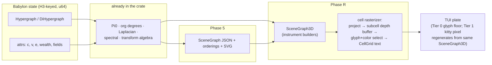

# PHASE-R-MAP — Deck → Rust component map for the cell rasterizer

**Status: owner-approved direction (2026-07-22, "I agree do it").** This is the complete
mapping from the Babylon Topology Deck reference artifact
(https://claude.ai/code/artifact/99a10084-4482-4101-9d83-49ff1f0e0c16, synced to the
Babylon Design System project as `topology/The Topology Deck.html`) to the Phase R
implementation in this crate. Phase R is PLANNED IN FULL after Phase 7 per the approved
`PROPOSAL-raster-replan.md`; this map is the design record so nothing decided on
2026-07-22 is lost. The deck is the **reference implementation**: same seed, same
algebra — the Rust instruments must reproduce its computed numbers before any pixel
is judged.

## 1. Component map

| Deck component (JS) | Rust home | Status 2026-07-22 |
|---|---|---|
| `mulberry32` seeded RNG | `generators::rng` (`Pcg64Mcg`, `seeded_rng`) | shipped (P4) |
| union-find Π₀ / components | `algorithms::connected` | shipped (P3) |
| spectral embedding (shifted-Laplacian power iteration + deflation) | `linalg` + `communities` eigensolver | shipped (P3+P6) |
| organization degree `o(C) = 1 − (|Π₀(C)|−1)/(|C|−1)` | thin fn over `subhypergraph` + `connected_components` | primitives shipped |
| transformation algebra `s=v·e`, `r=ΣS/Σ(C+V)`, `T=r(c+v)−s` | pure fn over edge/node attrs (~30 lines) | Phase R, trivial |
| tick dynamics | `dynamics` (Kuramoto shipped; economy tick trivial) | shipped (P6) |
| convex hulls (community halos) | Phase 5 Task 2 (Andrew's monotone chain) | Phase 5 |
| layouts / SceneGraph / SVG | Phase 5 Tasks 3–10 | Phase 5 |
| PAOH / Levi ego-tree orderings | Phase 5 Task 12 (owner amendment) | Phase 5 |
| hex grid, parent aggregation, snap-to-cell | `h3o` crate — u64-native H3 | Phase R dep |
| 3D projection + painter's/depth sort | Phase R core (~100 lines: rotY/rotX, perspective divide, sort) | Phase R, small |
| canvas pixels → terminal cells | **Phase R rasterizer — the one genuinely new organ** | Phase R, the real work |

## 2. Pipeline

## 3. The three genuinely new organs

1. **Instrument builders** — pure `state → SceneGraph3D`, one per instrument
   (~150–250 lines each), direct transcriptions of the deck's draw functions minus
   canvas calls:
   - **Adjoint cylinder**: bottom disc = atomized agents at spectral positions;
     each community's hull at height = o(C); ghost-edge struts; verbs move hulls.
   - **Contradiction terrain**: heightfield z = field value (IDW-diffused per-node
     tension in the deck; babylon's real field registry when swapped), curvature
     cliffs at bridge edges.
   - **Hyper-Sankey Φ over the invariant grid**: industries/cells snapped to H3,
     altitude = OCC `q = c/v`; lanes/regions = periphery, internal colonies, settler
     garrisons, apex; ribbons = transformation transfers `T`; zoom = parent-cell
     aggregation. **Invariants the deck already proves and Rust must golden-test:
     net T ≡ 0 (zero-sum) at every zoom level; r invariant under aggregation
     (ratio of sums); r strictly falls under c-accumulation ticks.**
     Owner directive: ribbons follow artery arcs (FAF O-D flows over the res-8
     corridor mesh) when babylon supplies them — a FAF O-D flow with in/dms/out mode
     legs IS a directed hyperedge (tails=origin cells, head=dest cell, M=per-leg
     mode+tonnage).
2. **The cell rasterizer** — `(SceneGraph3D, camera, cols, rows) → CellGrid`:
   scanline triangles + Bresenham lines into a subcell grid (2×4 braille dots or
   2×2 quadrants per cell), per-subpixel depth buffer, then per-cell glyph + fg/bg
   selection. Technique reference (MIT, Rust): ludvigsandberg/tui-3d-renderer —
   mined, not depended on. Output is TEXT → byte-exact golden tests.
3. **Color under constraint** — one fg+bg pair per cell against the crimson/gold
   truecolor canon + ADR097 D5's declared degraded 256-color palette. Small
   quantization search per cell.

## 4. Contracts and constraints (carried from ratified babylon rulings)

- Every frame is a pure function of `(state, camera, cols, rows)` — no wall-clock,
  no entropy. Frames golden-test byte-exactly (III.13 discipline).
- Assert the SOURCE: SceneGraph3D JSON is the golden artifact class; cell frames are
  ALSO assertable here because they are text (the rasterizer collapses ADR099's
  two-tier split — `ai/_inbox/post-v1.0.0/rasterizer.md` anticipated exactly this).
- Glyph floor mandatory; Tier 1 kitty pixel plates regenerate from the SAME
  SceneGraph3D (information parity by construction — the `map_room.py` pattern).
- S9: babylon's topology surfaces consume orderings. The 2D H3-snapped base plane is
  an INDEX, not a layout — S9-clean as-is. 3D spatial embeddings (spectral heights,
  cylinder) are library/CLI capability (`render --format cells3d`) until the owner
  issues a lane-extension ruling for babylon-side consumption.
- H3 indexes are **u64** end to end (owner directive 2026-07-22): parent = bit
  masking, children = contiguous integer ranges; `h3o` in Rust and BIGINT in
  babylon's Postgres share identical bit semantics. The hypergraph core stays
  stringly-typed at the ID boundary (divergence D7) — the bitwise spatial algebra
  lives below the graph, in projection/SQL/rasterizer snapping, never in graph
  semantics.
- Formalism surface is closed (NORTH_STAR): everything above renders quantities the
  engine already computes; spectral coordinates are existing mathematics re-projected.

## 5. Open design decisions (each needs one owner call at Phase R planning)

1. Cylinder height metric: `1 − (|Π₀(C)|−1)/(|C|−1)` (deck's choice) vs hull-fill
   fraction (simpliciality) — or expose both.
2. Worldtube time-axis parameterization (instrument: stratigraphy) — which committed
   projection supplies per-tick positions.
3. Rust-side PNG plate emission (collapsing Tier 1 into the crate) vs leaving pixel
   plates to babylon's textual-image path. (`rasterizer.md` leans toward collapsing;
   ADR097 currently splits.)
4. Effort envelope: Phase R core ≈ Phase 5-sized (a few thousand lines + golden
   fixtures + the three instrument builders).

## 6. Verification strategy

- Stage 0: port the deck's world (seed 1917, 13 industries, 4 lanes) as the Phase R
  test fixture; assert Rust reproduces the deck's numbers (Π₀, o(C) per community,
  r=0.4608 at seed defaults, falling-r sequence, net-T conservation at both zooms).
- Stage 1: SceneGraph3D JSON fixtures (assert-the-source golden tests).
- Stage 2: CellGrid text golden frames per (instrument, camera, cols×rows, palette).
- Stage 3: property tests — depth-sort stability, zoom-invariance of extensives,
  glyph-floor information parity (every labeled quantity appears in cell output).
