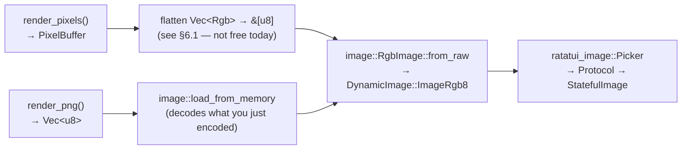
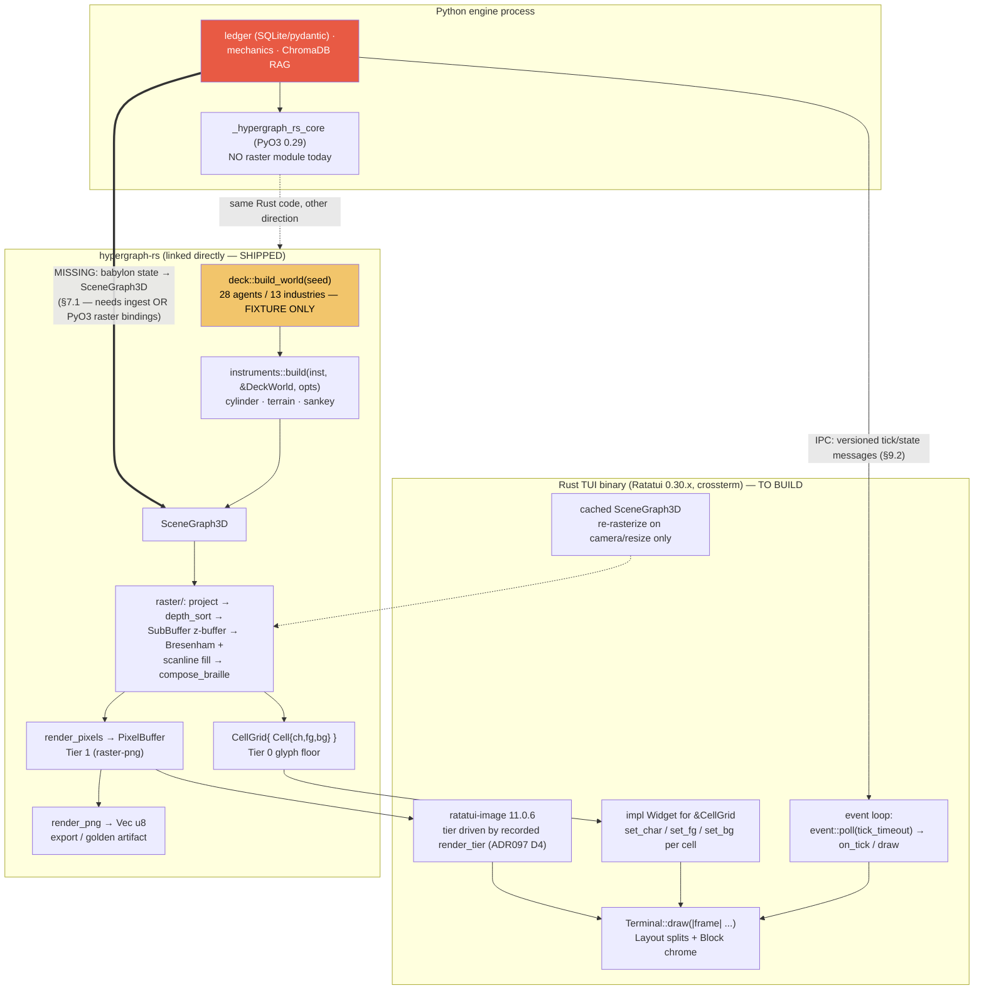

# RATATUI ASSESSMENT — moving babylon's TUI from Textual/Python to Ratatui/Rust

**Status:** decision-support for the owner. Written 2026-07-22; **revised 2026-07-22
after an adversarial completeness review returned needs-revision.** The owner has ALREADY
decided to move the TUI to Ratatui and is amending the project constitution; this
document does not re-litigate that. It answers *how to do it well*, *what it changes*,
and *what it costs*.

**Baseline — re-established on disk for this revision.** **Phase R is DONE, not in
flight.** All 15 tasks are committed, ending at `14e5edd chore(hypergraph-rs): clippy +
fmt + feature-matrix cleanup`. 2,410 LOC ship under `crates/hypergraph-rs/src/raster/` at
that commit; `[features]` carries `raster` (in `default`), `cells3d`, and `raster-png`;
the golden estate is frozen (4 `scene3d` JSON, 7 frame `.txt` — one of which is a
truecolor ANSI frame — and 1 PNG). A **review-findings fix pass is landing concurrently**
in the working tree as this document is revised; it touches 8 raster source files and
regenerates every frame golden, the scene3d JSON, and the PNG. That fix pass is itself the
best available measurement of what a post-hoc change to Phase R costs (§12).

Everything below is graded against that baseline. Recommendations that touch
`crates/hypergraph-rs/src/raster/` are **change requests against shipped, clippy-clean,
golden-frozen code**, not plan amendments.

**Diataxis quadrant:** EXPLANATION (why/architecture). Not a tutorial, not a how-to.
Every unverified item is labelled **[UNVERIFIED]** and must be checked before anyone binds
against it. Claims verified by direct on-disk inspection during this revision are marked
**[VERIFIED]** where the correction matters.

---

## 1. Verdict + headline

**Verdict: strong fit for the rendering seam — but the TUI framework choice is the *small*
decision inside a much larger one, and the large one is unmade.**

The single most important reason Ratatui is the right call: **Phase R's `Cell { ch: char,
fg: Rgb, bg: Rgb }` and Ratatui's `Cell { fg: Color, bg: Color, symbol }` are the same
data structure.** Phase R was designed (before this decision) around a row-major grid of
glyph+fg+bg with a mandatory Tier-0 glyph floor. That is *exactly* Ratatui's rendering
primitive. The integration is a per-cell blit inside one `Widget::render` impl — no
serialization, no ANSI round-trip, no adapter layer of consequence (scout B: Ratatui's own
`Canvas::render` does precisely `buf[(x,y)].set_char(..); set_fg(..); set_bg(..)`).

**Two caveats make this "strong fit" and not "no-brainer":**

1. **Ratatui is a *rendering* library.** It solves the TUI half. It says nothing about the
   seam between a Rust TUI and babylon's Python engine (SQLite ledger, pydantic models,
   ChromaDB, rustworkx). That seam (§7) is a real cost centre and is currently undecided.
2. **The render path is only half-built.** The instruments accept a hard-coded deck
   fixture, not babylon state, and Python cannot reach the raster module at all. This is
   §7.1 and it is the largest gap this assessment found.

**Correction to the original draft (finding 10).** The first draft claimed "Textual has no
comparable seam; feeding a `CellGrid` into Textual means emitting ANSI text and hoping the
widget doesn't re-wrap it." **That is wrong and is withdrawn.** [VERIFIED by executing
`inspect.getsource` against the installed `rich.console`]: Rich exposes a documented
custom-renderable protocol — `ConsoleRenderable` with `__rich_console__` yielding
`Segment(text, style, control)` tuples, each carrying text plus a `Style` that supports
truecolor. That is a per-run styled seam, not "ANSI and hope." The isomorphism argument
for Ratatui stands on its own and does not need a false claim about the incumbent.

**[UNVERIFIED]** Whether a Textual *widget* can host a full-cell-grid renderable without
re-wrapping or re-flowing it, and what the per-cell (as opposed to per-run) cost of the
`Segment` protocol is at 80×40. No scout examined Textual. If anyone wants to re-litigate
the framework choice, this is the question to answer — but the owner has already decided,
so it is recorded rather than pursued.

---

## 2. What Ratatui is

**Versions, license, health** (scout sonnet-5 A, verified against
`raw.githubusercontent.com/ratatui/ratatui/main/Cargo.toml` and docs.rs):

| Fact | Value |
|---|---|
| Latest release | `0.30.2`, 2026-06-19 |
| License | MIT |
| MSRV / edition | **1.88.0 / edition 2024** |
| Provenance | forked from Florian Dehau's `tui-rs` in 2023 |
| Activity | 21.8k stars, 2,296 commits on main, 138 releases, 147 open issues, 67 open PRs |
| Companion crates | `ratatui-core`, `ratatui-widgets` (0.3.2), `ratatui-crossterm`, `ratatui-termion`, `ratatui-termwiz`, `ratatui-termina` |

0.30.0 split the crate into a modular workspace and added `no_std` support
(https://ratatui.rs/highlights/v030/).

**Render model.** Immediate-mode over a double-buffered cell grid:

```rust
pub trait Widget {
    fn render(self, area: Rect, buf: &mut Buffer) where Self: Sized;
}
```

`Terminal::draw(|frame| ...)` autoresizes, runs your callback, then `flush()` — which
"compares the current buffer with the previous buffer and passes only the changed cells
to `Backend::draw`" (docs.rs 0.30.2). Two buffers, whole-frame diff, no per-widget
dirty tracking.

**This matters more than the original draft admitted.** Ratatui's diff optimizes
*terminal bandwidth*, which was never our bottleneck. The expensive half — recomputing
the entire `CellGrid` from scratch every frame — is ours, and Ratatui does nothing for
it. §8 costs that properly; the original draft's "a free bandwidth optimization we
neither fight nor rely on" quietly conceded the expensive half and then never priced it.

**Backends.** `crossterm` is the default feature (pinned to `crossterm_0_29`) and the
project's own recommendation — "Choose Crossterm for most tasks... supported on
Linux/Mac/Windows" (https://ratatui.rs/concepts/backends/comparison/). `termion` excludes
Windows; `termwiz` is WezTerm-tied. **Recommendation: crossterm, no debate.**

**Layout.** `Layout::vertical/horizontal([Constraint...])` → `.areas::<N>(rect)`, backed
by a constraint solver (docs reference `kasuari`), results cached in a thread-local LRU
keyed on `(layout, area)`. Constraint-based, not CSS-grid.

### 2.1 The MSRV question — NOT a hard blocker (correction, finding 6)

The first draft called this "the one hard blocker" and said depending on Ratatui "forces a
toolchain and edition bump across all four crates." **That is wrong on both halves and is
withdrawn.**

| Original claim | Reality [VERIFIED on disk] |
|---|---|
| "forces an edition bump across all four crates" | **False.** Rust editions are per-crate. An edition-2021 crate may depend on an edition-2024 crate; the compiler handles the mix. No edition change is forced on anything. |
| "forces a toolchain bump" | **Already paid.** `rust-toolchain.toml` pins `channel = "1.91.1"` — above ratatui's 1.88 — and describes itself in-file as "the single source of truth for local dev AND CI." Nothing needs bumping to *compile* ratatui today. |

**What the real cost is.** The workspace declares `edition = "2021"`, `rust-version =
"1.85"` in `[workspace.package]`, and **all four crates inherit both** via
`edition.workspace = true` / `rust-version.workspace = true` [VERIFIED]. The only genuine
friction is the declared MSRV floor and the gate that enforces it:

```
[tasks."rust:msrv"]  # .mise.toml, and CI job `rust-msrv` runs the same task
MSRV=$(grep '^rust-version' Cargo.toml | cut -d'"' -f2)
rustup toolchain install "$MSRV" --profile minimal
cargo +"$MSRV" check --workspace --locked
```

Note `--workspace`. **The gate is workspace-wide**, so even a per-crate `rust-version`
override would not save it: `cargo +1.85 check --workspace` still compiles the crate that
took the dependency. Taking ratatui anywhere in this workspace means either raising the
workspace floor to ≥1.88 or reworking the `rust:msrv` task to exclude that crate.

**The conclusion is unchanged; only its grounding is.** Keep ratatui out of
`hypergraph-rs` — not because of a false blocker, but on **dependency-hygiene grounds**:
this crate is a library with PyO3, CLI, and WASM surfaces computing pure text/JSON, and an
interactive-application framework requiring a live `Terminal` and a TTY backend does not
belong in its dependency graph. The MSRV floor is a secondary, real, but modest cost. See
D-T1/D-T2.

---

## 3. The isomorphism that matters

Phase R (`plans/phase-R-rasterizer.md:133`, shipped in `src/raster/mod.rs`) defines:

```rust
pub struct Rgb(pub u8, pub u8, pub u8);
pub struct Cell { pub ch: char, pub fg: Rgb, pub bg: Rgb }
pub struct CellGrid { pub cols: u16, pub rows: u16, pub cells: Vec<Cell> }  // row-major
```

Ratatui 0.30.2 defines (docs.rs, scout A verbatim):

```rust
pub struct Cell {
    pub fg: Color,
    pub bg: Color,
    pub underline_color: Color,   // feature-gated "underline-color"
    pub modifier: Modifier,
    pub diff_option: CellDiffOption,
    pub skip: bool,               // DEPRECATED since 0.30.1
    /* private fields — the symbol */
}
```

**Field-by-field:**

| Phase R | Ratatui | Impedance |
|---|---|---|
| `fg: Rgb(u8,u8,u8)` | `fg: Color`, variant `Color::Rgb(u8,u8,u8)` | **None.** Structurally identical. A `From<Rgb> for Color` is three lines. |
| `bg: Rgb` | `bg: Color` | **None.** |
| `ch: char` | private symbol, `CompactString`, accessed via `symbol() -> &str` / `set_symbol(&str)` / `set_char(char)` | **Real but benign.** We cannot read/write the field; we go through `set_char(ch)`. Braille (U+2800–U+28FF) is always a single `char`, never a grapheme cluster, so `set_char` is lossless for our glyph floor. |
| (none) | `modifier: Modifier` | Extra capability we don't use. Leave at default. |
| (none) | `diff_option: CellDiffOption` | Irrelevant — every Phase R frame is a full pure recompute. Leave at default. |
| `Palette::Ansi256` + our `to_ansi256()` | `Color::Indexed(u8)` | We still need our own quantizer: Ratatui does **not** auto-degrade truecolor. Its own docs on `Color::Rgb` say terminals without 24-bit support "may exhibit unpredictable rendering or fallback to default colors, depending on the backend." `to_ansi256` stays; it just emits into `Color::Indexed` instead of an escape string. |

**Can hypergraph-rs implement `Widget` and write cells directly into a `Buffer`? Yes** —
and scout B confirmed this is exactly what Ratatui's own `Canvas` does internally:
`let cell = &mut buf[(x,y)]; cell.set_char(sym); cell.set_fg(c); cell.set_bg(c);`.
The adapter is roughly ten lines of loop.

**[UNVERIFIED]** The precise `Buffer` mutation surface. Scout A flagged that it did not
re-pull `Buffer`'s methods from docs.rs; scout C did, reporting
`cell(P) -> Option<&Cell>`, `cell_mut(P) -> Option<&mut Cell>`, with `get`/`get_mut`
deprecated and `buf[(x,y)]` indexing that **panics** out of bounds. Scout A additionally
did not check the out-of-bounds policy. Before writing the adapter: confirm
`cell_mut` vs indexing and prefer the `Option`-returning `cell_mut` so an area/grid
size mismatch degrades rather than panics (Power-of-10 rule 4).

**Architectural conclusion: do NOT put `ratatui` in `hypergraph-rs`'s core dependency
graph.** Grounded on dependency hygiene (§2.1), with the MSRV floor as a secondary cost.
The adapter belongs either on the babylon TUI side (an `impl Widget for &CellGrid` newtype
in the TUI binary) or behind a strictly optional, default-off `ratatui` feature in this
crate. Scout B reached the same conclusion independently.

---

## 4. Division of labor with Ratatui `Canvas`

Scout B read the entire shipped `ratatui-widgets/src/canvas.rs` (1221 lines) at the
0.30.2-generation commit `7986192`. The findings are unambiguous.

**What Canvas is:** a 2D drawing surface. `Context` → `Painter` → `Shape::draw` →
`Grid::paint(x, y, color)`. `Marker` selects the sub-cell grid: `Braille`/`Octant` at
2×4, `Sextant` 2×3, `Quadrant` 2×2, `HalfBlock` 1×2, `Dot`/`Bar`/`Block`/`Custom(char)`
at 1×1.

**What Canvas does NOT have, confirmed from source, not assumed:**

1. **No z / depth anywhere.** Every coordinate in `Context`, `Painter`, `Shape`, `Grid`,
   `PatternCell`, `LayerCell` is 2D `f64`. There is no depth field and no depth test:
   `Grid::paint` is an unconditional overwrite.
2. **No triangle or polygon fill.** `Rectangle::draw` decomposes into four `Line`s —
   outline only. `Circle::draw` plots one dot per degree over `0..360` via sin/cos.
   There is no edge-function, barycentric, or scanline code in the module.
3. **No per-cell background under the sub-cell markers.** Verbatim source comment on
   `PatternCell`: *"The color of a cell only supports foreground colors for now as
   there's no way to individually set the background color of each pseudo-pixel in a
   pattern character."* Braille/Octant/Quadrant/Sextant store one `Option<Color>` per
   terminal cell, **last-paint-wins**. Only `HalfBlock` carries two colors per cell
   (fg=upper, bg=lower) — at 1×2 resolution, a quarter of braille's.
4. **`ctx.layer()` is not z-order.** It is a manually-invoked snapshot pushed onto a
   `Vec<Layer>`; compositing takes, per character position, the topmost layer with a
   `Some` value. Caller-sequenced painter's algorithm, not depth-derived.
5. **`Grid` is module-private and non-extensible.** You cannot write a depth-aware
   `Grid` and inject it. The only public extension point is `trait Shape { fn draw(&self,
   painter: &mut Painter); }`, and `Painter::paint(x, y, color)` takes no z.

**Does the shipped Phase R rasterizer become redundant? No. Nothing in it is replaceable.**

| Phase R component | Canvas equivalent | Ruling |
|---|---|---|
| `Camera`, `project` (rotY∘rotX + perspective divide, near-plane clip) | none — Canvas is 2D | **STAYS** |
| `SubBuffer` depth buffer, z-test | none — no depth field exists | **STAYS** |
| `fill_triangle` (edge function, top-left rule) | none — no fill primitive | **STAYS** |
| `compose_braille` (2×4 bit composition) | `Marker::Braille` composes braille — but at one fg, no bg, last-write-wins | **STAYS.** Canvas is strictly less expressive than our `Cell{ch,fg,bg}` floor. The depth-tested majority/tiebreak fg + real bg cannot be expressed through `PatternGrid`. |
| `line_bresenham` (integer) | `Line::draw` does Cohen-Sutherland clip + integer Bresenham | **STAYS** — convergent design; reusing it would require depending on ratatui inside the core and would still leave faces and depth unhandled. Worth noting as validation that CRITICAL CORRECTION 1 (integer Bresenham over the reference repo's float DDA) matches what a mature TUI library independently chose. |
| `heat()` / `to_ansi256` / fg-bg pick | none | **STAYS** |

**The recommended split:**

- **hypergraph-rs owns 100% of rasterization.** `SceneGraph3D → Camera → depth_sort →
  SubBuffer (z-buffered) → Bresenham struts → scanline-filled faces → compose_braille →
  CellGrid`. Unchanged, and shipped.
- **The TUI owns compositing and chrome.** One `Widget` adapter blits `CellGrid` into a
  `Buffer` rect; Ratatui supplies `Block` borders, `Layout` splits, `Terminal` diffing,
  input, and every other panel in the app.
- **Canvas remains legitimate for genuinely 2D, non-hypergraph-rs charts** — a tension
  sparkline, a scatter overlay — drawn by babylon directly. That is an orthogonal use and
  should not be conflated with the instrument render path.

**Explicitly rejected: emitting Ratatui `Shape`s and letting Canvas rasterize.** To hand
Canvas filled triangles we would have to run the entire scanline fill and depth test
ourselves and then feed it a finished dot list via `Points` — Canvas contributes nothing,
while we acquire a mandatory `ratatui` dependency in the core and forfeit the byte-exact
`CellGrid::to_text()` golden contract (PHASE-R-MAP §4).

---

## 5. Testing & determinism

### 5.1 Correction: the color-golden claim was false (finding B2)

The first draft's headline testing finding — *"the byte-exact artifact is glyphs only",
"the `.txt` golden is blind to all of it", "This is a real gap in Phase R today"* — **is
wrong and is withdrawn.** It was a rediscovery of something Phase R already shipped, and
it was wrongly credited as "a genuine coverage gap found by this assessment."

**[VERIFIED on disk]:**

```
crates/hypergraph-rs/tests/fixtures/frames/cylinder_front.ansi.txt   (93,043 bytes)
crates/hypergraph-rs/tests/test_raster.rs:552
    fn test_frame_cylinder_front_ansi_truecolor() {
        ... rasterize(&scene, &frame_front_camera(), 80, 40).to_ansi(Palette::TrueColor),
            include_str!("fixtures/frames/cylinder_front.ansi.txt")
```

That fixture freezes per-cell truecolor **fg and bg** for a full 80×40 frame. The
color-under-constraint logic is frame-tested today.

### 5.2 The real gap — smaller, but sharper

**Color is frozen for exactly 1 of 7 frames, and only under one palette.**
[VERIFIED — full fixture listing]:

| Fixture | Instrument | Camera | Palette coverage |
|---|---|---|---|
| `cylinder_front.txt` | cylinder | front | glyphs only |
| `cylinder_front.ansi.txt` | cylinder | front | **TrueColor fg+bg** |
| `cylinder_3q.txt` | cylinder | 3/4 | glyphs only |
| `terrain_front.txt` | terrain | front | glyphs only |
| `terrain_3q.txt` | terrain | 3/4 | glyphs only |
| `sankey_front.txt` | sankey | front | glyphs only |
| `sankey_3q.txt` | sankey | 3/4 | glyphs only |

`to_ansi256` is unit-tested and pinned (`test_raster.rs:348`,
`to_ansi256(Rgb(196,58,46)) == 167`), but **no Ansi256 *frame* is ever frozen.** So
**ADR097 D5's declared degraded palette — "256-color terminals get a DECLARED degraded
palette, recorded as a DESIGN_BIBLE section 9b row" — is unit-tested at the quantizer but
never frame-tested end-to-end.** A regression in the fg/bg pick that only manifests after
quantization would ship green.

**Recommendation: add exactly one fixture — `sankey_front.ansi256.txt`.** Sankey exercises
the widest heat range (donor→absorber ribbons across the full `heat()` domain), so it is
the frame most likely to expose a quantization-collapse bug where distinct truecolor
values land on the same `Color::Indexed`. This is a *new fixture*, not a new serialization
format — `to_ansi(Palette::Ansi256)` already exists. Cost is one test function plus one
generate-and-visually-inspect cycle (§12).

### 5.3 What Ratatui offers

(scout sonnet-5 C, docs.rs + ratatui.rs):

- `TestBackend::new(width, height)`, `TestBackend::with_lines(lines)`; accessors
  `buffer() -> &Buffer`, `scrollback()`, `cursor_position()`.
- Assertions: `assert_buffer(&Buffer)`, `assert_buffer_lines(lines)`,
  `assert_cursor_position(p)`, `assert_scrollback*`. **`assert_buffer_eq!` is deprecated
  as of v0.26.3 (2024-05-19)** — new test code must not reach for it.
- **[UNVERIFIED]** `Buffer: PartialEq` compares `area` **and** `content`, where `content`
  is `&[Cell]` and each `Cell` carries symbol **and** fg/bg/modifier. *No scout quoted the
  `PartialEq` impl or its derivation;* scout C reported the `content()` accessor and the
  `Debug` formatting only. This claim is load-bearing for any "Buffer golden captures
  color" recommendation and **must be checked before a `Buffer` golden is adopted.** Added
  to the Provenance list.

### 5.4 Recommendation: LAYER, do not replace

1. **Keep the `.txt` glyph goldens.** Human-diffable in a PR, greppable, trivially
   reviewable, and the only fixture form that survives if we ever drop ratatui. They stay
   the primary Phase R artifact — no change.
2. **Add the `sankey_front.ansi256.txt` frame golden** (§5.2). Closes the D5 blind spot
   inside hypergraph-rs, adds no dependency, incurs no MSRV cost.
3. **Add `TestBackend`/`Buffer` goldens on the babylon TUI side**, asserting the
   *adapter* — that a `CellGrid` lands in the right `Rect` with the right colors, composed
   correctly against surrounding widgets. That is an integration contract for the TUI, not
   a rasterizer contract for this crate. **Conditional on resolving the `PartialEq`
   [UNVERIFIED] above.**

### 5.5 Reconciling with III.13 (finding 14)

Tier 3 above proposes new Rust-side baselines while babylon already has a ratified
byte-identical-artifact regime. **These must be reconciled explicitly, and it is a ruling,
not a testing-convenience call.**

babylon's golden estate today [VERIFIED, main tree, worktree copies excluded]: **27 frozen
`.raw` snapshot baselines totalling 1,767,493 bytes (1.69 MB)**, produced by
`pytest-textual-snapshot==1.1.0`, which ADR097's consequences name as "the ecosystem
mechanism" that III.13 governs. On a Ratatui rewrite **every one of them is dead** —
syrupy/pytest-textual-snapshot has no Ratatui analogue, and the capture mechanism goes
through Textual internals (`tests/unit/tui/snapshots/conftest.py` monkeypatches
`textual._doc.take_il_screenshot` [VERIFIED]).

**The owner owes a ruling on which of these it is:**

- **Rebuilt** — new Rust-side `Buffer`/`TestBackend` baselines, a new blessing workflow,
  and a III.13 amendment naming the new mechanism; the 27 `.raw` files are regenerated in
  the new format and the vault re-blessed. Preserves the determinism law, costs a full
  re-freeze plus a new blessing tool.
- **Retired** — Tier-0 frame coverage moves wholesale into hypergraph-rs `.txt`/`.ansi`
  goldens, and babylon keeps snapshot coverage only for non-instrument chrome. Cheaper,
  but shrinks what III.13 certifies.

This is tracked as **D-T9**.

### 5.6 Determinism hazards to record

- **`insta` cannot assert color.** The official recipe
  (https://ratatui.rs/recipes/testing/snapshots/) states plainly: *"Asserting with color
  is not supported as of now"* for `insta::assert_snapshot!(terminal.backend())`. Anyone
  adopting insta expecting color coverage will get a false green.
- **Unicode table drift.** Ratatui computes display width via `unicode-width` and segments
  via `unicode-segmentation`; both are pure functions of UCD tables baked into whichever
  crate *version* the lockfile resolves. Byte-exact `Buffer` goldens could silently drift
  across a `cargo update`. Same hazard class as the libm transcendentals Phase R already
  handles explicitly (CRITICAL CORRECTION 2, and the `ln`/`exp` tolerance notes). Pin
  those crates exactly if `Buffer` goldens are adopted.
- **[UNVERIFIED, and load-bearing]** Braille U+2800–U+28FF is *reasoned* to be
  `unicode-width` 1 (Neutral/Narrow), but scout C did not execute
  `UnicodeWidthChar::width('⣿')`. If any braille codepoint reports width 2, Ratatui blanks
  the following cell and our `CellGrid` index alignment breaks silently. **Add a one-line
  unit test asserting width 1 before the adapter ships.** Ratatui exposes
  `CellDiffOption::ForcedWidth(NonZero<u16>)` as an escape hatch if this bites.
- **[UNVERIFIED]** Whether Ratatui treats its `Buffer`/`Cell` `Debug` output as
  semver-stable. Rust convention says `Debug` is non-contractual. Do not serialize goldens
  *through* `Debug`; write an explicit serializer if color-bearing `Buffer` goldens are
  adopted.

---

## 6. The pixel tier

Phase R's `raster/png.rs` (feature `raster-png = ["cells3d","dep:png"]`) ships two
functions side by side [VERIFIED]:

- `render_pixels(&SceneGraph3D, &Camera, w_px, h_px) -> PixelBuffer`
- `render_png(...) -> Vec<u8>` (pinned encoder settings)

**The consumer, per scout D:** `ratatui-image` v11.0.6 (MIT,
github.com/ratatui/ratatui-image, crates.io description "An image widget for ratatui,
supporting sixels, kitty, iterm2, and unicode-halfblocks"). Its `Picker`
(`Picker::from_query_stdio()`) probes the terminal for graphics capability *and* font
pixel size, falling back to unicode half-blocks. Widgets are `Image` (stateless, resizes
and encodes at construction) and `StatefulImage` (resizes at draw time; the docs push a
`ThreadProtocol` pattern to keep that work off the render thread).

**The critical fact: `ratatui-image` consumes `image::DynamicImage`.** Not a file path,
not PNG bytes. So the two data paths are:



### 6.1 Correction: `PixelBuffer` is already public (finding 11)

The first draft listed "expose `PixelBuffer` publicly" as an amendment. **It is already
done** [VERIFIED — `raster/png.rs:19`, behind `pub mod png`]:

```rust
pub struct PixelBuffer { pub w: u32, pub h: u32, pub px: Vec<Rgb> }
```

**What is actually missing is different and was unmentioned.** `px` is `Vec<Rgb>`, and
`Rgb` is a tuple newtype declared `pub struct Rgb(pub u8, pub u8, pub u8);`
(`raster/mod.rs:34`) **with no `#[repr(C)]`** [VERIFIED]. Therefore
`image::ImageBuffer::from_raw` — which wants `&[u8]` / `Vec<u8>` — **cannot consume it
without a full-buffer flatten and copy, every frame.** The original draft's
"allocation-cheap bridge, no round trip" framing hid that copy.

**Restated change request:**

1. **Document a row-major RGB8 layout contract** on `PixelBuffer` — index
   `(y * w + x)`, three bytes per pixel, no padding, no stride. This is a doc-comment plus
   a contract test; it costs nothing and is required either way.
2. **Then choose one, explicitly:**
   - **Zero-copy `fn as_bytes(&self) -> &[u8]`** — add `#[repr(C)]` to `Rgb` and use
     `bytemuck` (`Pod`/`Zeroable`) to reinterpret `&[Rgb]` as `&[u8]`. Per-frame cost:
     **zero copies.** Cost of the change: a new dependency (`bytemuck`, no_std-friendly,
     widely vendored) and a `repr` attribute on a type used throughout the raster module —
     which is a change to shipped code and triggers the §12 cycle.
   - **Explicit documented copy** — `fn to_rgb8(&self) -> Vec<u8>` that flattens. Per-frame
     cost: **one `w*h*3`-byte allocation + copy.** At a 640×480 plate that is 921,600
     bytes per frame; at 30 fps that is ~27 MB/s of memcpy and allocator churn. Tolerable
     for a plate refreshed on demand, wasteful for a plate refreshed on camera drag.

**Recommendation: document the layout now; take the zero-copy `as_bytes()` only if §8's
benchmark shows the pixel tier is on an interactive path.** If Tier 1 plates refresh on
demand rather than per frame, the explicit copy is the simpler, dependency-free answer.
Say which in D-T3.

### 6.2 Is the owner's D-R3 ruling validated?

*Partially — and it should change form, not be reversed.*

- **Validated:** Rust emitting the Tier-1 pixel plate from the same `SceneGraph3D` is
  correct. Information parity by construction (ADR097) is preserved, the geometry is
  shared with Tier 0, and nothing about Ratatui changes that.
- **Should change form:** PNG is the wrong *interchange* type for a live TUI path.
  Encoding to PNG and immediately decoding back to a `DynamicImage` is a wasted round
  trip. `render_pixels` + a documented layout contract (§6.1) is the live path.
- **`render_png()` stays** — as the *export/artifact* path: screenshots, the
  platform-pinned golden fixture, non-interactive plates, ADR097 Tier-2-adjacent
  deliverables. PNG bytes are artifact-shaped; a pixel buffer is not. Both/and, not
  either/or.

### 6.3 ADR097 D4 conflict — the recommended API violates a ratified ruling

**This is the sharpest ADR conflict in the document and the first draft never mentioned
D4 at all.** ADR097 D4 says, verbatim [VERIFIED,
`babylon/ai/decisions/ADR097_render_seam.yaml`]:

> D4 (capability detection, probe-once): babylon doctor probes once (DA1/XTGETTCAP,
> COLORTERM, TERM, tmux detection), writes render_tier + specifics to config, prints the
> verdict. **Runtime honors config — no mid-session re-probing, no silent tier switches;**
> babylon --render=glyph|pixel overrides. **Degradation is declared, never silent** (III.11
> applied to aesthetics).

And it is implemented: `src/babylon/render/capability.py` opens with *"``probe`` is a pure
function over an environment mapping plus an injected [querier]… is persisted to config.
**Runtime never re-probes (no silent tier switches).**"* — with `CapabilityReport`,
`derive_tiers() -> (RenderTier, PaletteTier)`, and `verdict_lines()` alongside
`doctor.py`, `config.py`, `session.py`, `tiers.py` [VERIFIED].

`Picker::from_query_stdio()` does the exact opposite: it probes the terminal **at
runtime**, from inside the running application, and **silently falls back to
halfblocks**. Adopting it as recommended would violate D4 on both clauses.

**Two ways out — the owner must pick one:**

- **(a) Drive `ratatui-image` from the recorded tier.** Never call `from_query_stdio()` in
  the app. Read `render_tier` + font-size specifics from babylon's config, construct the
  `Picker` from those recorded values, and honor `--render` as an override. Requires that
  `ratatui-image` exposes a from-explicit-values constructor. **[UNVERIFIED]** whether
  v11.0.6 offers one (e.g. a `Picker::from_fontsize`-style path) — this must be checked
  before (a) is chosen, because if it does not, (a) is not available.
- **(b) Amend D4** to permit one runtime probe by the Rust TUI, with the probe result
  *printed as a declared verdict* rather than applied silently — preserving III.11's
  loud-failure spirit while relaxing probe-once.

**Recommendation: (a), subject to the [UNVERIFIED] check.** It preserves a ratified ruling
and keeps a single source of truth for capability. Tracked as **D-T7**.

### 6.4 Terminal reality checks

All single-source, treat as indicative: Kitty is the reference-quality target; Ghostty
gets the Kitty protocol via Unicode placeholders; WezTerm is reported bug-free specifically
under the *iTerm2* protocol. Sixel is rejected fleet-wide by ADR097 anyway, which
conveniently sidesteps the reported sixel-on-last-line scroll bug.

**[UNVERIFIED, and it matters for deployment]** tmux and SSH behaviour. No scout found a
sourced `ratatui-image` statement. `Picker::from_query_stdio()` works by writing control
sequences and reading a reply on stdin; under tmux that generally requires
`allow-passthrough`. **Before committing to the pixel tier as a default-on feature,
someone must test under the owner's actual terminal + multiplexer stack.** If the probe
hangs or misdetects under tmux, the glyph floor (which ADR097 already mandates) is the
graceful degradation — a reason to be glad Tier 0 is the mandatory floor. Note that under
resolution (a) above this risk largely evaporates, since babylon's own `doctor` already
does tmux detection.

**[UNVERIFIED]** Exact `Resize`/`Protocol`/`FontSize` type names in v11.0.6 — scout D
flagged its own naming as approximate and not confirmed against docs.rs source.

---

## 7. The seam: a Rust TUI driving a Python engine

This is the highest-stakes section and the one the Ratatui decision does not itself
answer.

### 7.1 THE ARCHITECTURAL GAP — the render path is only half-built

**This is the most important finding in the revised document, and the first draft got it
backwards.**

The first draft called *"the render path never crosses the language boundary"* **"the
single highest-leverage fact in this whole assessment."** That is true **only for the
seed-1917 deck fixture.** [VERIFIED on disk]:

```rust
// crates/hypergraph-rs/src/raster/instruments/mod.rs:48
pub fn build(inst: Instrument, world: &DeckWorld, opts: &InstrumentOpts) -> SceneGraph3D
```

The instruments accept a **`DeckWorld`**, constructed by `deck::build_world(seed)` from
the deck's hard-coded **28 agents and 13 industries**. Consequently:

1. **There is no babylon-state → `SceneGraph3D` ingest in this crate, and none planned.**
   Phase R's D-R2 deferred even the 4th instrument for want of a committed projection.
2. **`crates/hypergraph-rs-python/src/` exposes NO raster module.** [VERIFIED: 18 source
   files — `algorithms`, `communities`, `convert`, `dihypergraph`, `dynamics`, `errors`,
   `generators`, `hypergraph`, `layout`, `lib`, `linalg`, `pyid`, `readwrite`,
   `simplicial`, `stats`, `utils`, `views` — and a repo-wide grep for
   `raster|CellGrid|SceneGraph3D|PixelBuffer` in that directory returns **zero hits**.]
   **Python cannot reach `CellGrid`, `SceneGraph3D`, or `PixelBuffer` at all today.**

So the honest statement is: **today the Rust TUI can render exactly one thing — the
seed-1917 deck fixture.** Rendering *babylon's actual state* requires work that does not
exist and is not scoped anywhere.

**The missing work item, with two options — and the choice has large IPC consequences:**

| | **(a) Native ingest in the TUI process** | **(b) Build `SceneGraph3D` in Python** |
|---|---|---|
| **Shape** | Add a `Hypergraph` + attribute-map ingest so `instruments::build` accepts real topology natively. The TUI holds engine state and calls Rust directly. | Add PyO3 raster bindings; the Python engine builds `SceneGraph3D` and ships it as JSON to the TUI. |
| **What crosses IPC** | **The whole engine state, per FRAME** — because the instrument builder needs the topology to build the scene, and the camera changes per frame. | **A `SceneGraph3D`, per state change** — the TUI re-rasterizes locally on camera/resize with no IPC. |
| **Render path crosses the language boundary?** | No — but the *state* path now does, at frame rate. | **Yes.** The leverage claim is retracted outright. |
| **New Rust work** | `Hypergraph`→instrument ingest + a committed projection (the thing D-R2 deferred). | PyO3 bindings for the raster module (currently zero) + a `SceneGraph3D` serde contract. |
| **New Python work** | Serialize full state per frame. | Call the new bindings; keep the ledger authoritative. |
| **Failure mode** | IPC becomes a per-frame hot loop — exactly the cost §7.3's "turn-based, not framerate-driven" argument assumed away. | Serialization size: `terrain.json` is the largest scene3d fixture on disk and the fix pass rewrites ~22k lines of it — a scene graph is not small. |

**Recommendation: (b), with a caching contract.** Ship `SceneGraph3D` across the seam once
per *state change* (a tick, or an explicit refresh), cache it in the TUI, and re-rasterize
locally on camera and resize — which the pure-function design already permits (§8). This
keeps IPC at tick cadence, keeps the *rasterizer* on the Rust side of the boundary at
frame rate, and requires the smaller, better-understood piece of new Rust work.

**But it means retracting the "render path never crosses the language boundary" claim, and
that retraction is the point.** What is actually protected is narrower and still valuable:
**the per-frame rasterization never crosses the boundary.** The scene construction does.

**This choice must be made before D-T5 is ruled**, because it determines whether the IPC
protocol carries state deltas or scene graphs — a difference in schema, size, and cadence
that is expensive to reverse.

### 7.2 The three options for the engine seam

**Option 1 — embed CPython in the Rust TUI binary via PyO3.**

The API exists and is documented: `Python::attach(|py| ...)` (renamed from
`with_gil` in PyO3 0.26.0, 2025-08-29; `with_gil` deprecated not removed), the
`auto-initialize` feature (opt-in since 0.14), `pyo3::append_to_inittab!` required
before interpreter init or your own `#[pymodule]` fails to import,
`Python::detach` (ex-`allow_threads`) to release the GIL for CPU-bound Rust.

The problems are not API problems, they are packaging problems, and PyOxidizer —
the most mature project in this space, itself built on pyo3/pyembed — documents them:

- Terminal/terminfo discovery is "hit-or-miss" in embedded distributions. **For a TUI
  this is disqualifying-adjacent on its own.**
- Python code depending on `__file__` breaks under the non-file module loader.
  babylon loads TOML game content from relative paths (project CLAUDE.md §5, the
  Paradox Pattern) — this is not a hypothetical.
- C-extension modules built for app-relative embedding are flagged as not fully
  supported and "may appear to work and break at linking or run-time." babylon's stack
  is `numpy`, `pydantic-core`, `chromadb`, `rustworkx` — all C/Rust extensions.
- Static linking is the hard path (LTO/PIE conflicts, export-dynamic requirements);
  PyO3 *deliberately disables* `auto-initialize` for static embeds. Dynamic embedding
  means shipping `libpython3.12.so` and setting `LD_LIBRARY_PATH` — reintroducing
  exactly the packaging complexity a single Rust binary was supposed to eliminate.
- **Direction conflict:** `crates/hypergraph-rs-python/Cargo.toml` (verified on disk)
  is `pyo3 = { version = "0.29", features = ["extension-module"] }`,
  `crate-type = ["cdylib"]`. Embedding needs the opposite feature configuration in a
  binary target. One crate cannot be both.
- **No precedent found.** Scout E found exactly one public discussion of the
  Ratatui+Python pairing (https://forum.ratatui.rs/t/ratatui-with-python-via-maturin/212)
  — it went the *other* direction, and the author ultimately stayed with Textual.

**Option 2 — two processes, message passing.**

The Rust TUI process and the Python engine process talk over stdio/JSON-RPC or a Unix
socket. Community guidance from the same forum thread: if the Python side's I/O is
stdin/stdout, `std::process::Command` is the pragmatic hookup, and "you're going to have
to have some sort of message passing/API between the two halves" regardless of transport.
Closest published precedent is `spika` (github.com/opaugam/spika) — a small Python
JSON-over-pipes command protocol; **no complete Rust-TUI/Python-engine reference
implementation was found.**

The fit argument is strong and specific to babylon: **the simulation is turn-based, not
framerate-driven.** A tick boundary (`advance_turn() -> StateDelta`) is a coarse, natural
request/response unit. **This argument holds only under §7.1 option (b)** — under option
(a) the state must cross per frame and the argument collapses. It buys independent crash
domains, independent debuggers (`pdb` on the engine, `RUST_BACKTRACE` on the TUI), and
zero linking risk.

The cost is real and ongoing: you own a versioned message schema (§9.2) and a supervision
story (§10).

**Option 3 — progressive port to Rust.**

Not hypothetical: it is already half-executed. `hypergraph-rs` ships `algorithms`,
`generators`, `stats`, `readwrite`, `layout`, `viz`, `dynamics`, `communities`,
`convert`, exposed to Python today through `hypergraph-rs-python` with XGI conformance at
311/0 vs xgi 0.10.2. That is the textbook shape: graph/linear-algebra-heavy subsystems
move to Rust first, called from the still-Python engine, invisible to callers.

### 7.3 Recommendation

**Option 3 as the strategy; Option 2 as the near-term seam; Option 1 rejected.**

Concretely, and in this order:

1. **The Rust TUI links `hypergraph-rs` directly as a normal Cargo dependency**, so the
   *rasterizer* runs natively: `SceneGraph3D → CellGrid` and `→ PixelBuffer` never cross
   the boundary. **The scene graph itself is built in Python and shipped across (§7.1
   option b).** This is the corrected, narrower version of the original leverage claim.
2. **Engine state crosses via IPC (Option 2).** Ticks, ledger reads, RAG queries, and —
   under (b) — the `SceneGraph3D` itself. Design the message contract as a versioned schema
   (§9.2) and treat it as a behavioural contract in the CLAUDE.md sense: it is exactly the
   "what would let us prove a rewrite correct" artifact.
3. **Subsystems migrate into Rust crates opportunistically (Option 3)**, each shipping a
   native Rust API *plus* PyO3 bindings, until that crate's last Python caller retires.
4. **Reject Option 1.** Highest risk, no precedent, and the documented pitfalls (terminfo,
   `__file__`, C-extension embedding) hit babylon's exact stack. It also contradicts the
   crate configuration already shipped.

**Sequencing note:** a first milestone rendering the *deck fixture* is available today with
zero IPC (§7.1: it is the only thing renderable today). That is a legitimate proof of the
Ratatui seam — but it must be labelled as a fixture demo, not as "the TUI renders
babylon," or the missing ingest will be discovered at integration.

### 7.4 What happens to the Phase 7 PyO3 bindings

**They stay. They do not invert. They become the migration bridge — which is what they
already were.** And under §7.1 option (b) they **grow**: the raster module needs new
bindings it does not have today.

- Under Option 3 they are the *mechanism*, not a casualty: every newly-ported Rust crate
  gets bindings so the shrinking Python remainder keeps working. Retirement is a per-crate
  decision made when that crate's last Python caller is itself ported.
- Under Option 2 the IPC boundary sits between the Rust TUI and the Python engine
  *process*; inside that process, Python keeps importing `_hypergraph_rs_core` as today.
- Only Option 1 would make them structurally awkward, and we are rejecting Option 1.

**New work item — PyO3 raster exposure.** Under §7.1 (b), `hypergraph-rs-python` must gain
a `raster` module exposing at minimum `SceneGraph3D` construction and serialization. Under
(a) it need not. Under *either*, exposing `CellGrid`/`PixelBuffer` to Python is **out of
scope** — the TUI reaches them natively and Python has no consumer. Tracked as part of
D-T5.

**One maintenance flag, unrelated to the TUI:** PyO3's current guide marks the
`extension-module` Cargo feature itself as deprecated in favour of maturin (≥1.9.4) or
setuptools-rust (≥1.12) passing the equivalent configuration automatically. Our crate
sets it explicitly. **[UNVERIFIED]** which maturin version this project uses. Worth a
check at the next PyO3 bump; not urgent, not TUI-related.

### 7.5 Architecture

The diagram below shows the **corrected** chain. The dashed red edge is the work that
does not exist.



**Read the diagram as:** everything solid is shipped or is ordinary TUI work. The thick
edge from `ENG` to `SceneGraph3D` is the unbuilt half. `DECK` is highlighted because it is
the *only* current source of a scene graph.

---

## 8. Interactivity and frame budget

**No frame budget exists anywhere in the program, and no benchmark exists in the repo**
[VERIFIED: `crates/hypergraph-rs/benches` does not exist; the Phase R plan contains no
benchmark task]. This section states the target and the measurement plan so that a miss is
a design input rather than a surprise at integration.

**Why it matters: every frame is a full re-rasterize by construction.** PHASE-R-MAP §4
makes each frame a pure function of `(state, camera, cols, rows)`. Camera drag changes
`camera`; a terminal resize changes `cols`/`rows` and therefore the entire subcell buffer.
Neither is amortizable by Ratatui's buffer diff, which optimizes only the bytes written to
the terminal, not the work that produced them.

**Measured geometry** [VERIFIED from
`src/raster/instruments/terrain.rs`]: `N = 34`, `M = 24`, and the face loop is documented
in-source as *"Bounded: N*M quads, 2 triangle faces each"* — **34 × 24 × 2 = 1,632
triangles from terrain alone**, before agent nodes. The Sankey adds donor×absorber ribbon
geometry on top. At 80×40 cells the braille subcell buffer is 160×160.

**Proposed target:** **< 16 ms** for a full `instruments::build` → `rasterize` →
`CellGrid` cycle, giving ~60 fps headroom for smooth camera drag. A softer **< 33 ms**
(30 fps) is acceptable for drag if the still-frame case is comfortably under.

**Measurement plan** (a standalone spike, not folded into any shipped task):

1. Add a `benches/raster.rs` (criterion or a plain `#[bench]`-shaped harness) covering all
   three instruments at **80×40, 120×50, and 200×60** — the third being a realistic
   full-screen modern terminal.
2. Separate the two halves: `instruments::build` (scene construction) and `rasterize`
   (projection + fill + compose). Only the second runs per frame under the caching
   fallback below; knowing the split determines whether caching is sufficient.
3. Record results in the plan, not just in a commit message.

**The fallback the design already permits.** Because rasterization is a pure function,
`SceneGraph3D` can be **built once per state change and cached**, with `rasterize()`
re-run only when the camera or terminal size changes. This is already reflected in §7.5's
`CACHE` node and is the same mechanism §7.1 option (b) needs. If the benchmark shows
`rasterize` alone fits the budget but `build` does not, caching is sufficient and no
redesign is required. If `rasterize` itself misses at 200×60, the options are
resolution-capping the subcell buffer, dirty-region rasterization, or accepting a lower
drag framerate — all of which are cheaper to decide before the TUI is written.

**Tracked as D-T10.**

---

## 9. Packaging and distribution

The first draft rejected Option 1 partly on PyOxidizer's packaging pain, then adopted an
architecture that ships a second, separately-compiled native binary next to a Python
application — and said nothing about the cost of that. Rejecting one option on packaging
grounds while not costing the other's packaging is not an honest comparison. This section
supplies the missing half.

**What babylon ships today** [VERIFIED — all present at the babylon repo root]:
`pyproject.toml`, `flake.nix`, `install.sh`, `docker-compose.yml`. The entry point is
declared as:

```toml
[project.scripts]
babylon = "babylon.cli:app"
```

### 9.1 The questions a two-artifact world creates

| Question | Why it is not free |
|---|---|
| **Who builds the TUI binary for a player?** | Either per-platform prebuilt artifacts (linux-x86_64, linux-aarch64, macos-arm64, macos-x86_64, windows-x86_64) built in CI and attached to releases, or a Rust toolchain on the player's machine. The latter is a regression from a `uv`-installable app; the former is 5 new CI build legs and a release process. |
| **Where does it live in the wheel?** | maturin already builds `_hypergraph_rs_core` as a `cdylib` extension. A **binary** is a different artifact class. Either ship it as package data inside the babylon wheel (platform-specific wheels, `py3-none-any` no longer possible) or distribute it separately and locate it at runtime. |
| **The nix derivation.** | `flake.nix` currently describes a Python application. A Rust binary needs its own derivation (`rustPlatform.buildRustPackage`, a vendored `Cargo.lock` hash) and the two must be composed. Nix will catch a mismatch — which is a feature, but it is work. |
| **Who owns the `babylon` entry point?** | Today `babylon = "babylon.cli:app"` is Python. Three shapes: (i) Python stays the entry point and spawns the TUI binary as a subprocess (keeps `uv`/pip install semantics, keeps `babylon doctor` in Python where ADR097 D4 already implements it — **recommended**); (ii) the Rust binary becomes the entry point and spawns Python (inverts install semantics); (iii) two commands (`babylon` and `babylon-tui`) — honest but a worse player experience. |
| **Docker.** | `docker-compose.yml` builds a Python image. Adding a Rust build stage makes it multi-stage and grows the image, or the binary is copied in from a release artifact. |

### 9.2 IPC schema versioning — mandatory, not optional

Two independently-releasable artifacts (the maturin wheel and the TUI binary) can be
installed at different versions. **Silent protocol drift between them is the single most
likely production failure mode of this architecture**, and it is exactly the kind of thing
that presents as an unexplained blank panel.

**Requirement: an explicit version handshake as the first message of every session.**

- Both sides declare a **schema version** (an integer, bumped on any breaking message
  change; not the product version).
- The handshake happens before any state message. Both sides also exchange their product
  version for diagnostics.
- **Mismatch policy — stated, not implied. Recommendation: refuse to start, loudly.**
  Print both versions, name which artifact is stale, name the fix
  (`uv sync` / reinstall the TUI binary), and exit non-zero. This is III.11 Loud Failure
  applied to the seam.
- **Explicitly rejected: auto-upgrade or best-effort degradation on mismatch.** A partially
  understood protocol produces wrong renders, which is worse than not starting, and the
  information-parity rule means a wrong render is a wrong *game state* to the player.
- The schema itself is a **behavioural contract** in the CLAUDE.md sense: it belongs in
  version control as a schema file with golden example messages, and it is the artifact
  that would let this system be rewritten in another language and proven correct.

**Tracked as D-T11.**

---

## 10. Error propagation, panic safety, and observability

Unaddressed in the first draft. Three requirements, one of which is mandatory.

### 10.1 MANDATORY: panic hook and terminal restoration

A Ratatui app puts the terminal into **raw mode** and switches to the **alternate
screen**. If the process dies without undoing both, **the user's terminal is left
unusable** — no echo, no line discipline, garbage state — and they must blindly type
`reset`. This is the standard Ratatui footgun and it is not optional to handle.

**Requirement:** install a panic hook *before* entering raw mode that (i) restores the
terminal (leave alternate screen, disable raw mode, show cursor), then (ii) chains to the
previous hook so the backtrace still prints. The same restoration must run on normal exit
and on signal-driven exit. Any error path that returns early must not bypass it — the
idiomatic answer is a guard type whose `Drop` restores the terminal, plus the hook for the
panic case.

**This is a release-blocker-class requirement, not a nicety.** It should be a checklist
item on the first TUI milestone (D-T8).

### 10.2 Every seam error renders as a declared degradation, never a silent blank panel

ADR097 D4 already rules that *"Degradation is declared, never silent (III.11 applied to
aesthetics)."* Extend that to the process seam:

- **Rule:** every failure at the seam — engine unreachable, IPC timeout, malformed
  message, schema mismatch mid-session, instrument build failure — renders **as visible
  text in the panel that would have shown the data**, naming what failed. Never an empty
  `Block`, never a stale frame presented as current.
- **Corollary:** a panel must be able to distinguish "no data yet" from "data failed" from
  "data is stale." A stale frame left on screen after the engine dies is the worst outcome,
  because the player reads it as current game state.
- **Implementation shape:** the widget's input is a `Result`-shaped or three-state value,
  not a bare `CellGrid`. Deciding this up front is nearly free; retrofitting it is not.
- **Mid-tick IPC failure specifically:** the engine is authoritative for state; the TUI
  must not invent or interpolate. Show the last known state **explicitly labelled as
  stale**, with the failure, and offer retry/quit.

### 10.3 Combined two-process observability

**`textual console` dies for BOTH halves, not just the Rust one.** The first draft's
§8 table treated it as a Rust-side replacement problem. But `textual console` captures
`print()` and structured logs *from a running Textual app* — once Python no longer owns a
Textual app, the Python half loses it too. Both halves need a new answer.

**Recommendation:**

- **Structured logs from both processes into one correlated stream.** `tracing` +
  `tracing-appender` on the Rust side; the existing Python logging on the engine side;
  both emitting a **correlation id per tick/request** so a single interaction can be traced
  across the seam. Without the correlation id, two log files are meaningfully worse than
  one `textual console`.
- **A debug panel in the TUI showing the last N IPC messages** (toggleable, off by
  default). This is the closest analogue to `textual console`'s value and it is cheap
  because the messages already exist as structured values at that point.
- **Budget honestly:** this is worse ergonomics than `textual console`, for both halves,
  and it is a real recurring cost — not a one-time build.

---

## 11. What babylon loses and must rebuild

### 11.1 Measured inventory

The first draft offered a feature-parity table with no quantities and the phrase "the
largest single line item of rebuild cost" with no estimate — while Phase R itself carried a
D-R4 estimate of ≈3.2 Mtok / ≈3 execution windows. That asymmetry made the migration look
cheaper than Phase R. It is not.

**All numbers below measured on disk in `/home/user/projects/game/babylon` during this
revision, main tree only (the three `.claude/worktrees/` copies are excluded — including
them inflates the `.raw` count from 27 to 108).**

| Asset | Measured | Fate under Ratatui |
|---|---|---|
| `src/babylon/tui/` | **7,350 LOC** across **31 `.py` files** | Rewritten in Rust |
| `src/babylon/render/` | **463 LOC** (`capability.py`, `config.py`, `doctor.py`, `session.py`, `tiers.py`, `widgets/`) | Partly survives — the probe-once logic (ADR097 D4) is worth keeping in Python (§6.3, §9.1) |
| **Total application code** | **7,813 LOC** | — |
| Test files importing `textual` or `snap_compare` under `tests/` | **70** (union; 34 import textual, 43 use `snap_compare`) | Rewritten or retired |
| `src/` files importing textual | **18** | Rewritten |
| Snapshot test modules (`tests/unit/tui/snapshots/test_*.py`) | **24**, paired with **24** driver `*_app.py` harness modules (50 `.py` in that directory incl. `conftest`/`__init__`) | **Dead** — pytest-textual-snapshot has no Ratatui analogue |
| Frozen `.raw` snapshot baselines | **27 files, 1,767,493 bytes (1.69 MB)** — 24 under `tests/unit/tui/snapshots/__snapshots__/`, plus `tests/unit/tui/`, `tests/unit/render/`, `tests/integration/archive/` | **Dead as-is.** Rebuilt or retired — a III.13 ruling, see §5.5 / D-T9 |
| Declared `Binding(` sites in `src/babylon/` | **27** across `app.py` (7), `tutorial_overlay.py` (3), `campaign_menu.py`, `app_shell.py`, and others | Rewritten as a Rust keymap |
| Focus-model tests (`tests/unit/tui/test_app_focus_model.py`) | **13 test functions, 9,462 bytes** | Rewritten against a Rust focus model |
| Textual-family dependencies in `pyproject.toml` | `textual>=8.2,<8.3`, `textual-image>=0.13,<0.14`, `textual-plotext>=1.0.1`, `rich>=13.9.4`, `pytest-textual-snapshot==1.1.0` | Removed or reduced (note: ADR097 cites textual-image **v0.12.x**; the pin on disk is **0.13** — the ADR is already one minor behind) |

### 11.2 The two load-bearing gates that go DARK

These are worse than "work to redo," because **they fail silently green** rather than red.

**(1) The T6 tutorial-coverage sentinel — `tests/unit/sentinels/test_tutorial_coverage.py`
(5,284 bytes).** Ruling, quoted from the file's own docstring: *"an option with no scenario
is a seam — red."* The gate asserts every player-facing option is taught by a tutorial
scenario or carries a cited exemption.

**Why it goes dark:** its option list is built by
`babylon.sentinels._ast.declared_bindings`, which AST-scans for
`textual.binding.Binding` declarations on class `BINDINGS` attributes
(`sentinels/tutorial_coverage/checks.py`, `registry.py` keys are
`("binding", <class_name>, <textual-key>)`) [VERIFIED]. **Delete the Textual classes and
the scan returns zero options — so `check_every_binding_covered_or_exempted()` returns
`[]` and the gate passes vacuously.** It goes green while certifying nothing.

Worse, the companion check `check_every_exemption_still_names_a_real_binding()` would go
**red** for all 5 registry exemptions (`ArchiveApp:ctrl+i`, `LobbyScreen:a`,
`LobbyScreen:d`, `LobbyScreen:escape`, `TutorialOverlay:escape`) because they name
bindings that no longer exist — a confusing failure that invites deleting the registry
rather than rebuilding the gate.

**What must be rebuilt:** an equivalent declared-option registry on the Rust keymap and an
equivalent scanner. The Rust side has no AST-scan-a-Python-file mechanism, so this is a new
tool: either the keymap is declared in a data file both languages can read (recommended —
it also serves the IPC schema), or the sentinel gains a Rust-side counterpart.

**(2) The BDD harness — `src/babylon/tui/shell/bdd/harness.py` (2,096 bytes).** It runs the
shell via **Textual `Pilot`**, presses a step's verb, walks `app.screen.walk_children()`,
and captures text through a **recording Rich `Console`** with `console.export_text()`
[VERIFIED — the file imports `rich.console.Console`, `textual.app.App`,
`textual.pilot.Pilot`, `textual.widget.Widget`]. Its own docstring notes it exists because
*"Textual 8.2.8 has no `App.export_text`."*

**Why it goes dark:** `Pilot`, `walk_children`, and Rich `Console` all vanish. Every
tutorial/BDD scenario built on `run_step` loses its driver.

**What must be rebuilt:** a Rust-side headless driver — a `TestBackend` terminal, a
synthetic key-event injector, and a text extractor off the `Buffer`. Ratatui's
`TestBackend` supplies the terminal and the buffer readback; the key injection and the
step-scripting layer are new. Determinism (narrator off, no wall-clock) must be
re-established on the Rust side.

### 11.3 Feature-parity table

| Textual capability | Status under Ratatui | What to do |
|---|---|---|
| **TCSS** — external stylesheets, live-reloaded on save | Gone. Ratatui styles are `Style` structs built programmatically per widget. No stylesheet, no live style reload. | Build a small theme module: named colour constants (the crimson/gold canon already lives in `raster::heat`) + `Style` constructors. Less capability, more type safety; Phase R already treats colour as data. |
| **`textual console` / devtools** | No equivalent — **and it dies for the Python half too** (§10.3). | Correlated `tracing` logs from both processes + an in-TUI IPC debug panel. Genuinely worse ergonomics. Budget for it. |
| **Widget library** — Textual ships 35+ widgets | Ratatui ships fewer built-ins: `Block`, `Paragraph`, `List`, `Table`, `Tabs`, `Chart`, `BarChart`, `Gauge`, `Sparkline`, `Calendar`, `Canvas`, `Scrollbar`. Gap filled by a thinner ecosystem of separate crates (`tui-realm`, `rat-salsa`, `edtui`). | Hand-write anything interactive beyond lists and tables — forms, modals, trees. Largest single line item. |
| **Command palette** — built in | Not present. | Hand-build, or drop. |
| **Input / keybinding / focus model** | Ratatui has **no** binding registry, no focus system, no `BINDINGS` declaration, no action dispatch. Crossterm delivers raw key events; everything above that is yours. | Rebuild: a keymap (recommended: a shared data file, per §11.2), a focus/tab-order model to replace what `test_app_focus_model.py`'s 13 tests pin, and an action dispatch layer. **This is also the prerequisite for un-darkening the T6 gate**, which makes it higher priority than its size suggests. |
| **Async app model** — async-first with reactive attributes | Synchronous immediate-mode draw loop. Async is yours to arrange. | Canonical patterns are documented in Ratatui's own examples: the tick-rate loop (`event::poll(tick_rate - last_tick.elapsed())`, `on_tick()` on timeout) and `Arc<RwLock<State>>` + `tokio::spawn` for background work (`examples/apps/async-github`), or an `mpsc` channel driving `terminal.draw` (`examples/apps/inline`). Compose with any seam option. |
| **SVG export** (ADR097 D3, Tier 2) | **No Ratatui equivalent exists.** See §12.2 — this is an ADR conflict, not a widget gap. | Ruling required. |
| **Browser target** | Needs a separate WASM backend (Ratzilla). | Irrelevant: the React web cockpit is superseded (PROPOSAL-raster-replan §1, owner ruling R1) and Phase 8 WASM is deferred indefinitely. |
| **Reactive attributes / message pump** | Gone. Immediate mode means you re-render from state every frame. | Aligned with Phase R's constitution — "every frame is a pure function of `(state, camera, cols, rows)`" (PHASE-R-MAP §4). Immediate mode *is* our rendering model. Low cost — **but see §8: "re-render every frame" has a price nobody has measured.** |

### 11.4 Coexistence and rollback during migration

Unaddressed in the first draft and it shapes the whole schedule.

- **Can both TUIs live simultaneously?** Yes, and they should. The Python entry point
  (§9.1 shape (i)) can dispatch to either: `babylon` launches Textual, `babylon --tui=rust`
  (or an env var) launches the Rust binary. This keeps rollback to a one-flag decision for
  as long as both work.
- **What is the cutover criterion?** Recommended: the Rust TUI is default only when (a)
  the T6 gate is un-darkened against a Rust keymap, (b) the BDD harness has a Rust
  equivalent running the existing scenarios, and (c) §5.5's III.13 ruling is executed. Any
  earlier default ships with two silent gates.
- **Does Textual feature work freeze?** **Recommendation: yes, freeze it at cutover-start**
  — every new Textual screen is a screen to port twice, and (worse) a new `Binding` that
  the Rust keymap must chase. Bug fixes continue; new player-facing options do not. This is
  an owner decision with schedule consequences: tracked as **D-T12**.
- **Deletion is the last step, not the first.** The 7,350 LOC and 27 baselines stay on disk
  until the criteria above are met. They are the rollback.

### 11.5 Effort estimate

**In the same units the program uses (D-R4: Phase R ≈ 3.2 Mtok, ≈ 3 execution windows for
a 2,410-LOC Rust module + 15 tasks + golden fixtures).**

| Workstream | Estimate | Basis |
|---|---|---|
| TUI shell, screens, widgets, chrome (replacing 7,350 LOC) | ≈ 4–6 Mtok, ≈ 4–6 windows | 3× Phase R's shipped LOC, but shallower per line (no numerical correctness proofs); offset by hand-writing widgets Textual supplied |
| Input/keymap/focus/action dispatch + T6 gate rebuild | ≈ 1.5–2 Mtok, ≈ 1.5–2 windows | 27 binding sites, 13 focus tests, plus a new cross-language keymap format and scanner |
| BDD harness rebuild (Rust headless driver) | ≈ 0.8–1.2 Mtok, ≈ 1 window | Small file, but the driver + determinism re-establishment is new construction |
| Snapshot estate: rebuild or retire (24 modules, 27 baselines) | ≈ 1–2 Mtok, ≈ 1–2 windows | Wide variance — depends entirely on the D-T9 ruling |
| IPC protocol + schema versioning + supervision (§7, §9.2) | ≈ 1.5–2.5 Mtok, ≈ 2 windows | New contract, both sides, plus handshake and failure paths |
| babylon-state → SceneGraph3D ingest (§7.1) | ≈ 1–2 Mtok, ≈ 1–2 windows | Option (b) at the low end; option (a) at the high end and it also needs D-R2's deferred projection |
| Packaging: per-platform builds, nix, entry point (§9) | ≈ 0.5–1 Mtok, ≈ 1 window | 5 CI legs + a derivation + release process |
| Panic safety, error rendering, observability (§10) | ≈ 0.5 Mtok, ≈ 0.5 windows | Small but mandatory |
| **Total** | **≈ 11–17 Mtok, ≈ 12–16 execution windows** | — |

**Stated plainly, as the critique demanded: the TUI migration is substantially larger than
Phase R was — roughly 4–5× by this estimate, and that is before any schedule risk from the
undecided items in §13.** Treat these figures as an order-of-magnitude planning input, not
a commitment; the variance is dominated by the D-T9 snapshot ruling and the §7.1 ingest
choice, both of which are owner decisions that can be made now and would tighten the range
considerably.

### 11.6 One asymmetry worth stating plainly

Since it cuts against the reflex framing: Textualize the company shut down 2025-05-07
(Will McGugan's own post,
https://textual.textualize.io/blog/2025/05/07/the-future-of-textualize/); Textual continues
community-maintained by its creator. Ratatui is also community-governed, with a larger
contributor base and a faster release cadence. This is a supporting argument for the move,
not the decisive one — the decisive one is §3.

---

## 12. Impact on shipped Phase R code

**Phase R is DONE.** All 15 tasks are committed through `14e5edd`; 2,410 LOC ship under
`crates/hypergraph-rs/src/raster/` at that commit; `[features]` carries `raster` (in
`default`), `cells3d`, `raster-png`; the goldens are frozen. **Everything in this section
is a change request against shipped, clippy-clean, golden-frozen code — not a plan
amendment.** The first draft framed these as "three small amendments, none blocking" to a
live plan, which understated them.

**What this research validates in the shipped code** (unchanged, and worth keeping):

- The `Cell { ch, fg, bg }` shape is the right shape — it is Ratatui's shape.
- Integer Bresenham over float DDA (CRITICAL CORRECTION 1) matches what Ratatui's own
  `Line::draw` independently chose.
- The depth buffer, triangle fill, camera, and colour-under-constraint have no substitute
  in Ratatui and were correctly built.
- The `render_pixels`/`render_png` split is the right split — and the *pixel* half turns
  out to be the live-TUI path, not the PNG half.

### 12.1 The real cost of a post-hoc change

Every change below pays this cycle. **This is not theoretical — the review-findings fix
pass landing concurrently in the working tree is exactly this cycle in progress**, and it
is measurable: 8 raster source files modified, **all 7 frame `.txt` goldens regenerated,
the truecolor `.ansi.txt` golden regenerated, `cylinder.json` and `terrain.json` scene
graphs regenerated (~22k lines changed in `terrain.json` alone), and the PNG golden
re-encoded (966 → 3,040 bytes)** — 14,360 insertions / 11,622 deletions across 19 files.

**The cycle, per change:**

1. Edit shipped source.
2. Regenerate every affected golden.
3. **Visually re-inspect** the regenerated frames — Phase R's own D-R4 notes that
   fixture-generation tasks "all require visual inspection before freezing." This is the
   step that cannot be automated and cannot be skipped.
4. Refreeze the fixtures.
5. Re-run the **five-way feature matrix**: `default`; `--no-default-features --features
   raster`; `--features cells3d`; `--features raster-png`; `--features all`. Commit
   `14e5edd` exists precisely because a missing `algorithms` dependency on the `raster`
   feature broke two of these legs.
6. Re-run the full gate (`mise run rust:check`: fmt check + `clippy --workspace
   --all-targets -- -D warnings` + `cargo test --workspace` + `cargo doc` with
   `RUSTDOCFLAGS='-D warnings'`).

### 12.2 Change requests, restated with cost

**CR-1 — Add an Ansi256 frame golden (`sankey_front.ansi256.txt`).** Closes the ADR097 D5
frame-test gap (§5.2). **Cost: LOW.** New test function + new fixture only; **no shipped
source changes**, so steps 1–2 are additive and no existing golden is disturbed. Step 3
(visual inspection of the new frame) applies. This is the cheapest item here and should be
done regardless of the TUI decision. *Supersedes the first draft's amendment 1, which was
based on a false premise.*

**CR-2 — `PixelBuffer` layout contract, and possibly `as_bytes()`.** Documenting the
row-major RGB8 layout is **cost: LOW** (doc comment + contract test, no behaviour change).
Adding `#[repr(C)]` to `Rgb` + `bytemuck` for zero-copy is **cost: MEDIUM** — `Rgb` is used
throughout the raster module, a new dependency joins the workspace, and the full §12.1
cycle applies. **Recommendation: do the documentation now, defer `as_bytes()` until §8's
benchmark says whether it is on an interactive path.** *Corrects the first draft's
amendment 2, which asked for something already shipped.*

**CR-3 — Braille-width unit test** (`UnicodeWidthChar::width('⣿') == Some(1)`).
**Cost: LOW.** Pure addition, no golden impact. Required before any `Buffer` adapter ships.
Note this pulls `unicode-width` into this crate's dev-dependencies (or the test lives on
the TUI side, which is also acceptable and cheaper). *Unchanged from the first draft.*

**CR-4 — A `benches/raster.rs` harness (§8).** **Cost: LOW–MEDIUM.** Additive; no shipped
source changes; a new dev-dependency (criterion) and a new CI consideration (benchmarks
should not gate CI). Required before the frame budget can be ruled on.

### 12.3 ADR097 amendment required

Three ratified clauses conflict with the Ratatui direction. **All three need an owner
ruling; none of them was mentioned in the first draft.**

**D2 — Tier-1 dependency swap.** ADR097 D2 names *"textual-image (+pillow) — the sole
Tier-1 dependency."* Substituting `ratatui-image` is **an ADR amendment**, not an
implementation detail. The first draft's claim that this tier "was aspirational; it is now
specified" is **wrong and withdrawn** — it was specified, just for a different stack, and
the dependency is pinned in `pyproject.toml` today (`textual-image>=0.13,<0.14`). The
amendment must also decide whether pillow leaves the dependency set, and whether
Python-side Tier-1 rendering survives at all for non-instrument plates.

**D3 — Tier-2 SVG export has no replacement.** ADR097 D3: *"plates render to SVG via
Textual's native export, governed by the RATIFIED III.13… deterministic, snapshot-testable,
feeding AAR export, the vault, bug reports."* **Ratatui has no SVG export.** [VERIFIED: no
`export_svg`/`save_svg` exists in babylon `src/` today — D3 is a ratified but
*unimplemented* capability, so what is at stake is planned capability, not shipped
capability. The only SVG reference in the tree is a comment in
`tests/unit/tui/test_tutorial_pilot.py` describing Rich's `Console.export_il` mechanism.]

The first draft's *"Tier 2: untouched, Phase 5 owns it"* **conflated two different things
and is withdrawn**: hypergraph-rs Phase 5 SVG covers *hypergraph-rs scenes*; ADR097 D3
covers *babylon plate export* generally. Under Ratatui:

- Instrument plates **can** get SVG from hypergraph-rs Phase 5 — that path survives.
- **Every plate that is not a hypergraph-rs scene loses Tier 2 entirely**, along with the
  III.13 golden-vault artifacts derived from it and the AAR export path that D3 names.

**Options:** (i) keep a minimal Rich/Textual rendering path in Python purely for plate SVG
export (retains D3, at the cost of not fully retiring Textual); (ii) write an SVG emitter
on the Rust side for `CellGrid` (a cell grid → SVG `<text>`/`<rect>` emitter is
tractable and would be deterministic by construction); (iii) amend D3 to scope Tier 2 to
hypergraph-rs scenes only and accept the loss elsewhere. **Recommendation: (ii)** — it
keeps determinism, keeps one rendering source of truth, and is a bounded piece of work; but
it is new work that no plan currently contains. Tracked as **D-T13**.

**D4 — probe-once vs runtime re-probe.** Covered in full at §6.3. The recommended
`Picker::from_query_stdio()` **violates a ratified ruling on both of its clauses** (no
mid-session re-probing; degradation declared, never silent). Resolve by driving
`ratatui-image` from the config-recorded `render_tier` (preferred, subject to an
[UNVERIFIED] API check) or by amending D4.

**What survives unchanged:** the **information-parity rule** — Tier 1 never carries unique
information, because both tiers render the same `SceneGraph3D` through shared geometry.
That is enforced by construction in the shipped code and nothing about Ratatui touches it.
**Tier 0 (glyph canon, mandatory)** is strengthened: it now has a first-class consumer
(`CellGrid` → `Widget` → `Buffer`).

### 12.4 Other program items

**MSRV — do NOT bump this workspace now.** Not because of a blocker (§2.1 withdrew that),
but because the recommended adapter lives on the TUI side and this crate has no reason to
carry an application framework. Keeping `hypergraph-rs` at the declared 1.85 floor
preserves it as a clean library dependency. Note the pinned toolchain is already 1.91.1, so
nothing is *blocked* either way. Revisit only if the owner later wants an optional,
default-off `ratatui` feature here — in which case the workspace-wide `rust:msrv` gate
(§2.1) must be addressed at the same time.

**Phase 9 CLI (#280) — extend, do not re-scope.** `render --format` already plans
`json`/`svg`/`cells`/`ordering` (PROPOSAL §Phase 9), and Phase R adds `cells3d`. Two
additions worth making when Phase 9 comes up: `--format ansi` (the `to_ansi()` form, so a
plain terminal can eyeball a frame without a TUI) and `--format png` behind `raster-png`.
The CLI stays valuable precisely *because* the TUI is a separate binary — it is how you
debug a frame without launching the app. **It also becomes the natural home for an SVG
emitter if D-T13 resolves to option (ii).**

**The swap (#282) — unaffected.** The swap replaces babylon's graph substrate with
`hypergraph-rs` via the PyO3 bindings. §7 concludes those bindings stay (and grow). No
change.

**The S9 ruling (#287) — still urgent, but the mechanism was stated wrongly.** S9 says
babylon's topology surfaces consume orderings, never forced layouts; 3D spatial embeddings
are library/CLI capability until the owner issues a lane extension.

The first draft claimed *"the `cells3d` feature gate is the only thing standing between
'library capability' and 'babylon renders a spectral cylinder'"* and that it is *"one
`Cargo.toml` line away from being made by accident."* **The alarm is right; the mechanism
is wrong.** [VERIFIED] **Two things gate it, not one:**

1. The `cells3d` feature flag, and
2. **the `DeckWorld`-only builder signature (§7.1).** Flipping `cells3d` on today gets you
   the **seed-1917 deck fixture** — 28 hard-coded agents and 13 hard-coded industries — not
   babylon's topology. A `Cargo.toml` edit alone cannot render babylon state, because no
   code path exists to feed babylon state in.

**The D-T6 recommendation is unchanged and still correct**: write the `cells3d` gate into
the constitution amendment so the TUI binary's features respect it. And it becomes
**genuinely load-bearing the moment §7.1's ingest path is built** — at which point the
feature flag really does become the only remaining gate, and the accident the first draft
feared becomes possible for the first time. Sequencing follows directly: **rule #287 before
building the ingest, not after.**

---

## 13. Open owner decisions

Each has a recommended default so work can proceed without blocking. **D-T5, D-T9, and
D-T13 are the three that gate schedule.**

**D-T1 — Where does the `CellGrid` → `Buffer` adapter live?**
*Recommend: in the babylon TUI binary, not in `hypergraph-rs`.* Grounded on dependency
hygiene: this crate is a library with PyO3/CLI/WASM surfaces and should not carry an
interactive-application framework. Keeps the declared MSRV floor at 1.85 as a secondary
benefit. The adapter is ~10 lines. Revisit only if a second consumer appears.

**D-T2 — Do we raise the workspace MSRV floor?**
*Recommend: no, not now.* Follows from D-T1. **Note the framing correction (§2.1):** this
is not a blocker — the pinned toolchain is already 1.91.1 and Rust editions are per-crate.
If D-T1 is overturned, the change is to the declared `rust-version` and to the
workspace-wide `rust:msrv` gate, and it should be its own task with a full feature-matrix
rebuild, never folded into another task.

**D-T3 — Tier-1 handover type, and does `Rgb` become `#[repr(C)]`?**
*Recommend: document the row-major RGB8 layout contract on `PixelBuffer` now (cheap, needed
either way); defer the zero-copy `as_bytes()` + `bytemuck` change until D-T10's benchmark
says whether the pixel tier is on an interactive path.* If it is not, an explicit
documented `to_rgb8()` copy is simpler and adds no dependency. Amends the *form* of D-R3,
not its substance — Rust still owns Tier-1 emission. `render_png` stays for export and
goldens.

**D-T4 — Golden-fixture strategy inside hypergraph-rs.**
*Recommend: layer, and add exactly one fixture.* Keep the 7 `.txt` glyph goldens and the
1 truecolor `.ansi.txt` golden as-is. **Add `sankey_front.ansi256.txt`** to frame-test
ADR097 D5's declared degraded palette, which is currently unit-tested but never
frame-tested. Do not serialize through `Debug`. Pin `unicode-width`/`unicode-segmentation`
exactly if `Buffer` goldens are ever adopted, and resolve the `Buffer: PartialEq`
[UNVERIFIED] first.

**D-T5 — The engine seam AND the state→scene ingest (the big one).**
*Recommend: TUI links `hypergraph-rs` natively for rasterization; **`SceneGraph3D` is built
in the Python engine via new PyO3 raster bindings and shipped across the seam** (§7.1
option b); the TUI caches it and re-rasterizes locally on camera/resize; two-process IPC
for engine state; progressive port continues; embedding rejected.*
**The first draft's "the render path never crosses the language boundary" is retracted.**
The corrected, narrower, still-valuable property is: **per-frame rasterization never
crosses the boundary.** Scene construction does, at tick cadence.
Rejecting embedding remains the firmest recommendation in this document: documented
pitfalls hit babylon's exact stack (terminfo for a TUI, `__file__` for TOML content
loading, C-extension embedding for numpy/pydantic-core/chromadb), and no precedent exists.
**This decision must be made before the IPC schema is designed**, since (a) and (b) imply
different message contents, sizes, and cadences.

**D-T6 — Does the S9 gate bind the TUI binary's feature flags?**
*Recommend: yes, explicitly, and write it into the constitution amendment.* The TUI must
not enable `cells3d` until #287 is ruled. **Sequencing correction (§12.4): rule #287
*before* building the §7.1 ingest path** — today the `DeckWorld`-only signature is a second
gate, and once the ingest exists the feature flag is the only one left.

**D-T7 — How is `ratatui-image`'s tier selected, given ADR097 D4?**
*Recommend: drive it from the config-recorded `render_tier`; never call
`Picker::from_query_stdio()` at runtime.* This preserves a ratified ruling (probe-once, no
silent switches, declared degradation) and keeps babylon's existing
`render/capability.py` + `doctor.py` as the single source of capability truth.
**Blocked on [UNVERIFIED]:** whether `ratatui-image` v11.0.6 exposes a construct-from-
explicit-values path. If it does not, the fallback is amending D4 to permit one runtime
probe whose result is *printed as a declared verdict*. Verify under the owner's real
terminal + multiplexer stack before Tier 1 is default-on.

**D-T8 — What is the first TUI milestone?**
*Recommend: a read-only single-instrument viewer over the deck fixture* — Ratatui +
crossterm + the `CellGrid` adapter + one instrument, no IPC. **Label it honestly as a
fixture demo, not "the TUI renders babylon"** (§7.1). It is the cheapest possible test of
every unverified item here. **Mandatory checklist item: the panic hook and terminal
restoration of §10.1 ship with this milestone, not after it.**

**D-T9 — What happens to babylon's frozen snapshot estate under III.13?** *(new)*
*Recommend: rule explicitly, and rule early — this dominates the §11.5 estimate variance.*
27 `.raw` baselines (1.69 MB), 24 snapshot modules, and 24 driver apps are dead as-is under
Ratatui. Rebuild (new Rust-side baselines + a new blessing workflow + a III.13 amendment
naming the mechanism) or retire (Tier-0 coverage moves into hypergraph-rs goldens; babylon
keeps snapshots for non-instrument chrome only). **This is a III.13 ruling, not a
testing-convenience call.**

**D-T10 — What is the frame budget, and does the design meet it?** *(new)*
*Recommend: target < 16 ms per full rasterize; measure before the TUI is written.* Add
`benches/raster.rs` covering all three instruments at 80×40, 120×50, 200×60, with
`instruments::build` and `rasterize` timed separately. Terrain alone emits 1,632 triangles
[VERIFIED] and no benchmark exists in the repo. The pure-function design already permits
the fallback (cache `SceneGraph3D`, re-rasterize on camera/size change only) — but whether
it is needed is currently unknown.

**D-T11 — Packaging, entry point, and IPC version policy.** *(new)*
*Recommend: Python keeps the `babylon` entry point and spawns the Rust TUI as a subprocess*
(preserves `uv`/pip install semantics and keeps `babylon doctor` where ADR097 D4 already
implements it). Per-platform prebuilt TUI binaries from CI; a `buildRustPackage` derivation
composed into the existing `flake.nix`. **An explicit schema-version handshake as the first
message of every session, with a stated mismatch policy: refuse to start, loudly, naming
the stale artifact.** Auto-upgrade and best-effort degradation are explicitly rejected.

**D-T12 — Coexistence and rollback during migration.** *(new)*
*Recommend: both TUIs live behind a flag until three criteria are met* — T6 un-darkened
against a Rust keymap, BDD harness rebuilt, D-T9 executed. **Freeze new player-facing
Textual feature work at cutover-start** (bug fixes continue); every new `Binding` added
during migration is one the Rust keymap must chase. Delete the Textual TUI last, not first
— it is the rollback.

**D-T13 — What happens to ADR097 D3's Tier-2 SVG export?** *(new)*
*Recommend: write a `CellGrid` → SVG emitter on the Rust side* (option ii of §12.3) — it
keeps determinism, keeps one rendering source of truth, is bounded work, and fits naturally
into the Phase 9 CLI as `--format svg`. Alternatives are keeping a minimal Rich/Textual
path in Python purely for plate export (retains D3 but prevents fully retiring Textual), or
amending D3 to scope Tier 2 to hypergraph-rs scenes only. **Whatever is chosen, D3 as
ratified cannot survive unamended**, and the III.13 golden-vault artifacts derived from SVG
export are in scope.

---

## Provenance

Every factual claim above traces to one of: **(a)** a file read or command run on disk
during this revision — in this repo (`Cargo.toml`, `rust-toolchain.toml`, `.mise.toml`,
`.github/workflows/ci.yml`, `crates/hypergraph-rs/Cargo.toml`,
`crates/hypergraph-rs/src/raster/**`, `crates/hypergraph-rs/tests/**`,
`crates/hypergraph-rs-python/src/`, `git log`/`git diff`, `plans/phase-R-rasterizer.md`,
`plans/PHASE-R-MAP.md`, `plans/PROPOSAL-raster-replan.md`, `plans/phase-9-cli.md`) or in
the read-only babylon reference (`pyproject.toml`, `flake.nix`, `install.sh`,
`docker-compose.yml`, `ai/decisions/ADR097_render_seam.yaml`, `src/babylon/tui/**`,
`src/babylon/render/**`, `src/babylon/sentinels/tutorial_coverage/**`,
`tests/unit/sentinels/test_tutorial_coverage.py`, `tests/unit/tui/**`); **(b)** docs.rs /
GitHub source / crates.io as fetched by the five scouts and cited inline; or **(c)** the
project's own ratified rulings (ADR097, S9, R1, III.11, III.13).

**Measurements are main-tree only.** babylon carries three `.claude/worktrees/` copies
whose duplicate fixtures inflate naive counts roughly 4× (e.g. `.raw` baselines: 27 in the
main tree, 108 including worktrees). Any number in §11.1 that is re-derived should exclude
them.

**Items no scout and no on-disk check verified**, carried forward and marked
**[UNVERIFIED]** in place:

1. The `Buffer` mutation API and its out-of-bounds policy (§3) — **must resolve before the
   adapter ships.**
2. Braille `unicode-width` == 1 (§5.6) — **must resolve before the adapter ships** (CR-3).
3. `Buffer: PartialEq` compares `area` and `content` (§5.3) — **newly added to this list
   by the revision; load-bearing for any `Buffer` golden, must resolve before one is
   adopted.**
4. `Buffer`/`Cell` `Debug` semver stability (§5.6) — need not block; the mitigation
   (never serialize through `Debug`) is unconditional.
5. `ratatui-image` v11.0.6 exact type names (§6.4) — need not block.
6. `ratatui-image` behaviour under tmux/SSH (§6.4) — **must resolve before Tier 1 is
   default-on** (D-T7).
7. Whether `ratatui-image` v11.0.6 exposes a construct-from-explicit-values `Picker` path
   (§6.3) — **newly added; blocks D-T7's preferred resolution.**
8. This project's maturin version (§7.4) — need not block.
9. Whether a Textual widget can host a full-cell-grid renderable without re-wrap, and the
   per-cell cost of the `Segment` protocol at 80×40 (§1) — **newly added; recorded rather
   than pursued, since the owner has already decided.**

**Claims withdrawn by this revision** (each was asserted as fact in the first draft and is
false or misleading on disk): the "`.txt` goldens are blind to color / a real gap in Phase
R today" finding (§5.1); "Ratatui forces a toolchain and edition bump across all four
crates" (§2.1); "the render path never crosses the language boundary" as an unqualified
claim (§7.1, D-T5); "expose `PixelBuffer` publicly" as an outstanding amendment (§6.1);
"Textual means emitting ANSI text and hoping" (§1); "Tier 1 was aspirational; it is now
specified" (§12.3); "Tier 2: untouched, Phase 5 owns it" (§12.3); "the `cells3d` feature
gate is the only thing standing between library capability and babylon rendering" (§12.4);
and the framing of Phase R as "executing now" with "three small amendments, none blocking"
(§12).
